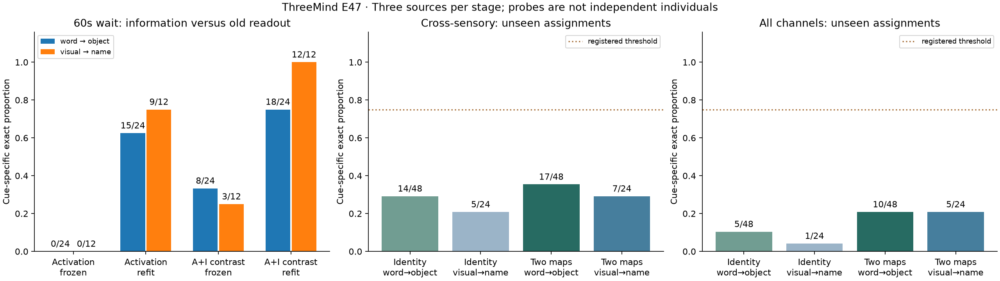
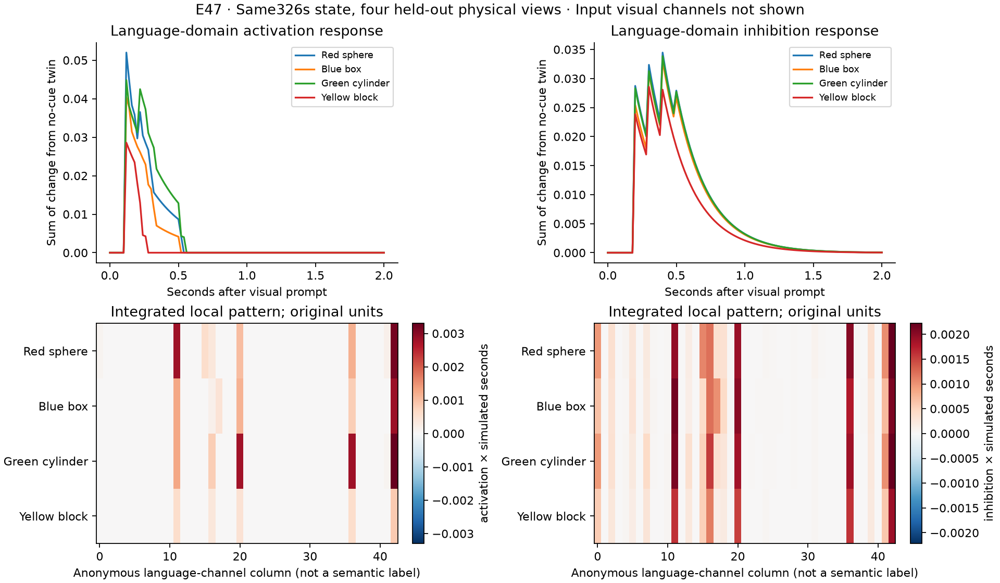

# E47: Learned internal associations can produce names; new-experience expression remains unresolved

> **Revision r3 · 2026-10-10**
> Revision reason: Verified original-file relocation; append location-resolution guidance and preserve the experiment conclusions.
> Original: [report.en.md](report.en.md); parent r2: [report.r2.en.md](report.r2.en.md)

> **Revision r2 · 2026-10-10**
> Revision reason: Relocate generated evidence out of Git; preserve original bytes and conclusions.
> Original: [report.en.md](report.en.md); parent r1: [report.en.md](report.en.md)

2026-10-05. Appended after E46; previous reports, criteria, Core formulas and defaults remain unchanged.

[简体中文](report.zh.md) · [Preregistration](design.en.md) · [Numerical results](/api/v2/storage/research-artifacts/research-artifact:a9c3a3ef0307662ed75899b8/content) · [Item-level viewer](../../../.work/expression-alignment-20261005/expression-alignment.html) · [Delivery](delivery.en.md)

## What was established

**A single small Transformer can translate a ThreeMind instance's activity into different, correct names for the same physical object after different teaching histories.** Across three new sources, original/reversed assignments and two observation times, visual naming scored48/48. The reader received anonymous process features, not question text, object IDs, the current assignment table or test answers. Calibration examples from both histories were included in reader training; testing used held-out intensity and view.

This is more than naming from direct visual input: with that entire input modality excluded, all24 correct responses at592s disappeared when visual–language connections were silenced; silencing the same number of other connections retained24/24. **Learned cross-sensory pathways contribute to this finite expression function.** This is not evidence of general reasoning, and the control did not fully match weight or topology; the actual mismatch is reported below.

**What remains unachieved is teaching only ThreeMind a new assignment and having its frozen expression adapter reliably report it.** Two fully held-out assignments failed the original gate. Including all channels did not solve this. Composition was therefore not started, as preregistered; unperformed reasoning tests are not negative results, and naming success does not establish free conversation.

| Question | Judgment |
| --- | --- |
| Can a Transformer express a learned internal correspondence? | **Yes, within jointly calibrated four-object naming, with pathway intervention evidence.** |
| Has it learned language? | **A limited perception-to-naming function works; continued acquisition of new meanings, free sentence production and ordinary communication do not yet work.** One undifferentiated yes/no would conceal this distinction. |
| Can it reason or think? | **No new relational-reasoning evidence was obtained here.** The new-assignment prerequisite failed, so composition was not run. Existing internal/autonomous-activity evidence is not retracted. |
| Can it converse naturally? | **Not yet.** An observer invokes a reader that produces short phrases; voluntary use of expression and decisions about when to speak were not demonstrated. |
| Are repeated words after visual silence caused by slow decoding? | **Not a backlog of old windows in the tested prior result.** Changing processing order, delay and device preserved the same-window output. |

## 1. Processing delay did not explain the repeated words

Nine physical activity windows from three E46 sources were paired with12 existing readers, giving36 window–reader combinations. CPU sequential, CPU reverse-order batch, reloaded models, a50ms artificial queue and GPU batch produced180 outputs: **zero same-window token mismatches**.

All12 readers emitted blank on all-zero input. In late530–532s windows, visual and language activation was zero while other activity remained; some readers still emitted words. E46 already decoded offline, independently fromBOS per window, without a cross-window cache. These observations support a relation between current remaining activity and the reader's output, rather than an unprocessed earlier visual window.

This neither establishes meaningful inner speech nor says every word is generated from nothing. Sensory activation reaching zero does not imply that all state is zero. A future live service can genuinely queue windows; the new tool separately records simulated sampling intervals, host queue time and decoding time. CPU sequential batch median was about8.7ms and GPU batch about22.1ms. Batch sizes differ, so these are descriptive timings, not a fair speed ranking.

## 2. The previous reader missed distinguishable information

Three E46 sources137/163/191 contributed378 new calibration copies and390 existing probes,768 observations total. Fitting used intensities0.4/0.6 and calibration views; testing used0.5 and a held-out view. The following results use a finite-phrase similarity reader after266s teaching plus60s waiting. Correct answers must also differ from the same-time no-cue output.

| Reader and calibration | Word→object | Visual→name |
| --- | ---: | ---: |
| Absolute activation, frozen266s calibration | 0/24 | 0/12 |
| Absolute activation, refitted at326s | 15/24 | 9/12 |
| Activation+inhibition contrast, frozen266s | 8/24 | 3/12 |
| Activation+inhibition contrast, refitted326s | 18/24 | 12/12 |

The entire directly stimulated modality was excluded. Contrast subtracts a no-cue twin from the same state and time, retaining negative changes; it never alters actual activity. The18/24 comprises9/12 bare names and9/12 name-plus-is prompts. Selection used137/163 only, leaving191 out. Joint activation/inhibition without extra mean/variance conditioning won the registered selection, at71.875% overall cue-specific correctness.

**Weaker activity and a mismatched reader can both make information disappear from the output; local inhibition processes also contain useful information.** Refitting uses current-state training labels and therefore is not evidence that a frozen reader acquired new knowledge.

Below, four held-out physical views at the same326s state of source137 induce language-channel changes. Inhibition retains a distinguishable process after the short activation response decays. Columns are anonymous channels, not semantic areas assigned to Core.

## 3. New individuals: calibrated expression succeeds, held-out assignment transfer does not

Sources223/251/279 used the same frozen input encoder71 and unchangedcontinuous-memory/2. Forgetting, inhibition, depletion/recovery, background and sensory mapping remained. Each blank source received180 lessons over266 simulated seconds, initially12 repetitions per sentence followed by2/4/8/16s reviews; teaching intensity1, testing0.5.

Copies of the common266s parent continued the original assignment or learned a reversal, one-step cycle or two-step cycle. A separate source had learning disabled from birth. Readers were fitted either on original assignments only or on original plus reversal; neither cycle supplied reader-training labels. Calibration/test copies never wrote back to parents. Three sources, two directions, two training regimes and two scopes produced24 scratch output heads, width64, two layers,2400 steps each.

The primary scope excludes the directly stimulated modality; the supplemental scope retains all anonymous channels. Both use normalized same-state contrasts, so **all channels does not mean all raw state or absolute context**. Transformer conditioning uses training rows only; the prototype preserves the geometry selected in stageB. This distinction was [registered before fitting](stage-c-calibration.en.md), as was the [scope supplement](scope-control.en.md).

Results for readers trained on original plus reversed assignments:

| History/time | Cross-sensory word→object | Cross-sensory visual→name | All-channel word→object | All-channel visual→name |
| --- | ---: | ---: | ---: | ---: |
| Continue original532s | 19/24 | 12/12 | 18/24 | 12/12 |
| Continue original592s | 12/24 | 12/12 | 9/24 | 10/12 |
| Reversal532s | 15/24 | 12/12 | 18/24 | 12/12 |
| Reversal592s | 6/24 | 12/12 | 14/24 | 12/12 |
| Unseen cycle1,532s | 9/24 | 4/12 | 8/24 | 5/12 |
| Unseen cycle1,592s | 9/24 | 5/12 | 8/24 | 5/12 |
| Unseen cycle2,532s | 8/24 | 3/12 | 2/24 | 0/12 |
| Unseen cycle2,592s | 8/24 | 0/12 | 2/24 | 0/12 |
| Learning off from birth266s | 0/24 | 0/12 | 7/24 | 9/12 |

The48/48 names come from three sources, two calibrated histories and two times, **not48 independent individuals**. For example, the same frozen reader for223 answers“甲。” when shown a red sphere after continued original teaching at592s, and“戊。” after reversed teaching. Its fitting data included calibration examples from both histories, but not the test view/intensity.

All-channel learning-off controls still produced9/12 names. Direct sensory features can provide a shortcut, which must not be credited to ThreeMind learning. The cross-sensory learning-off result0/12 is an important counterpoint.

The registered new-assignment gate required at least75% cue-specific correctness on both cycles in at least two sources. All32 scope/instrument/regime/direction/time gates failed. At592s, visual naming on cycle1 was2/4,1/4,2/4 in both scopes, and cycle2 was0/4 in each source. Reader training itself fitted well: all visual-naming training rows were correct; cross-sensory word→object fitted107/108 or161/162 rows, and all-channel fitting was perfect. Simply failing to fit the training set is therefore not the immediate explanation, although other capacity, representation and training-method limits remain possible.

A post-result description found that10/12 cross-sensory cycle1 outputs at592s reused the old reversed answer; the all-channel count was11/12. Neither cycle produced blank outputs. Errors often **read a new pattern as a familiar answer**. [Descriptive counts](interpretation-checks.json) are not a new success criterion; old answers sometimes coincide with new targets, so they are not separate error counts.

## 4. Pathway dependence, with the control's limitations made explicit

After observing48/48 calibrated naming, the [supplement was registered before intervention](known-mediation.en.md). All three sources, both known histories and all four592s prompts were used. Four prompts plus no cue under each intervention added60 copies. Existing readers remained frozen.

| Scope | Normal | Visual–language connections silenced | Same count of other connections silenced | Registered selectivity condition |
| --- | ---: | ---: | ---: | --- |
| Direct-input modality excluded | 24/24 | 0/24 | 24/24 | Passed |
| All channels | 22/24 | 12/24 | 22/24 | Did not pass the at-least-half reduction |

Every one of the six cross-sensory source/history branches changed4→0 under target silence and4→4 under the control. This gives clearer intervention evidence for finite calibrated expression than E46. All-channel readers can still exploit direct visual information and must be interpreted separately.

There were982–1063 target connections per branch. The control selected unused other edges nearest in weight, one by one. Target weight totals were329.55–334.35 versus221.15–240.20 for controls, about66.3%–72.7% of target totals. Mean per-edge mismatch was0.1368–0.1476; topology was not matched. **This is equal-count, approximately weight-selected control, not equal damage dose or equal function.** It supports the registered pathway dependence, not unique mechanism localization or a claim that inhibition alone carries semantics. With direct sensory input excluded, cross-sensory edges are the route into the observed domain; disconnecting that route is not automatically an intervention on advanced reasoning.

## 5. Inner interpretation, expression and next priorities

The user's distinction remains: interpretation serves observers and may be fragmentary; an expression adapter is a tool the instance may eventually use to communicate and needs separate tests of order and faithfulness. No“what/when to speak”rule was added to Core.

**The best contrast reader requires a no-cue twin and is unsuitable as a direct test of unprompted inner speech.** Subtracting identical unprompted trajectories yields zero by construction; that cannot establish absent autonomous activity. New heads also learned no-cue/zero→blank, making them prompted-response readers, not validated free inner-speech instruments. E46 absolute processes and raw words remain available; the latency control does not establish their semantic truth.

Recommended order:

1. **Retain useful individual expression and address developmental adaptation.** Compare absolute process and preceding context alongside contrast, retaining amplitude and background context. Normalization/subtraction may discard useful context; this is an untested explanation, not a proven Core defect.
2. **Co-develop through communication feedback.** Compare frozen readers, continued calibration and cold training on identical accumulated data; supply teaching feedback, never held-out answers. Freezing locates the carrier of new knowledge; it is not a requirement that a language center must never learn again or grounds for rejecting co-development.
3. **Separate observing inner speech from voluntary expression.** Preserve raw continuous processes for observation. Preserve ordering at the expression interface, and return actual environmental consequences through ordinary adapters. Observer-initiated decoding is not voluntary speech by the instance.
4. Once new assignments are stable, test unseen relation combinations, multimodal replay and agreement between communicating parties. Present evidence does not require changing Core dynamics or raising ordinary teaching intensity.

These are next-stage recommendations. The bounded batch is complete; criteria were not changed or resources expanded until a positive appeared. Finite learned expression is a real improvement; reliable new-knowledge expression and reasoning remain explicit open items. The existingautonomy-criteria/1 result keeps its original meaning.

## 6. Scale, checks and evidence

1458 new source/probe records comprise18 source/branch records and1440 probes, including378 calibration probes of E46 states. New independent random sources are223/251/279, not every branch. There are24 new output heads. Recorded simulation, fitting and decoding totaled57.72 minutes on one worker, below the6h budget. Working evidence before archive was about1.31GiB; archive/database growth is separately receipted. Account usage moved43%→44%, including other projects, so the increase is not attributed solely to this batch.

Reusable [process-contrast/timestamp CLI](../../../docs/en/reference/expression-observation-tools.md) and pure-data connection controls were added. Focused tests, a real CLI decode, CPU/GPU controls and1440/390px viewer checks completed. Production UI, Core, saved states and services were not modified, so unrelated full builds were not repeated. Inputs, trajectories, checkpoints, models, raw output, failure records and E46 dependency locations remain preserved; no repeated full scans/hashes of old large data were performed. See [delivery](delivery.en.md) for platform and archive identities.

## Data location revision

Selected generated evidence has been archived and verified byte for byte. Original reports, criteria, conclusions and embedded source_commit values are preserved. The logical downloads below require the current host administrator. The data directory is not public.

`data/experiments/2026-10-05-expression-alignment/`

[Location and hash index / 位置及哈希登记](../../artifact-index/2026-10-09-relocations.json)

- [results.json](/api/v2/storage/research-artifacts/research-artifact:a9c3a3ef0307662ed75899b8/content) — 415439 B; SHA-256 `98e91b5bad93ed6ca9d99e832736ec2c43d02c36f9d7ebaf118f197a0c920587`.

> **Storage-location revision · 2026-10-10**
> This edition adds the verified move of the selected originals to `E:\ThreeMindData`. Stable scientific identities and hashes, experiment dates, measurements and conclusions remain unchanged. Paths in the preserved body describe historical sources; use the registered evidence resolver for current locations. Repository documents and frozen fixtures remain in place, and source copies are retained. Structured query data and running checkpoints remain in the database. This annotation does not assert that missing historical evidence was recovered.
