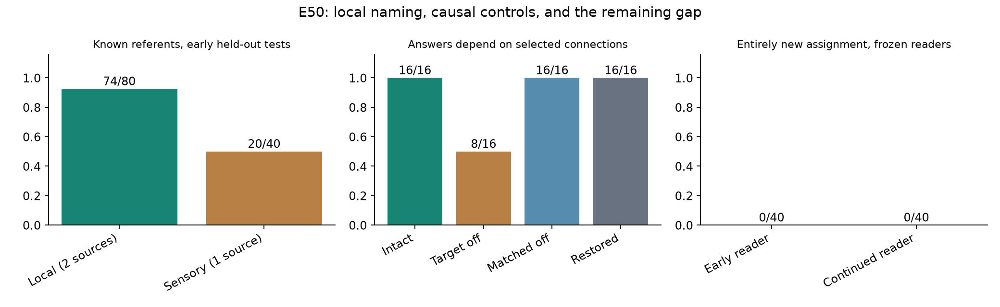

# E50: local activity supports naming; new experiences are not yet freely translated

> **Revision r3 · 2026-10-10**
> Revision reason: Verified original-file relocation; append location-resolution guidance and preserve the experiment conclusions.
> Original: [report.en.md](report.en.md); parent r2: [report.r2.en.md](report.r2.en.md)

> **Revision r2 · 2026-10-10**
> Revision reason: Relocate generated evidence out of Git; preserve original bytes and conclusions.
> Original: [report.en.md](report.en.md); parent r1: [report.en.md](report.en.md)

2026-10-05. [Chinese](report.zh.md) · [Registration](design.en.md) · [Results](/api/v2/storage/research-artifacts/research-artifact:79cf4dc3b7ceee7e51cab6ea/content) · [Tool](../../../docs/en/reference/graph-expression.md)

**Achieved: fairly reliable naming of jointly taught referents from participating local activity, with causal evidence that some answers depend on learned internal connections. Not achieved: automatically translating wholly new correspondences while keeping the expression adapter frozen.** These are separate conclusions. General reasoning and natural conversation were not demonstrated.

## Main evidence

Two source-specific readers scored **74/80** on early held-out views/phrases across original and reversed teaching histories. A same-architecture reader of current sensory input alone reached **50%**, the exact theoretical ceiling here: identical current objects have opposite names in the two histories. Local processes therefore provide history information unavailable in the current cue alone.

Silencing selected vision/language association edges reduced naming from **16/16 to 8/16**. Matched other-edge silencing retained **16/16**, and restoring the selected edges restored **16/16**. Transferring selected edge states from the opposite history changed **6/16** answers to the donor's taught name; matched unrelated transfer changed **0/16**. This strengthens attribution of some answers to internal experience, beyond peripheral image recognition.

A wholly unseen assignment, with all four object/name pairs absent from expression calibration, produced **0/20** at both early and late times for both the frozen early and continued readers. The automatic new-experience translation test failed. This was object naming, not a test of untaught words such as “yesterday.”

## Teaching and observation

Four MuJoCo rigid objects remain present: red sphere, blue box, green cylinder and yellow block. Teacher-selected viewpoints produce five ray distance/RGB measurements, not full camera images. Four names are taught in three short forms. Each form/object starts with twelve consecutive repetitions, followed by four increasingly spaced reviews: **192 lessons/source**. Ordinary text intensity is 1; the inherited encoder, normalization, paired dose and recorded physical telemetry remain unchanged. Replayed rather than live telemetry prevents observer load from feeding back into CPU stimuli.

Each external reader receives 32 supervised observations spanning modalities and opposite histories. Tests hold out viewpoints, intensity and wording; prompts omit the target name. Two sources and repeated views are not 80 independent minds.

The primary reader keeps participants with activation/arrival flow or increasing inhibition, six dynamic measurements and actual observation times. It selects 17 existing records from a 101-sample window, without semantic filtering, top-k selection, baseline subtraction or per-example scaling. One example reduces 134 stored nodes to 50 participants; 50 is not a quota. Dormant full-graph storage is not the primary input. The reader is trained from scratch; old models remain available.

The temporal information here comes from the **observation window**. Input text frames retain the registered same-time route. This batch does not claim to fix sentence presentation time.

## Detailed results

| Condition | Source 223 | Source 279 |
| --- | --- | --- |
| External training fit | 32/32 | 32/32 |
| 440 s, held-out views/phrases | 37/40 | 37/40 |
| 500 s, unchanged reader | 19/40 | 35/40 |

Combined early results: new visual viewpoints **32/32**, bare object words **16/16**, taught description form **16/16**, uncalibrated wording **10/16**. Common referents are readable through several viewpoints; wording remains weaker.

Adding 16 late supervised observations to source 223 while retaining the original 32 raises performance on the **same 24 untouched late tests from 11/24 to 16/24**. New visual views become 8/8, while verbal errors remain. Early performance stays 37/40. This is supervised peripheral adaptation, not zero-shot new-knowledge transfer.

On cross-source deployment, the source-223 reader scores 14/40 early and 19/40 late on source 279; the reciprocal reader scores 21/40 and 20/40. A personal reader is not yet a universal translator.

The old fixed-channel reader fits 32/32 and answers 31/32 of the early tests it can accept, versus 32/32 for the new reader on that identical subset. It cannot accept **50 additional observations**, including no-cue records, because new channels lie outside its training dictionary. Those are explicit unread cases, not all wrong-answer trials. Handling changing node sets is the clear engineering gain; comparing unequal accuracy denominators would overstate it.

A random-label reader fits all 32 arbitrary training labels but scores **10/40** early and **11/40** late against ordinary test truths. Training success alone can reflect arbitrary labeling. The no-learning Core copy scores **2/4** visual tests; that tiny, potentially out-of-distribution control is not a sufficient semantic claim on its own.

## Attribution limits and revisions

The novel assignment is `[2,0,3,1]`, with four genuinely new pairs. Before executing it, an earlier proposed cycle was found to reuse two calibrated pairs; the [extension record](extension.en.md) preserves the proposal and dated correction. Neither its labels nor test accuracy selected the models. Both frozen reader versions score 0/20 at 440 and 500 s, ending expansion into complex relation tests for E50.

Transfer copies selected edges and associated short-term/fast states, retaining recipient node activity, energy, clock and pending events; recipient edges absent from the donor may be removed. Matched controls approximate edge count/strength, not exact topology/function. One 1105-edge receipt has total target/control weights 191.54/119.76 and mean absolute difference .0737. Receipts and errors are preserved. There is no independent body-choice task here; these controls do not establish every generated word's meaning or intent.

All no-cue words remain in the output record. A finite-name decoder without a no-cue semantic truth cannot label those words dreams or inner monologue.

Initial whole-graph `/1` fit was **4/16**, retained as a failure. `/2` jointly revised numerical representation and node-time retention, reaching **16/16** on that calibration. No isolated cause was established. Following the user's correction, local activity became primary; whole graphs remain offline diagnostics. [Revision](revision.en.md)

The [output-bus audit](bus-audit.en.md) found that the current research route distributes state observations, rather than only actual above-threshold transmissions. Passing through a bus is not equivalent to restoring the user's original signal semantics. Production output was not replaced; signal-only versus local-observation comparison remains pending.

Following evolving activity differs from learning a clock and recounting yesterday. The user's additional clock teaching and sentence demonstrations are recorded in a [separate plan](../../../docs/en/plans/clock-grounded-recollection.md). E50 does not count untaught temporal concepts as failures.

## Delivery and next work

**384** new Core sources/probes, **8** research models, about **3664 s (61 min)** cumulative simulation/training, approximately **545 MiB** local pre-archive evidence. A two-example CPU continuation smoke test is engineering acceptance, not another research model. Shared account readings rose from 49% to 51%, including unrelated work. Final archive/database storage is recorded separately in `publication-resources.json`.

Python/CLI local-first reading, continuation, CPU fallback, checkpoint versions and explicit bounds are provided. Original outputs, failures, inputs, states and checkpoints are published to a separate research project. Core dynamics/defaults, old instances and earlier reports remain unchanged.

Next: authorized clock/retelling teaching with current-versus-past controls, and locating why a fixed reader still fails wholly new correspondences. Actual transmission-stream reading is separately pending. The results support further work on individual, continually adaptable expression peripherals; they do not make one supervised calibration a general translator.

## Data location revision

Selected generated evidence has been archived and verified byte for byte. Original reports, criteria, conclusions and embedded source_commit values are preserved. The logical downloads below require the current host administrator. The data directory is not public.

`data/experiments/2026-10-05-graph-expression/`

[Location and hash index / 位置及哈希登记](../../artifact-index/2026-10-09-relocations.json)

- [results.json](/api/v2/storage/research-artifacts/research-artifact:79cf4dc3b7ceee7e51cab6ea/content) — 166498 B; SHA-256 `d2d503fe713103688fdf43882b2571bb0b7f9ed6f43dc0563d810f58ab652703`.

> **Storage-location revision · 2026-10-10**
> This edition adds the verified move of the selected originals to `E:\ThreeMindData`. Stable scientific identities and hashes, experiment dates, measurements and conclusions remain unchanged. Paths in the preserved body describe historical sources; use the registered evidence resolver for current locations. Repository documents and frozen fixtures remain in place, and source copies are retained. Structured query data and running checkpoints remain in the database. This annotation does not assert that missing historical evidence was recovered.
