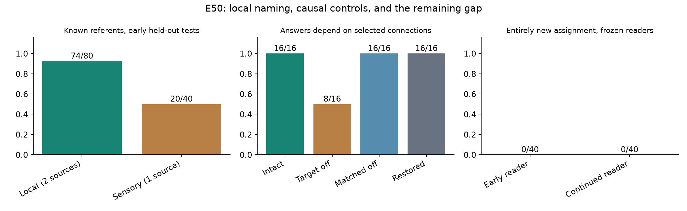

# E50：局部活动可以支撑可靠命名，新经历仍未自动译出

2026-10-05。[English](report.en.md) · [原始登记](design.zh.md) · [局部方案补充](local-registration.zh.md) · [结果数据](results.json) · [工具](../../../docs/zh/reference/graph-expression.md)

**本轮做成的是：从意识实际参与活动的局部过程里，比较可靠地说出已经共同教过的物体名字；而且部分回答确实依赖内部经历形成的连接。没有做成的是：表达器保持不变时，自动读出意识后来学到的全新对应。**这两个结果同时成立。尚未测试通用逻辑推理，不把物体命名称为自然语言交流已经完成。

## 主要发现

两个来源分别用自己的新表达器，在原、反两套教学中，早期合计 **74/80** 正确。只看当前入射感官、看不到意识经历的同架构对照只能达到 **50%**，且已经达到本任务的理论上限：相同眼前物体在两套经历中有相反名字。局部活动提供了眼前感官本身没有的经历信息。

针对视觉—语言相关连接做屏蔽，正确回答从 **16/16 降到 8/16**；屏蔽匹配的其他连接仍为 **16/16**；解除目标屏蔽恢复 **16/16**。把另一套经历的相关连接状态移来，有 **6/16** 回答改成供体教过的名字，移植其他连接则 **0/16**。这加强了“部分回答依据来自意识内部”的判断，而不只是一个外围模型在认图。

但将四个物体全部改成表达器没有见过的新名字对应，Core 完成相同课程后，两个冻结表达器版本在早、晚两次各 **0/20**。所以它仍不能自由翻译新经历。不能把这个失败归于没有教“昨天”：这里问的依然是物体名字，不是时间词。

## 教了什么，读了什么

环境保留红球、蓝盒、绿柱、黄块四个 MuJoCo 刚体。教师改变观察角度；视觉测量为五条射线的距离和材质 RGB，不是完整摄影图像。名字为甲、乙、丁、戊。每个物体用三种句式，例如“甲是红球。”“这是红球，叫甲。”“看见红球，这是甲。”每一种初次连续十二次，再进行四轮先密后疏复习，总计每来源 **192 次**。文本强度 1，原感官规范化／编码及配对剂量保留；背景用已记录的真实物理遥测重放，避免读出负荷改变现场 CPU 刺激。

每个表达器有 32 条外部监督观察，涵盖同物体的视觉和语言观点、相反的教学历史。测试换视觉角度、强度和说法，另留“我看见……”未校准说法。测试提示没有目标名字。两来源、两历史的这些视角不是 80 个独立意识，不能按 80 个独立实验计算显著性。

主表达采用窗口中有激活／触达／抑制增长的节点，只给六个活动字段和真实采样时间；101 个密集样本中取 17 个已有时刻，不传静默全图，不按答案或前几名挑选。一个示例由 134 个存储节点缩到 50 个参与节点；这不是固定保留 50 个的规则。没有无提示相减，没有逐题归一化，没有改 Core 输出。表达器从零训练，旧版保留。

当前新表达的时间来自**观察窗口的采样过程**。原文字感官帧仍沿用登记的同时刻方式；本轮未声称解决了输入句子的时间经历问题。

## 结果明细

| 条件 | 来源 223 | 来源 279 | 意义 |
| --- | --- | --- | --- |
| 外设训练拟合 | 32/32 | 32/32 | 只证明校准可行，不单独证明忠实翻译 |
| 440 秒，留出观点／说法 | 37/40 | 37/40 | 已教共同所指可从局部过程读出 |
| 500 秒，表达器保持不变 | 19/40 | 35/40 | 继续活动后可读性因来源而异 |
| 来源 223 表达器用于来源 279 | 早期 14/40；晚期 19/40 | — | 个体表达器不能直接当通用译码器 |
| 来源 279 表达器用于来源 223 | 早期 21/40；晚期 20/40 | — | 同上 |

早期两个来源合计：视觉新角度 **32/32**，裸物体词 **16/16**，已教描述式 **16/16**，未校准说法 **10/16**。多个观点的共同所指确有收益，措辞变化仍是薄弱处。

来源 223 加入 16 条晚期观察监督后继续训练，旧 32 条也保留。对**同一批未用于追加训练的 24 个晚期题**，由 **11/24 提高到 16/24**；其中新视觉角度 8/8，但文字说法仍错。这是外设监督适应，不能写成无需教师的新知识泛化。早期 37/40 保留。

旧固定通道表达器读取完全相同的局部信息，在可接收的 32 道早期题上 **31/32**，新表达器对应 **32/32**。旧版另有 **50 条观察无法读取**，因为包含训练目录外的通道；其中包含无提示记录，不能把 50 都当答题错误。新工具的明确工程增益是接收变化节点，而不是凭两个不同分母声称准确率大涨。

随机标签头可拟合 32/32 任意训练标签，但普通测试早期 **10/40**、晚期 **11/40**。这提醒我们：漂亮训练分数可以来自任意标注；必须看历史反转和干预。无学习 Core 的四道视觉题为 **2/4**，单独样本不足以判定机制，亦可能包含分布外读出问题。

## 新对应、移植与边界

真正未给表达器校准的分配为 `[2,0,3,1]`，四个名字—物体配对均未出现在原、反两套校准中。执行前发现最初拟定的循环复用了两个配对，已在[补充登记](extension.zh.md)保留原文并追加更正；不是根据成绩换题。早期冻结头、继续校准后的头，在 440／500 秒均 **0/20**。本轮到此停止扩大复杂关系题，保留失败而不反复搜索漂亮结果。

移植的是选中连接及其短时资源／快迹状态，不是供体全部意识；受体的节点活动、能量、时钟和在途信号保持不变。某些供体缺少的对应边被移除。匹配消融近似匹配边数和强度，但不保证拓扑与功能相同；例如一份 1105 边的掩码目标权重总量 191.54、匹配 119.76，平均绝对差 0.0737。完整匹配误差和移植收据已保存。没有独立身体选择任务，不能将局部取名归因扩大成所有语义和意图的证明。

无提示原始输出均保留在逐题页面中。模型只训练有限名字，未建立无提示词语的语义真值；这些词不能直接称作回忆、梦或内心独白。

## 修订经过与总线核查

首版全图外设 `/1` 在固定旧资料上拟合 **4/16**，失败保留。修订 `/2` 分开编码身份／测量、处理数值范围并保留节点—时刻记录，可拟合 **16/16**；这些联合变化不能归因于单个机制。用户随后纠正“全图当表达”的方向，主要试验改成局部动态过程，全图仅保留离线诊断。[修订](revision.zh.md)

用户提出的原输出总线应该传送“达到能传导强度的信息”。审计确认当前研究主路是复制分发**状态观察帧**，并非只转发实际发射事件。该差别已明记，未用“已经过总线”冒称原设计恢复。本轮不改变生产协议；实际传输、局部观察和两者合用的对照仍待执行。[总线审计](bus-audit.zh.md)

“跟随变化”与“昨天发生了什么”是不同任务。用户后续提出先教时钟、计时和复述句式；已另记[时钟教学方案](../../../docs/zh/plans/clock-grounded-recollection.md)。E50 未教时间词，也未测试过去时概念，不以此作负面结论。

## 交付与下一步

合计 **384** 个新来源／探针，**8** 个研究表达模型，累计模拟与训练约 **3664 秒（61 分钟）**；归档前局部资料约 **545 MiB**。工程验收的两样本 CPU 续训另列，不冒充研究模型。共享账户读数由 49% 到 51%，包括同时进行的其他工作。归档／数据库实际占用见 `publication-resources.json`。

主工具提供局部优先的 Python／CLI、继续训练、CPU 回退、版本检查及输入限额；实验原话、失败、输入、快照和模型入独立项目，旧数据不覆盖。Core、默认值、旧意识及旧报告未改。

下一步优先两条：一是用户批准的时钟与复述教学，先区分当前／刚刚并排除眼前线索；二是继续定位“可见的内部经历为何尚不能被固定译码器读成新对应”。实际传输流的输出总线比较也已留案。当前证据支持继续研究**个体化且能继续适应的表达器**，不支持把一次监督校准当作通用翻译已经完成。
