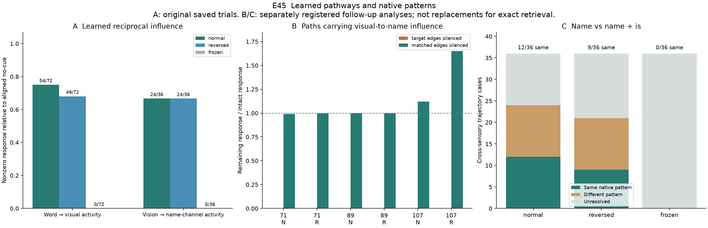
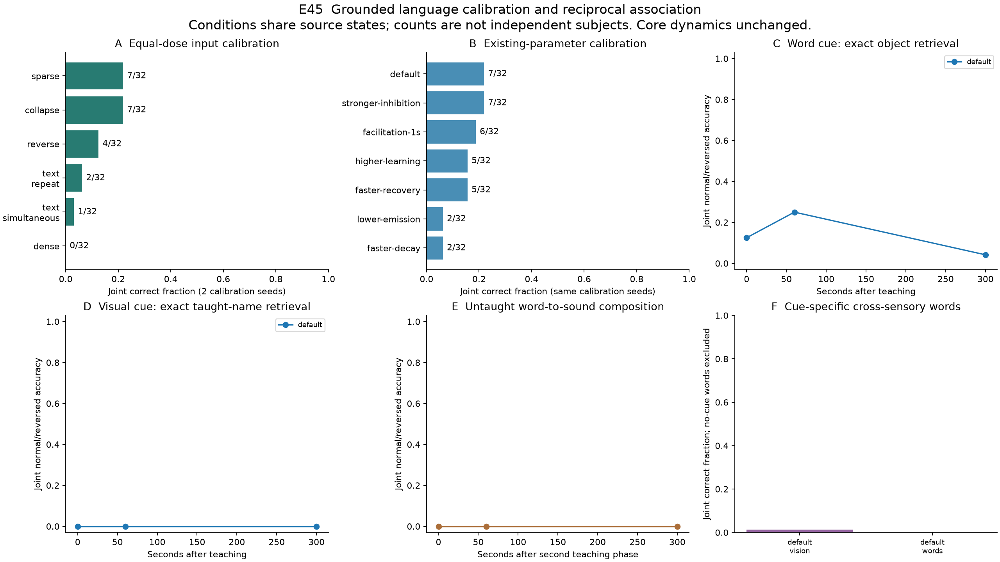

# E45: learned reciprocal sensory pathways; stable naming and composition remain open

> **Revision r3 · 2026-10-10**
> Revision reason: Verified original-file relocation; append location-resolution guidance and preserve the experiment conclusions.
> Original: [report.en.md](report.en.md); parent r2: [report.r2.en.md](report.r2.en.md)

> **Revision r2 · 2026-10-10**
> Revision reason: Relocate generated evidence out of Git; preserve original bytes and conclusions.
> Original: [report.en.md](report.en.md); parent r1: [report.en.md](report.en.md)

[中文](report.zh.md) · [Original design](design.en.md) · [Results](/api/v2/storage/research-artifacts/research-artifact:4795ac8772bc27150be8c9b5/content) · [Execution](delivery.en.md) · [Discussion and next steps](../../../docs/en/plans/language-calibration-and-composition.md)

2026-10-05. Independent project: **E45 语言对应校准与双向感官联想**. E44 and the original E45 criteria remain intact. Follow-ups registered after seeing results are identified below. The 2041 completed sources/branches contain many forks and are not 2041 independent subjects.

## Findings in plain language

**Teaching made words and vision influence each other through learned connections.** Looking only for a correctly spoken name previously concealed a useful result. Visual cues changed name-sensory activity in **24/36** normal-assignment and **24/36** reversed-assignment trials, versus **0/36** with learning disabled. At six selected sources, silencing the language–vision edges removed at least **99.9813%** of this influence. Silencing equal numbers of other, approximately weight-matched edges retained **98.995%–165.205%**. This is the clearest positive result of the batch.

**Native representations need not resemble the original sensory image.** Following the user's suggestion, an additional analysis used the model's own response trajectories as references. A name and the name followed by “is” retrieved the same native visual-channel pattern in **12/36** normal and **9/36** reversed cases; learning-off cases had no discriminable cross-sensory pattern. Stability across 60/300-second delays and across changed assignments was much weaker. There is partial pattern recurrence, not yet a stable communicable concept system.

**Reliable language answers and two-step composition were not achieved in this batch.** Under the original criterion, joint normal/reversed exact retrieval was **10/72** for word→object, **0/36** for vision→taught name, and **0/48** for the untaught word→sound relation. The original sparse character route remained best; none of six single-parameter alternatives beat the default. No Core dynamics or global defaults were changed, and these results do not close the language research direction.

## Conditions and measurements

The batch retained continuous-memory/2, simulation time, forgetting, inhibition, depletion/recovery, death rules, background and original sensory normalization. The extra strong-input rule and coefficient remained; teaching intensity was 1, so it did not deliberately exploit the above-1 term. Cue intensity was 0.5. Background replayed physical host/process telemetry recorded for E44, excluding live observer-load feedback.

The input peripheral was a scratch-trained, width-64, two-layer Transformer. Its calibration corpus contained no formal name–object assignments. Peripherals and cache boundaries were frozen during experience attribution. Four MuJoCo objects supplied five-ray distance/RGB measurements under simulated gravity; this was not active embodied manipulation or an ecological task.

Each sentence received 12 initial consecutive repetitions followed by increasingly spaced reviews: 45 presentations per sentence, 180 total, over 266 simulated seconds. Calibration used names 壬癸子丑 and seeds 17/29; formal validation used 甲乙丁戊 and seeds 71/89/107, unseen during selection. Every cue and no-cue branch restored the same checkpoint independently.

The primary observation was the two-second time-weighted mean of anonymous activity, minus an aligned no-cue branch, compared with independent physical-response templates. Fixed 0–0.2, 0.2–0.5, 0.5–1 and 1–2-second windows were retained. It uses trapezoidal integration divided by duration. E44 used windowed peak features: the [pre-computation supplement](additional-observation.en.md) records this difference, so the values must not be treated as identical reanalysis.

Joint normal/reversed success requires the same cue to follow each of two opposite teaching assignments. The original task gate was at least 6/8 jointly correct cues in at least two formal seeds. This was a task criterion, not a consciousness criterion, and never required 100%.

## Calibration

For a five-character lesson, language dose was 5 and visual dose 10. Simultaneous controls delivered original frames separately, respecting per-channel amplitude at most 1; they did not merge illegal amplitudes or substitute increased intensity. Equal total dose does not imply equivalent frame dynamics.

| Input route | Joint normal/reversed correct |
| --- | ---: |
| Sparse character stream | 7/32 |
| Character frames delivered separately at one time | 7/32, worse target margin |
| Reversed teaching character sequence | 4/32 |
| Repeated full sentence | 2/32 |
| Simultaneously repeated full sentence | 1/32 |
| Dense character stream | 0/32 |

| Single-parameter alternative on the selected route | Joint correct |
| --- | ---: |
| Default | 7/32 |
| Inhibition gain ×1.5 | 7/32, worse margin |
| Facilitation time constant 1 second | 6/32 |
| Learning rate ×2 | 5/32 |
| Recovery time constant 0.4 seconds | 5/32 |
| Propagation amount ×0.5 | 2/32 |
| Activation decay time constant ×0.5 | 2/32 |

None improved on the default, which was retained for formal validation. This bounded search does not support simply increasing inhibition or decay to solve naming, nor prove these mechanisms unhelpful elsewhere. A readout calibrated on actual independent visual responses passed **24/24** held-out checks, but formal reanalysis reached only **9/72**, versus the original 10/72. Failure cannot all be attributed to an instrument unable to distinguish direct vision.

## Learned reciprocal influence and its cause

Influence means the cross-sensory time-mean difference from aligned no-cue has L1 greater than 1e-8. It is separate from exact physical-template retrieval and does not force tiny or absent responses into a class.

| Direction | Normal: measurable influence | Reversed | Learning off |
| --- | ---: | ---: | ---: |
| Name→vision | 54/72 | 49/72 | 0/72 |
| Vision→name-sensory channels | 24/36 | 24/36 | 0/36 |

After discovering this distinction, a [registered follow-up](reciprocal-effects.en.md) selected the earliest nonzero visual→name effect per seed and assignment. Each intervention retained cue/no-cue pairing.

| Seed / assignment | Influence remaining after target-edge silence | After matched-other-edge silence |
| --- | ---: | ---: |
| 71 normal | 0% | 98.995% |
| 71 reversed | 0% | 99.719% |
| 89 normal | 0% | 99.919% |
| 89 reversed | 0% | 100.000% |
| 107 normal | 0.000000947% | 112.194% |
| 107 reversed | 0.0186795% | 165.205% |

Learned cross-sensory pathways therefore carry a real causal effect. Controls are approximate: target sets had 360 or 440 edges, matching used edge count and nearby weight, mean weight error ranged 0.0035–0.0396, and topology was not fully matched. The finding concerns these six sources, not all connections or an established language faculty.

Six selected exact object-retrieval successes also received interventions. Target silence removed five; matched silence retained five. Both normal/reversed cases for seed 89 showed selectivity. One matched intervention impaired retrieval and one target intervention left the correct result; both are retained. No complete source passed the overall task gate, so these are localized correspondence effects rather than whole-task mediation acceptance.

## Native patterns without an external image answer

The user proposed that associations may be feelings, processes, multiple intentions or inhibition rather than replicas of external input. A [post-result registered analysis](pattern-checks.en.md) reread saved trajectories without replacing primary outcomes.

It concatenated four fixed-window cross-sensory differences and compared cosine similarity, excluding the directly stimulated modality. Nonexistent activity or no unique positive leader was unresolved, not forced. A reference-mean-centered variant is retained separately.

| Comparison | Normal correct/total (unresolved) | Reversed correct/total (unresolved) |
| --- | ---: | ---: |
| Same checkpoint: name vs name + “is”, visual pattern | 12/36 (12) | 9/36 (15) |
| End-teaching name→visual pattern retrieved after 60/300 seconds | 1/24 (18) | 2/24 (16) |
| End-teaching vision→name-channel pattern retrieved after 60/300 seconds | 3/24 (12) | 3/24 (15) |

Learning-off counterparts were all unresolved. Comparing normal with reversed teaching while remapping expected targets by the shared taught object/name gave **3/36** for name→visual and **4/36** for vision→name patterns. Centered variants gave 5/36 and 6/36. Partial prompt-form recurrence is present; robust shared-referent organization has not been established.

The earlier identical 3/24 totals for seeds 71/89 came from different successes: seed 71 had 甲, 甲是 and 丁 at 326 seconds; seed 89 had 乙是 and 戊是 at 266 seconds and 戊 at 326 seconds. Equal counts alone do not establish a shared hidden rule.

This supplement covers **activation trajectories in declared sensory channels**, not all local network states, inhibitory processes, transmission ordering or longer-scale codes. Complete anonymous activation traces and checkpoints remain available. The user's broader hypothesis remains open.

## Composition, expression and uncued observation

The two-step task first taught name–vision, then vision–sound, never jointly teaching names and sounds. Sound came from a defined mass–spring oscillator, not semantic sound labels or a complete acoustic scene. The second phase again lasted 266 seconds with 45 presentations per object. Seeds 71/89, normal/reversed/learning-off and delays 0/60/300 seconds were tested.

Original name→sound success was **0/48**, including all fixed short windows. Subsequently registered component diagnosis found:

- Independent actual-sound classification: **8/8**.
- Joint normal/reversed vision→sound retrieval: **9/24**; learning-off 0/24.
- After the second phase, name→vision: normal 5/48, reversed 1/48, joint **0/48**.

Thus **two-step composition did not pass**, while reliable access to its first link was also absent after the second phase. This does not isolate a defect in combining two otherwise reliable relations. Time, additional-teaching interference and expression conditions were not separated by an equal-duration no-new-teaching second phase.

Two scratch expression heads learned only independent single-sense calibration, without formal assignments, question text, previous-window text or feedback. Held-out calibration yielded **95/108** object windows and **45/48** name windows; the former includes 12 blank windows. All four half-second cue outputs are saved. Auxiliary success requires a correct word in at least one window and its absence in the aligned no-cue window: joint normal/reversed object words **1/72**, taught names **0/36**. **Reliable natural-language answering was not achieved.**

Fifteen sources each provided 300 continuous seconds, totaling 9000 half-second windows. Declared visual/name/audio channels were active only during roughly the first 1–1.5 seconds. No registered re-entry candidate appeared beyond five seconds after teaching, so candidate-replay intervention branches were not executed. Background-supported whole-network activity continued. This is neither total Core silence nor a refutation of prior internal-activity findings. **No new late sensory recall/dream monologue was detected and validated in this batch.**

The [continuous viewer](../../../.work/language-calibration-20261005/language-calibration.html) displays sources, time, raw text and measurements. It does not splice successful cue branches into a monologue. It is offline research replay, not a deployed live chat peripheral.

## Recommended next steps

1. **Teach expression to read each individual's own learned patterns.** The adapter may learn how to express them without requiring resemblance to direct sensory templates. Then freeze it and test new assignments it has never seen, with reversal, bypass/mismatched-Core and localized silence controls. Start with a small usable black-box communication task.
2. **Retain both component relations before judging composition.** Compare an equal-duration empty second course, interleaved review and visual-only review. Only reliable component relations make a specific composition failure interpretable.
3. **Extend individual-pattern observation.** Include inhibition, transmission, multiple timescales and contextual variants, with fixed repetition/discrimination/reversal checks. Deterministic replay of identical state/input alone is not learned mapping evidence.

A concrete encoder clue remains: isolated-prefix 戊 and 是 at seed 89 share four sparse channels with cosine approximately **0.99547**, although the vectors differ. This is not every contextual occurrence of 是, nor a proven main bottleneck. The simpler text route performed worse, so separation alone is not an established solution.

These are recommendations, not new unlimited batches or default changes. The best-supported next targets are **native-pattern expression and retention of both links**, rather than blindly intensifying inputs, disabling forgetting or expanding parameter grids.

## Evidence boundaries

Original criteria, dated supplements, configurations, models, anonymous traces, checkpoints, interventions and negative findings are retained. [Results](/api/v2/storage/research-artifacts/research-artifact:4795ac8772bc27150be8c9b5/content) link the recorded sources; [delivery](delivery.en.md) describes execution, resources and publication. Three formal encoding seeds are a small sample, and conditions share parents/background: repeated windows were not treated as independent subjects for inflated significance claims.

Explicit verdicts: **learned, causally effective reciprocal sensory pathways: supported; reliable task naming, two-step composition and usable language answers: not passed; new late sensory replay or credible monologue: not detected.** Heterogeneous internal representations and lossy language remain valid research directions, not substitutes for the still-needed communication test.

## Data location revision

Selected generated evidence has been archived and verified byte for byte. Original reports, criteria, conclusions and embedded source_commit values are preserved. The logical downloads below require the current host administrator. The data directory is not public.

`data/experiments/2026-10-05-language-calibration/`

[Location and hash index / 位置及哈希登记](../../artifact-index/2026-10-09-relocations.json)

- [component-results.json](/api/v2/storage/research-artifacts/research-artifact:758072860eb8c3cd44269677/content) — 212042 B; SHA-256 `a174e9b9efb15cbad7b4c7e93aff5fdfc906b19520cd8ab288f9ba43000ac1fb`.
- [pattern-results.json](/api/v2/storage/research-artifacts/research-artifact:e3871100a200076d7e3338ba/content) — 204589 B; SHA-256 `166d9b4bf7d38fee785af570ddc2fc9d64bd93b12f7a5b4725cc5ac0b869dab5`.
- [results.json](/api/v2/storage/research-artifacts/research-artifact:4795ac8772bc27150be8c9b5/content) — 3496820 B; SHA-256 `e37e54174e9a676430fa907c81104d2777e31de375b672c8bd2df4f7cb61b709`.
- [visual-reader-formal.json](/api/v2/storage/research-artifacts/research-artifact:22dfd8a5138d3a6df92cd884/content) — 107090 B; SHA-256 `fdb0fddb995e271eb46bbee1a1a474c7345a3394732b0f9f75d556d7b3ea4b7d`.

> **Storage-location revision · 2026-10-10**
> This edition adds the verified move of the selected originals to `E:\ThreeMindData`. Stable scientific identities and hashes, experiment dates, measurements and conclusions remain unchanged. Paths in the preserved body describe historical sources; use the registered evidence resolver for current locations. Repository documents and frozen fixtures remain in place, and source copies are retained. Structured query data and running checkpoints remain in the database. This annotation does not assert that missing historical evidence was recovered.
