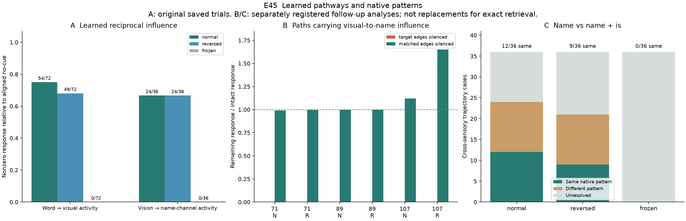
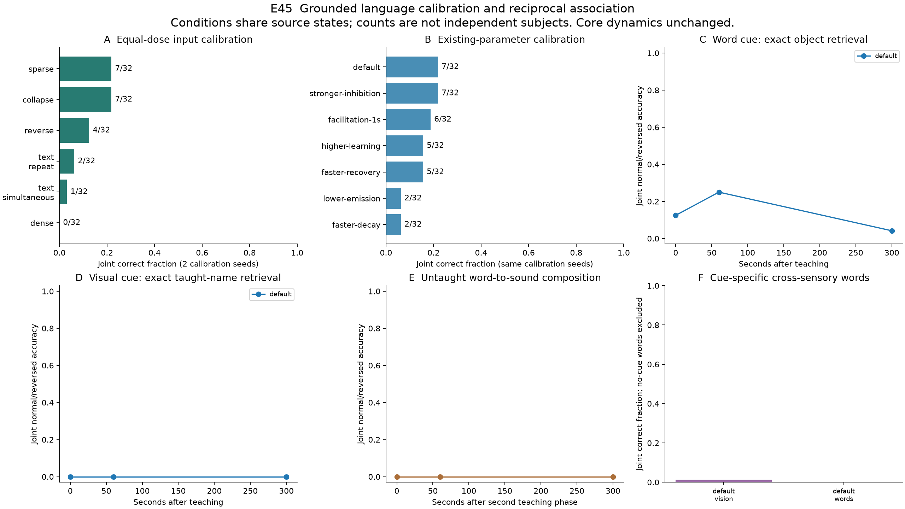

# E45：确实学出了双向感官联系，稳定取词和关系组合尚未形成

[English](report.en.md) · [原始设计](design.zh.md) · [结果数据](results.json) · [执行与交付](delivery.zh.md) · [讨论与后续](../../../docs/zh/plans/language-calibration-and-composition.md)

2026-10-05。独立研究项目：**E45 语言对应校准与双向感官联想**。本报告保留 E44 及本轮原判据；后发现、后登记的分析另行标明。2041 个来源／分支包含大量同源副本，不能当作 2041 个独立样本。

## 先说清楚发现了什么

**教学已经让词语与视觉相互牵动，作用来自形成的连接。** 以前着重看“视觉后有没有说对名字”，容易把“说错／没说出”误读成“视觉没有引起语言相关活动”。本轮发现：正常教学和反转教学中，视觉提示后名字感官通道均有 **24/36** 次可测变化，关闭学习为 **0/36**。六个来源的针对性消融又把这些变化削弱至少 **99.9813%**；数量相同、权重尽量匹配的其他连接静默后，仍保留 **98.995%～165.205%**。这是本轮最明确的正面成果。

**内部模式可以与原始物体视觉不同，这个方向值得保留。** 按用户补充，用意识自己的响应过程当参考，而不要求像外界图片：正常／反转经历中，“名字”和“名字是”分别有 **12/36、9/36** 找回相同的内部模式，关闭学习全部没有可分辨的跨感官模式。不过，跨 60／300 秒以及改变名字—物体关系后，这种对应大幅减弱。这支持局部、部分的模式复现；尚不能说已经得到稳定可交流的概念系统。

**本批没有达到可靠语言回答或二步关系组合的目标。** 原主指标下，词语→正确物体为 **10/72**，视觉→正确所教名字为 **0/36**，未共同教学的名字→声音为 **0/48**，都要求正常和反转经历同时正确。最好的输入路线仍是原稀疏逐字路线，六个单因素参数候选没有超过默认。没有据此改内核、改默认或宣布语言路线无望。

## 做了什么，哪些东西没有改

保留 continuous-memory/2、统一时间、遗忘、抑制、耗竭与恢复、死亡规则、背景以及原感官规范化。额外强刺激项的规则及系数保留；普通教学强度 1，没有主动使用超过 1 的教学增益。提示强度为 0.5。背景是 E44 保存的宿主／进程物理遥测重放，并非本次实时 CPU 负载。

输入是从零训练的小 Transformer，宽度 64、两层；词表校准不含正式名字—物体对应。正式教学和测试时冻结外设及缓存边界。四个 MuJoCo 物体用五条射线的距离和 RGB 测量进入内核；有真实模拟重力，但这不是主动运动或生态任务。

每句先连续重复 12 次，随后按递增间隔复习，每句共 45 次、四句共 180 次，课程长 266 模拟秒。校准名字为壬癸子丑、种子 17/29；正式名字为甲乙丁戊、种子 71/89/107。正式选择前不看这些保留种子的结果。每个提示和无提示分支从同一快照独立恢复，避免前一问题教会下一问题。

原主指标是两秒匿名活动的时间加权平均，相减同状态无提示后与独立物理样式比较；同时保留 0–0.2、0.2–0.5、0.5–1、1–2 秒过程。它使用实际时间的梯形积分再除以时长。E44 用的是分窗峰值特征；本批在计算前的[增补](additional-observation.zh.md)已声明区别，不能把两批数值直接当作同一量。

“正常／反转同时正确”指同一提示在两种相反教学后分别指向各自被教的对象，防止一个固定偏好被算成两个成功。原任务门槛为至少两个正式种子各达到 6/8；这是本次工程任务标准，不是意识判据，也没有要求 100%。

## 校准的结果

五字教学的语言总量为 5、视觉总量为 10。合法单通道幅度不超过 1；同刻对照分别递送原帧，没有合并成越界大幅度帧，也没有用提高 intensity 偷换输入总量。总量相同不等于分帧动力学相同，后者正是对照因素。

| 输入路线 | 正常／反转同时正确 |
| --- | ---: |
| 稀疏逐字 stream-sparse | 7/32 |
| 逐字帧同刻分别递送 stream-collapse | 7/32，目标差值较差 |
| 教学字符逆序 stream-reverse | 4/32 |
| 整句重复 text-repeat | 2/32 |
| 整句同刻重复 text-simultaneous | 1/32 |
| 稠密逐字 stream-dense | 0/32 |

| 在选定输入上的单因素参数 | 正常／反转同时正确 |
| --- | ---: |
| 默认 | 7/32 |
| 抑制增益 ×1.5 | 7/32，目标差值较差 |
| 易化时间常数 1 秒 | 6/32 |
| 学习率 ×2 | 5/32 |
| 耗竭恢复时间常数 0.4 秒 | 5/32 |
| 传播量 ×0.5 | 2/32 |
| 激活衰减时间常数 ×0.5 | 2/32 |

没有参数超过默认，故正式阶段只用默认。这次有限扫描不支持“只需加快衰减／加强抑制就会说准”，也不证明这些机制在其他任务无用。独立真实视觉响应读出校准通过 **24/24**，用于本批再判却只有 **9/72**，未改善原 10/72；因此不能把全部失准归咎于读出器完全不认识四种视觉。

## 教学形成了什么联系

“有影响”与“像正确物体”使用不同指标。下面的有影响，是提示相对同状态无提示的另一感官时间平均差异向量 L1 大于 1e-8；不是只看末帧，也不是把微小数字强制分类。

| 方向 | 正常教学有影响 | 反转教学有影响 | 关闭学习有影响 |
| --- | ---: | ---: | ---: |
| 名字→视觉 | 54/72 | 49/72 | 0/72 |
| 视觉→名字感官 | 24/36 | 24/36 | 0/36 |

在上述发现后，另行[登记双向联系消融](reciprocal-effects.zh.md)：每个正式种子、每种教学方向取最早的非零视觉→名字效应，共六个来源；对每一来源保留提示／无提示配对。

| 种子／经历 | 静默语言—视觉连接后的剩余影响 | 静默匹配其他连接后的剩余影响 |
| --- | ---: | ---: |
| 71 正常 | 0% | 98.995% |
| 71 反转 | 0% | 99.719% |
| 89 正常 | 0% | 99.919% |
| 89 反转 | 0% | 100.000% |
| 107 正常 | 0.000000947% | 112.194% |
| 107 反转 | 0.0186795% | 165.205% |

这确认了**已学习网络中的跨感官通路承担实际作用**。匹配不是完美同构：目标边 360 或 440 条，其他边按数量和相近权重匹配，平均权重差 0.0035～0.0396；并未匹配所有拓扑。因此结论限定为这六处作用，不能外推每个连接或把增幅直接叫作“更懂语言”。

原来的正确物体局部成功也做了消融：六处中，目标静默后五处失去正确结果；匹配静默保留五处。种子 89 的正常／反转两处都体现了选择性；另有一处匹配静默也损伤结果、一处目标静默后仍正确，均保留。没有任何完整来源通过原总体任务门槛，故这些是**局部对应的因果证据**，不是完整语言能力验收。

## 不用外界图片当答案，内部模式会怎样

用户提出：联想可以是感觉、过程、多个意向或抑制，不必逐点复刻原感官。这一假设被纳入[事后登记的内部模式分析](pattern-checks.zh.md)。它只重读已有数据，不修改主结果。

以四个固定时间窗的跨感官差异向量串联为模式，用余弦比较；直接输入的感官不作为该项输出。没有足够活动、没有唯一正领先项时记“未判出”，不能强选。另列减去参考均值的版本，不选择更漂亮的版本替换主表。

| 比较 | 正常经历匹配／总数（未判出） | 反转经历匹配／总数（未判出） |
| --- | ---: | ---: |
| 同一快照：名字与“名字是”引发的视觉模式 | 12/36（12） | 9/36（15） |
| 教学结束的名字→视觉模式，60／300 秒后再找 | 1/24（18） | 2/24（16） |
| 教学结束的视觉→名字感官模式，60／300 秒后再找 | 3/24（12） | 3/24（15） |

关闭学习的相应项全无可分辨模式。正常教学模式与反转教学比较、按同一所教对象／名字重新配对，名字→视觉匹配 **3/36**，视觉→名字模式匹配 **4/36**；中心化版本为 5/36 和 6/36，也未形成稳定对应。这里有部分形式变化下的复现，但尚无充分证据认定模式稳定地代表共同对象。

两种子词语→视觉都曾得到 3/24，实际成功项不同：71 是 326 秒的甲、甲是、丁；89 是 266 秒的乙是、戊是及 326 秒的戊。相等计数没有指向同一组成功提示，不足以单独证明一个共同的隐藏规则。

本分析只覆盖已声明感官通道的**激活过程**。它没有穷尽全网络局部结构、抑制过程、传播顺序或更长时间上的编码；完整匿名激活轨迹和检查点仍在。用户的更广泛假说保留为后续观察方向，没有因本表局部不稳定而被否定。

## 二步联想、表达与无提示观察

二步任务先教名字—视觉，再教视觉—声音，不共同输入名字与声音。声音来自参数明确的质量—弹簧振子，不是把音名塞给内核，也不是完整声场。第二段每物同样 45 次，266 秒。种子 71/89，正常／反转／关闭学习，结束及 60／300 秒后检验。

名字→声音原任务 **0/48**，各短窗也为零。随后登记的分段诊断发现：

- 实际声音的独立读出 **8/8** 正确。
- 视觉→声音正常／反转同时正确 **9/24**，关闭学习 0/24。
- 第二段后名字→视觉仅正常 5/48、反转 1/48，联合 **0/48**。

所以，本轮**二步组合未通过**，但先前名字—视觉这一步在第二段之后也不能稳定读出，不能把失败专门定位为“有两条可靠联系却不会推理”。是时间、追加教学干扰还是表达条件造成，尚未用等时空白第二课程分开。

两个从零表达头仅用独立单感官样本校准，不接收正式对应、问题文本或前窗输出。验证中物体头 **95/108**、名字头 **45/48** 正确；前者包含 12 个空活动窗。正式提示四个半秒窗全部保存，至少一窗正确且相应无提示窗没有该词才计辅助成功：正常／反转联合物体词 **1/72**，所教名字 **0/36**。**本批未建立可靠自然语言回答。**

15 条来源各保留 300 秒连续活动，共 9000 个半秒窗。声明的视觉／名字／声音通道仅在开头约 1～1.5 秒出现活动，未检出教学后 5 秒以外的登记再入候选，故没有执行候选回放干预。背景支持下全网仍有活动；这不是全网静止，也不是对旧实验内部活动的否定。本批**没有检出并验证新的感官回忆／梦境独白**。

可在[真实连续回放](../../../.work/language-calibration-20261005/language-calibration.html)选择来源、移动时间、查看原样文字和过程。每段来自一个连续实例，不把不同提示的成功片段拼成独白。该页为本地／平台离线证据回放，不冒充主聊天界面的实时语言设备。

## 可以采取的下一步

1. **把已学成的双向影响作为基础，单独训练表达接口读取每个意识自己的模式。** 不要求这些模式像外界感官模板；适配器可以学“怎么表达”。再冻结适配器，用它没见过的新对应检验知识是否来自 Core，配反转、绕过／错配 Core 和局部静默。先验收少量可用黑盒交流，不立即堆长语法。
2. **先维持两段联系，再测组合。** 对第二段设置同长度无新增教学、交错复习、仅视觉复习等少量对照；若两段各自都可靠而组合失败，才更有资格讨论组合机制缺口。
3. **补充个体内部模式仪器。** 本轮已经保存激活轨迹。以后可加入局部抑制、传输、不同时间尺度及同词在不同情境的模式测试；预先定义可区分性、重复性和反转对照，避免相同输入确定性重放被误当作新学习。

编码还有一条具体线索：种子 89 的孤立前缀“戊”和“是”稀疏编码余弦约 **0.99547**，使用相同四个通道，虽然向量不完全相同。它可能造成混淆；这不是所有上下文里的“是”，也未被证明是主要瓶颈。简单文本路线反而更差，故不能靠这一条线索宣布换编码就能解决。

上述为后续建议，未启动无限探索，也未修改内核默认。当前最值得推进的是**个体模式与表达的对接、两段联系的保持**，不是再盲目加大刺激、削弱遗忘或不断扫参数。

## 证据与边界

原判据、补充登记、完整配置、模型、原始轨迹、快照、匹配干预及所有负结果分别保留。数据见 [results.json](results.json)，各项来源可追溯至同目录脚本和独立项目；工时、设备与存储见 [交付记录](delivery.zh.md)。三个正式编码种子是小样本，条件共享实例与背景，未把重复窗口当成独立样本做夸大的显著性声明。

本轮明确命题：**“教学形成有实际因果作用的双向跨感官联系”成立；“已达到本任务可靠取词、二步组合和可用自然语言回答”未通过；“此次检出了新的晚期感官回放或可信独白”未检出。** 内部表征不必同构、人类语言可能有损，这些合理研究方向不因此消失；也不能以这些解释替代尚缺的交流验证。
