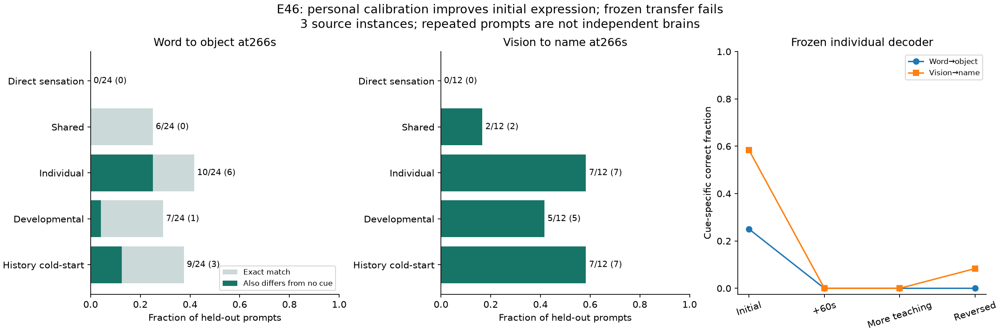

# E46: individual patterns can become words, but frozen expression does not track new experience

Completed2026-10-05. [中文](report.zh.md) · [Design](design.en.md) · [Statistics](results.json) · [Activity and raw-text replay](../../../.work/native-language-20261005/native-expression.html)

## Main findings

**Training the decoder on the individual's actual associative activity produced more correct words than sharing a decoder trained on other instances or calibrating only on direct sensation.** Visual prompts yielded the taught name in **7/12** individualized tests versus **2/12** shared tests. All seven individualized matches differed from the matched no-cue output. Per source, performance was2/4,4/4,1/4. This supports individual activity calibration for this task; it does not establish that every instance must permanently have a wholly separate decoder.

**A dependable, continuously learning language interface has not been established.** After freezing expression and continuing or reversing Core teaching, outputs did not reliably follow the new correspondence. Even60 simulated seconds of waiting sharply reduced initial expression. The problem has moved from reading nothing to reading some patterns at calibration time but failing later. The experiment has not isolated memory loss, representation change, background interaction or limited decoder generalization as the sole cause.

## Method

Three normally learning sources, seeds137/163/191; three plasticity-disabled controls; three continuations of each normal266-second snapshot: same teaching, reversed teaching, and background only. In total **15 sources and708 probe copies,723 cases**. Probes never write back to teaching parents. These are not723 independent learning subjects.

The original`continuous-memory/2`defaults remain: teaching intensity1, probe0.5, forgetting, inhibition, local depletion/recovery and lifecycle rules. Finite global supply and extra facilitation were not enabled. All receive the same recorded real physical telemetry, avoiding live probe-load feedback. Each266-second course has180 lessons,45 per correspondence, initially12 repeats per sentence followed by2/4/8/16-second reviews. Input Transformer and sensory wiring are fixed at71; Core seeds and teaching orders vary.

Read-only reanalysis of E45 native patterns selected`stream-collapse`, separately delivered frames at the same timestamp:33/96 combined pattern checks, versus sparse26/96, repeated sentence23/96, simultaneous sentence20/96 and dense16/96. Reverse order scored30/96 but remains an intervention. This is a combined pattern measure, not language accuracy. Character normalization and E45 results were preserved.

Readout uses a complete2-second anonymous process in16 bins, excluding the entire directly prompted modality. Other activity remains available; unmasked raw activation, inhibition and additional state are retained separately. Numerical calibration uses training samples only and is frozen during testing.

Thirty output Transformers were trained from scratch: six per original regime and six supplementary direct-sensation heads. Each receives1200 updates; developmental training uses400 at each24/72/266-second stage with replay. Input encoding remains fixed and no gradient reaches Core. Thus co-development here means staged output calibration, not end-to-end joint development of every component.

## Initial expression

Parentheses count exact matches also differing from matched no-cue output. Held-out tests use intensity0.5, viewpoint9 and an additional prompt form.

| Calibration | Word→object,24 prompts | Vision→taught name,12 prompts |
| --- | ---: | ---: |
| Individual direct sensation, supplementary | 0(0) | 0(0) |
| Other two instances' associative activity | 6(0) | 2(2) |
| This instance at266s | **10(6)** | **7(7)** |
| Continue training across24/72/266s | 7(1) | 5(5) |
| Same historical samples trained from scratch | 9(3) | 7(7) |

Individual word→object results were2/8,4/8,4/8, each with2/8 cue-specific matches. There are only three learning sources. **Staged development did not outperform cold training on the same historical samples.** Extra historical data cannot be credited entirely to chronological co-development.

A simpler standardized cosine-prototype reader achieved10/24(6),6/12(3), versus the individual Transformer's10/24(6),7/12(7). It is a useful inexpensive baseline, not a free-language generator; its similarity scores are not calibrated truth probabilities. Transformer indispensability is not established.

### Direct sensing and recall need not share a decoder distribution

The [supplement](calibration-source.en.md) was registered after initial results without replacing the original test. Direct-sensation heads correctly decoded12/12 direct object probes and12/12 bare-name probes, but0/36 cross-sensory tests on the same instances. Adding “是” to a directly prompted name yielded0/12, exposing prompt-form sensitivity too.

This supports the user's distinction: learning what activity looks like while sensing something is not the same as learning its activity when another modality evokes it. Failure was not simply an inability to fit or read any signal. It neither implies absent internal information nor requires every input encoder to be personal.

## Frozen expression and new experience: failed gate

Decoders freeze at266s; continuations are tested at532/592s. The original gate requires two sources with jointly correct pre/post-reversal6/8 word probes or3/4 visual probes. **No regime passed.** Requiring both answers to differ from matched no-cue output leaves no jointly correct item in the original four regimes.

An occasional post-reversal match is insufficient: a fixed guess can match one target. Individual expression after60 seconds was0/24 word→object and1/12 visual→name; the latter also occurred without a cue. Continued teaching at532s gave2/24 and1/12, all indistinguishable from no-cue output. An isolated reversed visual match lacked a corresponding correct before/after pair.

**This batch did not establish that a frozen decoder reads a new correspondence learned independently by Core.** The conditional relational-composition stage was not started, and must not be reported as a failed reasoning experiment. Representation drift, forgetting/interference, background proportions and calibration shift remain distinct explanations; no single Core parameter was identified as the cause.

## Connection interventions

After the failed overall gate, an explicitly [registered supplement](initial-mediation.en.md) localized initially readable responses. Every source/direction with initial cue-specific success was selected before intervention. Matched copies silence all language↔vision edges or an equal number of nearest-weight other edges, then repeat every test prompt and the no-cue control.

Each target set contained1480 edges, a broad pathway rather than a small precise region. Mean weight mismatch was0.068–0.069, maximum0.435–0.456; topology was not matched. The control is imperfect.

| Initially correct responses | Retained after target silence | Retained after other-edge silence |
| --- | ---: | ---: |
| Word→object,6 | 0/6 | 2/6 |
| Vision→name,7 | 0/7 | 2/7 |

Four prompts provide a clearer contrast: seed137 sees red ball→“甲” and yellow block→“戊”; seed163 receives“甲” or“甲是”→“红球”. They disappear with target silence and remain with the matched intervention. The remaining nine also fail after other-edge silence, preventing exclusive pathway attribution. Overall, the original requirement of75% retention under the matched control was not met.

This supports internal transmission contributing to some correct expression and shows fragility. It does not attribute all13 answers to a specific associative path or establish general reasoning. Earlier E45 findings remain intact.

## Continuous observation and raw interpretation

Nine histories yielded2289 overlapping windows: normal266–326s, background-only continuation266–532s, and plasticity-disabled266–326s per seed. The first60 normal seconds also occur in the background branch; they are not independent replications. Each readout uses2 actual seconds with0.5-second stride, not a stretched half-second fragment.

Language and visual channels quickly became inactive. No registered sensory reactivation candidate appeared after five seconds, so corresponding replay interventions were not run. Background activity continued and kept the instances alive. Some decoders still emitted“绿柱”,“丁”,“乙” or malformed text; plasticity-disabled sources produced similar words. **Those words do not establish recall of the named objects.** They identify a readout false-positive risk.

The [viewer](../../../.work/native-language-20261005/native-expression.html) retains raw text beside sensory, background and inhibition curves, with source/model selection and time seeking. No language model polished the output; raw internal activity was not suppressed by human semantic judgments. This batch found no credible autonomous linguistic replay under its registered conditions, not an absence of all internal patterns or a reversal of previous ocean-autonomy evidence.

## Explicit conclusions

| Question | Conclusion |
| --- | --- |
| Can individual associative patterns be translated into finite words? | **Yes, for some prompts; personal calibration improved performance.** |
| Are all correct words merely guesses independent of Core? | That does not explain all cue specificity, learning-control differences and four intervention contrasts. Exclusive attribution of all13 answers is unfinished. |
| Is a continuously learning language interface established? | **No: frozen-expression/new-experience test failed.** |
| General language or novel relational composition? | **Not established; conditional composition stage was not run.** |
| Evidence-supported autonomous verbal monologue? | **Not detected here; several words occur in no-cue/nonlearning controls.** |
| An internally selected decision to speak? | **Not tested.** Passive interpretation and outward expression are separate roles. |

## Recommended next steps

Keep native individual calibration. First track how the same correspondence and prompt change with time, measuring raw pattern distinguishability separately from fixed-decoder accuracy. Then compare calibration across direct sensing, association, delays and background states with genuinely held-out correspondences. Continued personal calibration must not feed test answers back and call the result independent Core learning.

Use smaller, better weight/location-matched interventions before attributing all expression to one pathway. Keep input encoding, observational interpretation and outward expression separate; test communication consequences and temporal expression in a later environment rather than inserting a hand-written speaking gate. [User discussion and central-adapter roles](../../../docs/en/reference/central-adapters.md).

No clearly isolated missing Core structure requires immediate alteration. These experimental heads should not replace ordinary chat defaults yet.

## Engineering and evidence

Added anonymous-process projection, training-only numerical calibration, finite-prototype readout, frozen Transformer Python/CLI replay and responsive raw-activity/text viewing. Fifteen affected tests passed. CPU, CUDA and a deliberately hidden-GPU fallback produced the same check word. Viewer interactions passed at1440/390 pixels. Windows temporary-directory ACL restrictions were resolved with a project-local test directory and approved execution.

Compute total **34.75minutes**:21.37minutes of simulation/observation and13.38minutes of training/translation/analysis. Pre-archive evidence approximately930MiB; final storage is in[delivery](delivery.en.md). Available RAM12.63GiB, C8.27GiB and E57.13GiB at measurement; shared-account usage41%→42%, including other work. No resource stop line was reached. Core, defaults, historical evidence and user services remain unchanged.

A provenance check rejected a post-registration addition to captured`src`before fitting. The frozen source was restored; numerical calibration moved to`lab/tools`with a recorded pre-expression amendment. The check was not bypassed, and old samples were not changed. Direct calibration and initial mediation are identified as post-initial-result supplements; original criteria remain intact.

Mechanism references: [original Transformer](https://arxiv.org/abs/1706.03762), [Tang et al.2023 individualized semantic decoding](https://www.nature.com/articles/s41593-023-01304-9). They motivate sequence modeling and personal calibration; they do not prove human language understanding or matching brain anatomy in ThreeMind.
