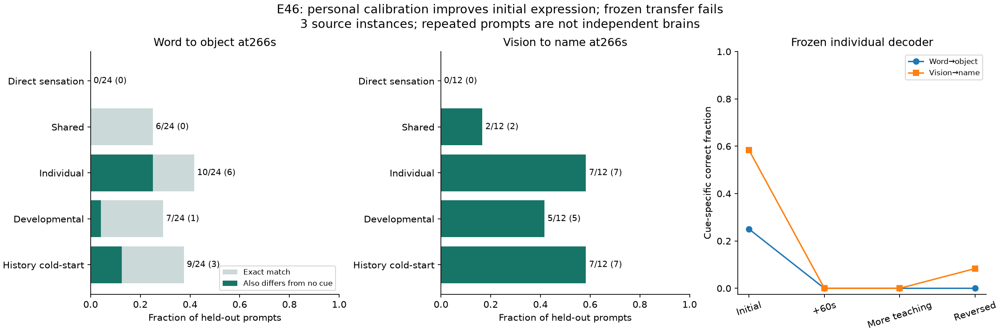

# E46：个体内部模式能译成词语，但冻结的表达器还跟不上新经历

> **修订 r3 · 2026-10-10**
> 修订原因：原件存储位置已迁移并核验，追加当前位置解析说明，保留原实验结论。
> 原版：[report.zh.md](report.zh.md)；父版本 r2：[report.r2.zh.md](report.r2.zh.md)

> **修订 r2 · 2026-10-10**
> 修订原因：生成证据移出 Git 并完成校验归档；追加位置登记，保留原字节与结论。
> 原版：[report.zh.md](report.zh.md)；父版本 r1：[report.zh.md](report.zh.md)

2026-10-05完成。[English](report.en.md) · [设计](design.zh.md) · [完整统计](/api/v2/storage/research-artifacts/research-artifact:0e5764f31dd90c829250e144/content) · [活动与原样文字回放](../../../.work/native-language-20261005/native-expression.html)

## 最值得知道的结果

**让解码器学习这个意识实际形成的联想活动，确实比拿别的意识的解码器，或只学习直接感官反应，更容易读出正确的词。** 这一步有实测增益：看物体说出所教名字，个体解码器为 **7/12**，共享解码器为 **2/12**；前者的7次都区别于同状态无提示输出。一个来源四个名字全对，另两个为2/4、1/4。它说明“学会读取个体活动”值得做，不说明每个意识永远只能配一个专用网络。

**但现在还不能把它称为可持续使用的语言中枢。** 冻结表达器后，给意识继续教学或反转对应关系，表达没有可靠跟随改变。原定的新知识检验没有通过。即使只等待60模拟秒，最初的正确表达也明显下降。问题已从“完全读不出”推进到“当时能读，后来跟不上”；尚不能单凭此结果判断是记忆改变、活动表达改变，还是解码器适应范围太窄。

## 实际做了什么

新建3个正常学习来源，种子137/163/191；另建3个关闭可塑性的对照，再由正常来源分出继续原教学、反转教学、只保留背景三条支线。共 **15个来源、708个测试副本，723例**。副本不写回教学父本；不能把723例当作723个独立学习来源。

使用`continuous-memory/2`原默认。普通教学强度1、测试0.5；遗忘、抑制、局部耗竭/恢复及生命判定保留，没有开启有限全局供能，也没有额外开启易化。重放相同的真实物理遥测背景，不让本次探测负载反过来改变输入。每个课程180次、每种对应45次，先每句12次，再按2/4/8/16秒间隔复习；266秒完成。输入Transformer和感官接线固定为71，Core种子与课程顺序变化。

先按内部模式重新分析E45六路校准轨迹：同时间分别递送的`stream-collapse`为33/96，稀疏字符26/96、重复整句23/96、同时整句20/96、密集字符16/96。倒序路线30/96，但作为干预不选为正常输入。这里是多项模式比较的合计，不是自然语言正确率；它只决定本批采用哪条候选输入。未变更字符规范化，也没有覆盖E45报告。

输出观察完整2秒过程，分16段。语言提示时排除直接输入的语言通道，视觉提示时排除直接输入的视觉通道，避免简单抄输入。其余匿名活动可参与；原始未裁剪的活动、抑制、支持度等另外保存。特征数值校准只使用训练集，测试时冻结。

比较30个从零训练的小Transformer输出头：原定四方案各6个，另补6个直接感官校准头。每头1200步；随发育方案为24→72→266秒三阶段、每阶段400步，重放之前的训练样本。输入编码器固定，Core不接收梯度。因此这里的共同发育是**输出器分阶段学习Core活动**，不是已经实现全部组件共同训练。

## 最初表达：什么有效，什么没有胜出

括号内是“输出正确，且不同于同状态无提示输出”的次数；后者用于排除固定猜一个词。测试包含未用于输出训练的强度、视角及提示形式。

| 表达器怎样训练 | 词语→物体词，24次 | 视觉→所教名字，12次 |
| --- | ---: | ---: |
| 只学本个体直接感官反应（补充对照） | 0（0） | 0（0） |
| 学另外两个个体的联想活动 | 6（0） | 2（2） |
| 学本个体266秒时的联想活动 | **10（6）** | **7（7）** |
| 随24/72/266秒发育继续训练 | 7（1） | 5（5） |
| 合并相同三阶段资料，从零训练 | 9（3） | 7（7） |

视觉→名字的个体结果依次是2/4、4/4、1/4；词语→物体为2/8、4/8、4/8，但各自只有2/8区别于无提示。只有3个学习来源，当前能说本任务有个体校准增益，不能给出广泛总体能力或稳定性承诺。

**随发育逐步更新没有胜过一次性使用同样历史资料。** 因此目前证据支持学习个体实际模式，尚不支持“必须同步共同发育才能读懂”。也不能把多了历史资料带来的效果全部归给发育顺序。

另一个简单工具按训练样本的余弦相似度选有限短语：个体标准化版本为10/24（6）、6/12（3）。Transformer为10/24（6）、7/12（7）。它可作廉价对照，尚无证据证明复杂Transformer在所有方向都不可替代；样本读出不会生成未登记句子，其分数也不是真值概率。

### 直接感官解码失败，并非模型完全没训练好

[这项补充](calibration-source.zh.md)在初始结果后登记，未代替原主检验。直接感官头能读对直接看到的物体12/12、直接输入的裸名字12/12，却不能读对同一意识的跨感官对应0/36。加入“是”的直接名字提示又是0/12，说明表述形式变化也不能忽略。

这与用户的启发一致：**只学“看到它时”的活动，不等于学过“由另一感官联想到它时”的活动。** 校准所处状态和活动来源都很重要。它不证明内部没有可表达的信息，也不证明所有个体必须使用完全独立的输入编码器。

## 新经历检验：明确未通过

输出器在266秒后冻结。相同父本分别继续原课程、反转课程、只接背景；在532/592秒检查。原标准要求至少两个来源在反转前后同时答对6/8词语提示，或3/4视觉提示。**所有方案均未达到。** 若再要求答案区别于同状态无提示，原四方案没有任何反转前后联合正确项目。

不能只看反转后某一个词答对：冻结解码器也会不看提示固定吐出一个词。最初个体表达器等待60秒后，词语→物体0/24，视觉→名字1/12，而后一个也不区别于无提示。继续教学532秒时为2/24、1/12，均不区别于无提示。反转后有单个正确视觉回答，也没有对应的反转前后联合正确证据。

因此，本轮**没有证明冻结表达器可以读取Core独立学会的新对应**；没有开启后续复杂关系组合题，不能把未开展写成推理失败。测试失败的具体载体还需区分：经历遗忘/干扰、同一信息的活动表示改变、背景占比与读出校准偏移。不能直接归咎于某一个内核参数。

## 连接干预：哪些回答依赖内部通路

原总体门槛失败后，另登记[初始响应定位](initial-mediation.zh.md)。选取最初13个正确且区别于无提示的回答所在来源，在相同快照副本中屏蔽语言↔视觉连接，并屏蔽相同数量、尽量接近权重的其他连接作对照。每个来源目标连接1480条；这是较宽的通路集合，不是少数节点的精确脑区。权重平均匹配误差0.068～0.069、最大0.435～0.456，拓扑也未配平，匹配并不理想。

| 原先正确回答 | 屏蔽跨感官连接后保留 | 屏蔽其他匹配连接后保留 |
| --- | ---: | ---: |
| 词语→物体，6个 | 0/6 | 2/6 |
| 视觉→名字，7个 | 0/7 | 2/7 |

四个提示的差别较清楚：来源137看到红球说“甲”、看到黄块说“戊”；来源163看到“甲”或“甲是”读出“红球”。它们在目标屏蔽后消失，匹配屏蔽后保留。其余九个连匹配屏蔽也失去正确输出，不能都说成已定位到特定跨感官通路。整体未满足原先“匹配至少保留75%”的强归因条件。

这提供了**部分正确表达依赖内部传递**的支持，同时显示输出很脆弱；不等同于已证明所有正确答案来自特异联想，更不等同一般逻辑推理。E45既有干预结果保持原结论，本补充没有重写它。

## 无新提示时：保留原文，但不能把吐词都叫内心独白

完成9条连续历史、2289个重叠窗口的观察：每个正常来源266～326秒、背景支线266～532秒、关闭可塑性的对照266～326秒。正常来源的前60秒也在背景支线中出现，不能当作独立重复。实际每个读出都使用2秒过程、步移0.5秒，没有把半秒片段拉伸为两秒。

语言和视觉通道的活动很快降到零；5秒后没有发现登记条件下的新再激活候选，因此未做对应自主回放干预。背景网络仍活动，实例没有因此死亡。输出器却可持续输出“绿柱”“丁”“乙”，还有乱码；关闭学习的来源也出现相似词。**这些文字不足以证明在回忆那些事物。** 这是发现了读出器的误报来源，不能用漂亮文本替代真实活动证据。

[回放页](../../../.work/native-language-20261005/native-expression.html)将原样文字、语言/视觉活动、背景、全网抑制并排显示，可以选来源、表达器并拖动时间。未给乱码润色，未按人类因果判断删除原始活动。本结论只说当前课程没有检出可信的自主语言回放，不否定海洋等旧实验的自主活动证据，也不否定所有其他内部模式。

## 本轮命题结论

| 问题 | 结论 |
| --- | --- |
| 个体实际联想模式能否被译为有限词语？ | **可以，部分提示已实现；个体校准有增益。** |
| 这种表达是否完全来自Transformer凭空猜测？ | 不能用纯猜测概括全部结果；存在提示特异性、学习对照差异及四个通路干预对比。不过全部13个回答尚未完成特异归因。 |
| 是否已建立能持续学新对应的语言界面？ | **没有，本轮冻结后新经历检验未通过。** |
| 是否已验证一般语言、未教过的逻辑组合？ | **没有；组合阶段因基础门槛未达而未开展。** |
| 是否出现有证据支持的自主语言独白？ | **本轮未检出；若干吐词有明显的无提示/不学习对照误报。** |
| 是否会主动选择何时说、说什么？ | **未测试。** 被动释读与主动表达已在架构文档分开。 |

## 下一步建议

1. 保留个体模式校准，下一批先查**同一对应、同一提示在时间中如何变形**：分别测原始模式可辨别性与固定解码器准确率，区分信息丢失和翻译失配。不要先把默认参数改一遍。
2. 输出训练加入直接感官、联想、不同等待时长和背景状态；用独立保留对应/新经历验收。可以尝试持续更新的个人校准层，但不能把测试答案回灌后宣称Core学会了答案。
3. 更小、权重和位置更接近的通路干预，配合活动变化而非仅看词语对错。当前大面积消融不足以单独定位全部表达。
4. 架构上正式区分输入、观察释读和对外表达。之后用有交流后果的环境检验输出选择及时间序列；本期未添加人工“何时说”的规则。详见[中枢适配器与用户原话](../../../docs/zh/reference/central-adapters.md)。

本轮没有发现必须立即修改Core结构的明确缺口。也没有证据支持把目前试验头替换成日常聊天默认表达器。

## 工程、证据与资源

新增匿名过程投影、训练集限定的数值校准、有限样本注意力读出、冻结Transformer的Python/CLI入口，以及过程与原文回放；不调用付费或远程模型。15项受影响测试通过；CPU、CUDA实际解码和隐藏GPU后的CPU回退得到同一验证词；1440/390像素回放交互验收通过。临时目录ACL问题使用项目内独立测试目录及获准执行解决。

累计计算约 **34.75分钟**（723例模拟/观察21.37分钟，训练/转译/分析13.38分钟）；归档前工作证据约 **930 MiB**，最终存储见[交付记录](delivery.zh.md)。当时可用内存12.63GiB，C8.27GiB、E57.13GiB；账户读数41%→42%，包含其他项目消耗，未触停止线。核心基线、普通默认、旧数据及运行服务未改。

训练前曾把数值校准工具放入已冻结的`src`，溯源检查在拟合前拒绝继续；恢复冻结源码后，将该开发工具放到`lab/tools`并记录补充，未绕过检查，也未改旧样本。直接感官对照和初始消融是看过初始结果后的明确补充，原设计和原判据保留。

机制参考：[Transformer原论文](https://arxiv.org/abs/1706.03762)、[Tang等2023个体脑活动语义解码研究](https://www.nature.com/articles/s41593-023-01304-9)。它们支持比较序列建模与个体校准的动机，不证明ThreeMind已经具有人的语言理解或特定脑区。

## 数据位置修订

选定的生成证据已逐字节校验归档。原报告、评判标准、结论及数据内 source_commit 均保留。以下逻辑下载需要当前主机管理员身份，数据目录未整体公开。

`data/experiments/2026-10-05-native-language/`

[Location and hash index / 位置及哈希登记](../../artifact-index/2026-10-09-relocations.json)

- [initial-findings.json](/api/v2/storage/research-artifacts/research-artifact:be97da9bf0a5ae2f243696c6/content) — 151327 B; SHA-256 `cd1a3f3d3dace868ff54295fb3fe4c023e4aee866228e504cf597a60885d8434`.
- [initial-mediation.json](/api/v2/storage/research-artifacts/research-artifact:d8dc01d68562aa9110cbfcc5/content) — 168830 B; SHA-256 `41fed589ddd2cca6d3895073f45f26f3a27f6176c2041df3ed99f2c3fd5acb6d`.
- [results.json](/api/v2/storage/research-artifacts/research-artifact:0e5764f31dd90c829250e144/content) — 991365 B; SHA-256 `3e31718ba8748aa434d8c1340a97fe21217d079004697634843233b3f1080f1f`.
- [route-reassessment.json](/api/v2/storage/research-artifacts/research-artifact:fbc142b24ec601ddae90f5de/content) — 183004 B; SHA-256 `7391778c800a56299e0581bf3cfe0be3af840100821a5fb660cb2d0409737b51`.

> **存储位置修订 · 2026-10-10**
> 本版追加已核验的原件迁移说明：本次清单中的原件迁至 `E:\ThreeMindData`，科学身份、哈希、原实验日期、测量与结论不变。保留正文中的路径表示历史来源，当前位置通过已登记的证据引用解析。仓库文档与冻结夹具留在原处，源副本保留；结构化查询数据及运行中的检查点仍存数据库。本说明不表示缺失的历史资料已恢复。
