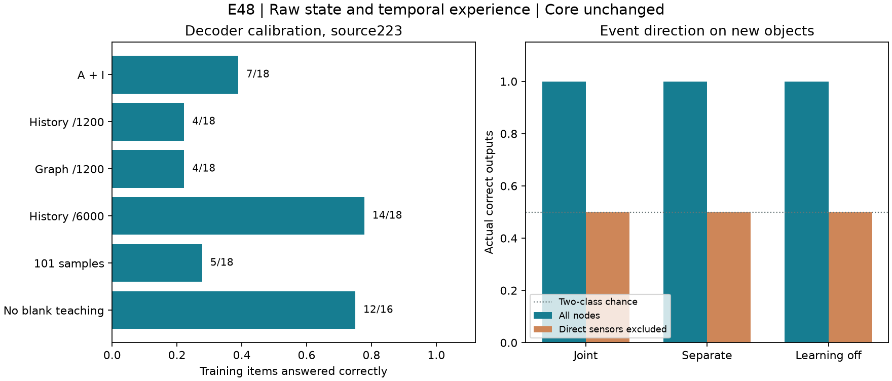

# E48: raw state, within-sentence time and continuous events

2026-10-05. [Chinese](report.zh.md) · [Discussion and decisions](../../../docs/en/plans/temporal-input-and-state-expression.md) · [Preregistration](design.en.md) · [Scoring correction](scoring-correction.en.md)

## Findings

**This round identified an expression-tool obstacle, not a defect requiring a Core change.** Failure to express an answer cannot directly establish absent Core information. Adding within-sentence delivery intervals alone did not resolve current naming or new-mapping expression.

Raw state, without counterfactual subtraction or per-sample normalization, contains classifiable information: a simple linear readout calibrated at the current state selects the correct name12/12 at326s. It chooses among four supplied labels and admits a direct sensory shortcut; this alone does not establish that Core learned the correspondence. The small Transformer itself is inadequately calibrated: most1200-step variants answer only4–7 of18 training items; extending one to6000 steps raises4/18 to14/18. More fields or more time samples do not automatically fix this training obstacle. Continuous physical events leave readable order information, but learning-disabled controls do equally well. Individual versus shared expression remains unresolved because neither is adequately fitted.

Core formulas, defaults, old instances and evidence remain intact. Research changes concern input timing, observation and external decoder calibration. Existing internal-activity/behavioural intervention evidence is not overturned by failed language expression. General reasoning, natural conversation and verified inner-monologue translation have not been established here.

## Public scoring correction

Stage A described9/12→12/12 as a broad naming improvement. Both were actually **cue-specific** scores: correct and different from matched no-cue output. Actual naming is12/12 in both cases.

| Original assignment,326s, all channels, current calibration | Actual correct | Old cue-specific correct |
| --- | ---: | ---: |
| Activation/inhibition | 12/12 | 9/12 |
| Plus trace/support/stability | 12/12 | 12/12 |

These are three teaching sources and four objects each, not twelve independent minds. The additional fields improve the no-cue distinction in this instrument, not the number of names learned. No-cue words remain unchanged and are neither automatically meaningless nor automatically verified translations. The old report/data remain with this dated correction.

E47's differential preprocessing did not modify Core; it changed information passed to the decoder. Its48/48 and pathway-intervention numbers remain facts under that instrument and criterion. They do not directly establish natural expression. Main E48 inputs preserve raw values. Direct-sensor exclusion is explicitly labelled attribution analysis.

## Input time

Compare0/1/5/20/100ms between sentence frames, three sources223/251/279,180 lessons,12 initial repetitions per sentence and spaced reviews. Frame values/order, total input, visual pairing, NFKC and channel mapping are unchanged. Physical telemetry is replayed identically, so observer compute load cannot feed back into input.

All five intervals have identical naming scores when calibrated at the current state. Select1ms as the smallest nonzero tied candidate, not an improved default. Restore sources223/279 at266s, then continue, reverse or cycle the assignments.

| Frozen-readout visual naming, two sources combined | 0ms | 1ms |
| --- | ---: | ---: |
| Original assignment,532s | 6/8 | 6/8 |
| Reversed assignment,532s | 8/8 | 8/8 |
| Cycle unseen by the decoder,532s | 2/8 | 2/8 |
| All three assignments,592s | 0/24 | 0/24 |

Actual and cue-specific scores happen to coincide in this table. Failure at592s does not establish that every memory/connection disappeared; a frozen decoder must also generalize across changing states. Other nonzero intervals were not extended to new mappings. The encoder already carries prefix information; only delivery timing changed. [Timing outputs](raw-timing.json) · [Follow-up design](timing-followup-registration.en.md) · [Follow-up outputs](timing-followup-results.json)

## State coverage and decoder fitting

The ordinary raw layout includes119 anonymous channels, presence, activation/inhibition and optional trace/support/stability. The17- and101-point variants inspect the same two-second window;101 includes every20ms recording, not every sub20ms transient.

The extended layout records five full snapshots and reads node plasticity, direct/associative touch, generated/pending inhibition, touch counts and local ages; directed-edge weights/stability/eligibility/history; short-term available/active/utilization values, fast state and update ages. The graph vector has214081 columns and the model about13.85 million parameters.

This is **extended dynamical state, not the entire recovery container**. Configuration, experiment IDs, seeds, labels and queued external inputs are withheld. Internal in-flight messages and every global counter are not yet vectorized, so information coverage is not exhaustive. Five snapshots and17/101-point processes are also different observation ranges, not strictly a single-factor comparison.

| Source223 calibration on original/reversed assignments | Training correct |
| --- | ---: |
| Activation/inhibition,17 points,1200 steps | 7/18 |
| History fields,17 points,1200 steps | 4/18 |
| Extended node fields,5 snapshots,1200 steps | 4/18 |
| Nodes plus edges/resources,5 snapshots,1200 steps | 4/18 |
| History fields,17 points,6000 steps | 14/18 |
| History fields,101 points,1200 steps | 5/18 |

The6000-step model answers6/8 held-out known-assignment items at532s and1/8 at592s. Unseen assignments yield actual2/8 at532s, none cue-specific. The preregistered17/18 fit gate was not met; further-source optimization stopped. The101-point variant also failed that gate. This shows these decoders did not effectively use the provided information, not that the fields are useless.

Three individual raw-history decoders each fit4/18; the shared decoder fits8/36. This cannot settle whether personal or shared expression is preferable. Input wiring is common to all sources; success would not establish universality across arbitrary anonymous wiring either.

Every inference starts without a dialogue cache. A translator need not keep its own conversation memory. Reading a process generated by Core accesses Core's history; it is not an independent conversational memory. Translation weights still learn rules, so frozen new-mapping, no-learning and intervention controls remain necessary.

Removing no-cue blank supervision gives12/16 training items at6000 steps for the same source. Actual known-assignment accuracy remains6/8 at532s and becomes2/8 at592s; unseen assignments score1/8 at each time. This single-source control retains the current6/8 without forcing blank supervision, but does not solve new mappings. No-cue output is preserved without assumed semantic truth or a claim of verified inner monologue. [All models](results.json) · [Item viewer](../../../.work/temporal-state-20261005/raw-expression.html)

## Shared-reference physical events

Keep all four MuJoCo objects. A kinematic camera scans in two orders with identical exposure multisets and final frames over0.8s. Joint versus separate visual/pan delivery preserves values and times. Teach two objects with initial12 repeats and spaced reviews, then test two untaught objects and held-out views. This is not autonomous camera control or a claimed accelerometer.

| Two sources,8 held-out events each | All-node actual correct | Direct vision/pan excluded |
| --- | ---: | ---: |
| Joint observation | 16/16 | 8/16 |
| Separate delivery | 16/16 | 8/16 |
| Joint, learning disabled from birth | 16/16 | 8/16 |

Each source individually scores8/8 versus4/8. These are not many independent statistical replicates. Old cue-specific totals are8/16 and0/16 and must not replace actual classification accuracy.

**Positive result: equal exposure and final observation need not produce an indistinguishable internal process; existing dynamics retain readable order differences.** Learning-disabled controls also succeed, so current sensory/short-term state suffices. This does not show additional learned relational transfer or that Core has mastered the teacher's words as language concepts. The registered positive-learning gate was not met, so no selective-pathway extension was triggered. [Design](events-registration.en.md) · [Results](events-results.json)

## Implications and remaining work

First make expression calibration and cross-state generalization reliable. Candidate work includes more varied translation teaching across time/experience and better handling of heterogeneous state fields and graph structure. Preserve raw quantities, transparent train/test splits and provenance; do not erase background or normalize individual responses to manufacture attractive output. A larger model is not assumed to solve the problem.

Continuous-world material remains promising, but distinguishing sequences is not yet learning a communicable relationship. Continuous object changes, shared physical references and communication with real consequences warrant later controlled teaching. Full NPC-life teaching and general family reasoning were not conducted here.

Spatial dimensions currently allow1–64, including11; geometry is disabled by default. This changes Core constraints and is not TEM relational learning. Historical ocean evidence links local paths and continuous sensory/action feedback to behaviour, but does not supply a demonstrated language mechanism. This round reviewed it without mixing in spatial changes. [Review](stage-a.en.md)

## Tools and delivery

Added raw-process/state CLI, graph-state layout, physical-event apparatus, separate score inspection and a paginated viewer. [Usage](../../../docs/en/reference/raw-state-expression.md)

Six targeted tests pass. One old probe reproduced identical recorded node processes after adding complete-state capture. Raw/graph CLI outputs match direct CPU calls. No repeated mass-data hashing. Nineteen candidate decoders use CUDA training; CPU interfaces were exercised. Core GPU migration is outside this study.

There are1242 new sources/branches/probes, including24 teaching sources or branches, not1242 independent replications. Another1002 existing E47 probes were reanalysed read-only. The documented resource amendment allows4 GiB work and12 GiB work/archive/database total, retaining single-worker, four-hour compute,4 GiB RSS,3 GiB GPU and reserve limits. Actual resource use is recorded at delivery.

Designs, corrections, bilingual reports, item viewer, models and evidence are published to **E48 原始状态与时间过程**. Old E47 archives are not duplicated; dependencies are identified. This bounded round is complete; general language/reasoning, personal/shared expression and reliable monologue decoding remain open.
