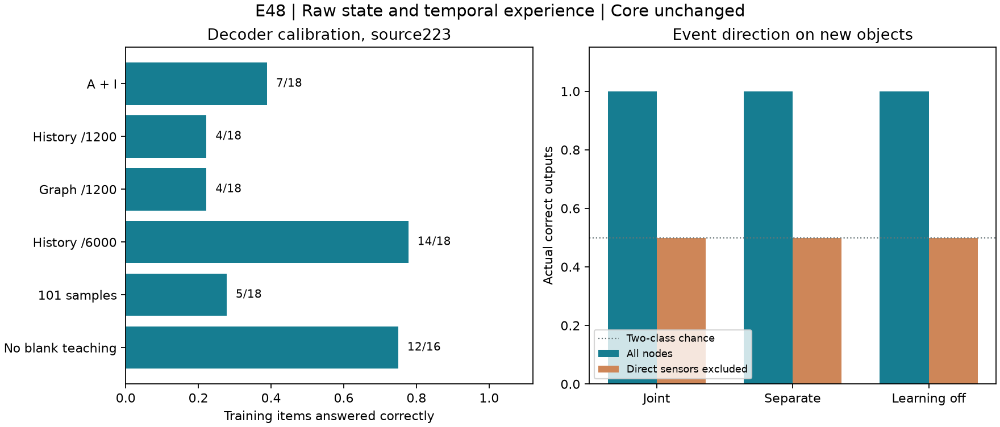

# E48：原始状态、句内时间与连续事件

2026-10-05。[English](report.en.md) · [讨论与决定](../../../docs/zh/plans/temporal-input-and-state-expression.md) · [事前设计](design.zh.md) · [评分更正](scoring-correction.zh.md)

## 先说结论

**本轮明确找到了表达工具的障碍，没有定位到必须修改Core的缺陷。** 不能再把“表达器答不对”直接解释成“内核没有那种信息”。同时，单独把一句话从同刻输入改为间隔输入，没有解决目前的命名与新对应表达问题。

1. 不减去无提示副本、不归一化单次幅度，原始状态仍有可分类的信息。简单线性读出在当前状态校准后，326秒视觉→名字实际12/12。这是从四个已有标签中选择，存在直接感官捷径，不能只凭这一项证明Core学到了对应。
2. 小Transformer直接读取原始量时，自身翻译校准没有成功。1200步，主要变体只拟合4～7/18训练题；延长至6000步可从4/18提高到14/18，说明训练方式/充分程度确实是瓶颈之一。
3. 更多状态不是自动的解法：增加连接、资格迹、短时资源等，或把17个时间样本增加到101个，并未使当前表达器通过校准。**本次不能判断这些信息没有价值，只能确认当前模型没有有效利用它们。**
4. 连续物理事件确实在内部留下了可读的顺序痕迹；但不学习的实例也能做到，尚未出现教学额外形成的跨感官关系迁移。
5. 个体专用与共享表达器都欠拟合，所以“一个意识必须有自己的表达器”仍未判定。没有证明一般推理、自然对话或可信的内心独白，也没有据此否定此前的内部活动及行为干预结果。

Core公式、默认值、旧意识及旧证据保持。本轮实际改变的是研究输入的递送时刻、外部观察和表达校准；未开空间基底来混改这些因素。

## 一个必须公开的评分更正

阶段A曾将“9/12→12/12”笼统称为丰富状态改善命名。逐条检查后，实际命名两者均为12/12；变化来自无提示输出。旧判据要求答对且不同于无提示，前一种有三题被额外扣掉。

| 326秒原对应，全通道、当前状态校准 | 实际答对 | 旧提示特异正确数 |
| --- | ---: | ---: |
| 激活＋抑制 | 12/12 | 9/12 |
| 再加痕迹、支持、稳定度 | 12/12 | 12/12 |

这不是12个独立意识，而是三个教学来源、每来源四个物体。额外字段改善的是本任务中对无提示样本的区分，不能说因此多学会了三个名字。无提示吐出的词原样保留，不能自动视为无意义或不存在真实活动；反过来，也不能仅因吐出一个词就认定翻译正确。[完整更正](scoring-correction.zh.md)

旧差值工具没有改动Core；它改变了送入表达器的信息。E47的48/48及通路干预数字仍属于原仪器与判据条件，本轮没有把它们改写成“自然表达已经全面成功”。本次所有主要输入保持原值；排除直接感官只在明确标记的归因对照中进行。

## 句内时间：0、1、5、20、100毫秒

每组保留180课、初次每句12次和后续间隔复习，三种来源223/251/279；逐帧值、顺序、总输入量、视觉配对、NFKC与通道映射不变。背景是同一份物理遥测重放，观察计算负荷不会回流成为额外输入。

五组在当前状态校准的指定命名任务上得分相同。额外选择最小非零候选1毫秒，并对223/279从同源状态继续原对应、反转或循环对应；不把它改为默认。

| 冻结读出后的视觉命名（两个来源合计） | 0毫秒 | 1毫秒 |
| --- | ---: | ---: |
| 532秒，原对应 | 6/8 | 6/8 |
| 532秒，反转对应 | 8/8 | 8/8 |
| 532秒，未用于表达器训练的循环对应 | 2/8 | 2/8 |
| 592秒，上述三种合计 | 0/24 | 0/24 |

表中实际正确与旧提示特异数恰好相同。不能由592秒读不出断言连接或记忆全部消失：固定表达器需要跨时间使用；本轮没有穷尽其后的可唤起状态。其他非零间隔的新对应未展开。[逐项时间结果](raw-timing.json) · [追加设计](timing-followup-registration.zh.md) · [新经历结果](timing-followup-results.json)

**结论：本课程下，增加句内时间不是单独奏效的修复；这不是“时间过程没有用”，更不是“所有时序方案都已排除”。** 编码本来就有前文信息；本轮只改变其进入Core的时间，不改编码。

## 表达器到底看到了多少

普通原始读法提供119个已声明匿名通道的存在状态、激活/抑制，以及可选痕迹/支持/稳定度。17点与101点版本读取同一两秒过程；101点是全部20ms观测，仍不能覆盖20ms以内所有瞬态。

扩展版保存五个时刻的完整快照，并从中读取节点局部可塑性、直接/联想触达、抑制生成与待处理量、触达计数、局部年龄；有向连接的权重、稳定度、资格迹、触达历史；短时可用量、活动量、利用率、快状态及更新时间。图输入214081列，表达器约1385万参数。

**扩展动力学状态不等于把整个恢复容器交给模型。** 配置、实验名字、种子、标签、外部待递送输入不进入表达器。内部在途消息及所有全局计数尚未加入该向量，因此没有声称穷尽信息。五快照与17/101点过程也是不同的观察范围，不能把两者分数作严格的单因素比较。

| 来源223，原/反对应翻译校准 | 训练题答对 |
| --- | ---: |
| 激活＋抑制，17点，1200步 | 7/18 |
| 增加痕迹/支持/稳定度，17点，1200步 | 4/18 |
| 扩展全部节点字段，5快照，1200步 | 4/18 |
| 再加连接与短时资源，5快照，1200步 | 4/18 |
| 原始历史字段，17点，6000步 | 14/18 |
| 原始历史字段，101点，1200步 | 5/18 |

6000步版本在532秒的已教原/反对应留出题实际6/8，592秒1/8；未见对应532秒实际2/8，其中没有题通过旧提示特异判据。达到17/18训练校准才继续另外来源的规则未满足，按登记停止扩展。101点版本也未过门槛。

全通道历史字段的三个个体表达器各4/18，共享表达器8/36。它们没有形成合格比较基础，不能据此决定是否通用。所有实例共用同一输入接线版本；即使共享表达器通过，也不能推广到任意匿名接线。

表达器每次从空缓存开始。**你的理解基本正确：翻译器不需要替Core保存对话记忆；读取Core自己的一段变化，则是在读取意识过程，并非另造一个回答问题的记忆。** 表达器权重学习过翻译规则，仍必须用冻结新对应、无学习和干预来限制其自行答题的可能性。

取消无提示空白监督后，同一来源6000步在16条教学题上拟合12/16；532秒已教对应实际仍为6/8，592秒2/8，未见对应在两个时点各1/8。这个单来源对照没有因取消空白监督而丢掉当前的6/8，也没有由此解决新对应。无提示输出原样保存，没有预设的语义真值；不把它们称为已经译对的内心独白。[全部模型结果](results.json) · [逐题查看](../../../.work/temporal-state-20261005/raw-expression.html)

## 刺激体与连续物理事件

四个MuJoCo物体始终保留。相机按两种顺序扫视，视觉与转轴位置的总曝光、末态相同，持续0.8秒；共同观测和分开递送的值、时刻相同。先用两个物体教“顺/逆”，各完整例首次12次，再间隔复习；测试另两个未教物体和新视角。相机是运动学扫描，不是模型学会了自行转头，也没有假称其为加速度计。

| 两来源、每来源8个留出事件 | 全节点实际答对 | 排除当次视觉/转轴通道后的实际答对 |
| --- | ---: | ---: |
| 共同观测 | 16/16 | 8/16 |
| 分开递送 | 16/16 | 8/16 |
| 共同观测，出生起关闭学习 | 16/16 | 8/16 |

每来源分别都是8/8与4/8；不是大量独立统计样本。旧提示特异数分别为合计8/16与0/16，不能取代上表实际分类结果。

**明确的正面信息：相同曝光、相同终点不意味着相同内部过程，现有动力学已能留下这两种顺序的可读区别。** 但这套材料用不学习实例也能区分，说明当前感官通道及短时状态已足够完成分类，没有证明训练额外获得了抽象关系，也没有证明“顺/逆”已经被Core作为语言概念掌握。按原阳性条件未触发进一步通路消融，不为得到阳性改规则。[设计](events-registration.zh.md) · [逐项结果](events-results.json)

## 接下来应该修哪里

优先提高表达器的**校准可靠性和跨状态泛化**，再以它判定内核语言/关系能力；不能继续以一个连校准题也答不好的工具给Core判缺陷。下一步候选是更丰富的跨时间、跨经历翻译教学，以及让表达器更合理地处理不同状态字段和连接结构。任何方案都保留原始量，训练/留出划分和来源透明，不靠删背景或差值归一化制造漂亮输出。不能假定换大模型就能解决。

连续环境材料值得继续，但本轮说明“能辨序列”与“通过教学建立可交流的关系”之间仍有距离。应把同一事物的连续变化、共同参照及有实际后果的交流结合起来，在表达器校准合格后再扩大；尚未开展完整NPC生活教学或一般家系推理。

空间维数当前支持1～64，11可用，默认空间约束关闭；它改变内核的几何条件，不等同TEM的关系学习。海洋旧结果提示连续感官—行动反馈和局部通路可因果影响动作，但没有给出已验证的语言模块。本轮只读复盘，未混入空间参数实验。[复盘依据](stage-a.zh.md)

## 工具、验证、资源及交付

新增原始状态/过程CLI、扩展图状态布局、连续物理事件工具、独立评分核查和逐题查看器。[操作](../../../docs/zh/reference/raw-state-expression.md)

六项定向测试通过；一个旧探针在新增完整状态采集后，原有逐时刻节点记录完全一致；原始/图状态CLI与CPU直接调用一致。不对大数据重复做全量哈希核查。19个候选表达器使用CUDA训练，CPU读取接口实测通过；本轮未作Core GPU迁移。

1242项新来源/分支/探针，其中24个教学来源或分支；这些共享来源与副本不是1242个独立重复。另对E47的1002个既有探针只读重分析。预算经[公开追加](resource-amendment.zh.md)为工作4 GiB、工作＋归档＋数据库12 GiB；单worker、累计计算4小时、RSS4 GiB、GPU3 GiB和磁盘/内存余量约束保留。最终实际资源见交付记录。

设计、更正、中英文报告、逐题查看、模型和证据包保存到研究项目 **E48 原始状态与时间过程**。旧E47完整证据不重复复制，依赖另列。当前这批有限实验结束；通用语言、关系推理、个体/共享表达归属和内心独白的可靠解码继续列为未结问题。
