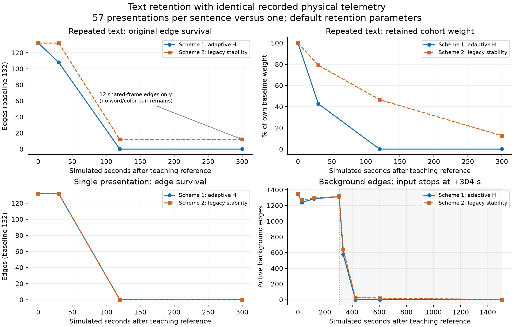
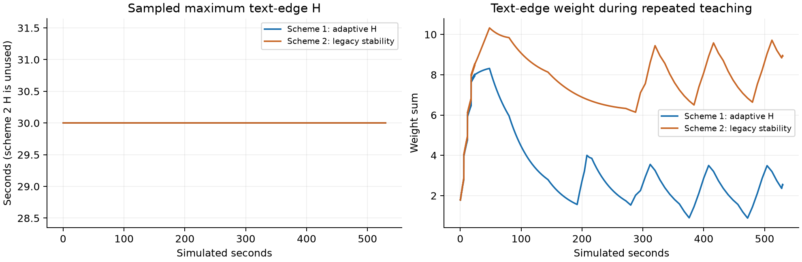
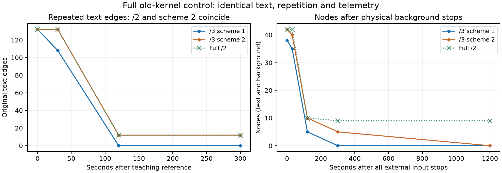

# Repeated text, retention and fading under recorded physical telemetry

> **Revision r3 · 2026-10-10**
> Revision reason: Supplement ten nested per-condition originals to the archive index.
> Original: [report.en.md](report.en.md); parent r2: [report.r2.en.md](report.r2.en.md)

> **Revision r2 · 2026-10-10**
> Revision reason: Relocate generated evidence out of Git; preserve original bytes and conclusions.
> Original: [report.en.md](report.en.md); parent r1: [report.en.md](report.en.md)

[中文](report.zh.md) · [Registration](protocol.md) · [Whole-sentence amendment](protocol-frame24.md) · [Results](/api/v2/storage/research-artifacts/research-artifact:f5d5564a3a713898fc5e1c3c/content) · [Analysis](analysis.json) · [Final verification](verification.json)

October 8, 2026. The user requested scheme 1 (`adaptive-half-life`) versus scheme 2 (`legacy-stability`) with physical telemetry as background and text as the actual test material, then reiterated appropriate repetition. The registered curriculum already included 57 presentations per sentence and a single-presentation control. Core, defaults, old subjects and E64/E65/E66 are unchanged. No full shape/color experiment was started.

## Findings

**Scheme 2 retains more text structure under these conditions, but neither scheme retains the specific word/color connections or produces a distinguishable cue response.** Four sentences are each presented 57 times, 228 presentations total. At 120 simulated seconds after the teaching reference, scheme 1 has no text edges; scheme 2 has 12, all between the shared characters 是/色/的/。. The 16 directed cue-character/correct-color connections are gone in both schemes. Those remaining edges do not establish retention of four color facts.

The user subsequently requested a full `/2` control, reported below. Its text-retention curves match scheme 2: under these conditions the `/3` default does regress in structural retention relative to the complete old version. No parameter search, background-off causal control or full semantic answering was performed, so neither H gain alone nor physical noise is established as the cause, and general capability regression is not established.

Lines join registered observations, not exact deletion times. The upper panels show repetition, the lower-left panel shows the overlapping single-presentation curves, and the shaded lower-right region follows telemetry removal.

## Conditions and continuity

The subject is blank Core plus a fixed, nonlearning text sensor and frozen input replay/cursor. There is no trained decoder, optimizer or body, and this is not a whole-system language accuracy test. The real OS source is the archived E43 840-second recording, **not a new live capture**: host only, 834 delivered frames, 38 actual stimulus channels, intensity 0.2, original timing and normalization. No looping, stretching, imputation, process input or runtime feedback. Three paging metrics are unavailable with reasons preserved; the other 18 metrics each have 841 available source samples. Both schemes receive exactly the same tape.

Text uses the existing literal-character encoder, NFKC, sensory seed 20261004, gain/intensity 1. The sentences pair apple/red, leaf/green, sky/blue and snow/white. Labels remain in observations; Core receives anonymous channels, with no manual edges or answer feedback. Each seven-character sentence enters a single frame with the sensor's existing square-root normalization. The repeated curriculum expands same-sentence spacing through 0.5, 2, 4, 8, 16 and 32 seconds, totaling 57 presentations each. Single-presentation subjects receive only the common final presentation, so this is not an equal-dose scheduling comparison.

The reference is 530s; +30/+120/+300s endpoints all retain telemetry. Background stops at 834s, followed by a separately labelled no-external-input diagnostic through 2034s. The schemes differ only in `consolidation_mode`. H minimum 30s, maximum 30 days, regression 0.125, gain 0.2, logarithmic growth, ordinary learning and edge consolidation remain enabled; node retention is automatic, retain-nodes/dormancy/awakening are off. The sole common nondefault Core setting is `quiescence_death_us=10^12`, permitting structural observation after all input stops; it does not establish default lifespan.

All scheduled inputs are queued at birth. Save Core queues/definition, sensor wiring/configuration, input lists/cursors and parent hashes. Each cue probe is a separate copy; no probe rehearsal enters its parent. Raw data, checksums and executed script versions are frozen.

## Initial input-design failure

[Run-01](/api/v2/storage/research-artifacts/research-artifact:4189a35c606f227343fa1d3d/content) used one character per frame. Text nodes existed, but all observed text/text (TT) and text/background (TB) edge counts were zero. The default co-stimulus birth policy requires distinct nodes touched in the same frame. The input design therefore supplied no eligible character pairs: **this was missing formation, not learned connections being forgotten**.

After explaining the issue and registering the amendment, run-02 creates four separate blank subjects using the sensor's existing default frame width of 24. No run-01 peripheral or subject was replaced/reset, and the negative evidence remains intact. Framing changes both co-presence and normalized amplitude; cross-run differences cannot be assigned to forgetting. The following results use run-02 and concern character co-presence, not word order or semantic understanding.

## Text-edge retention

Track the original 530s cohort by endpoint node IDs and edge birth time. Recreated edges cannot count as retained originals. Each group starts with 132 TT edges; percentages use its own baseline weight. No new TT edges appear during retention.

| Curriculum / scheme | Baseline weight sum | +30s original edges / weight retained | +120s | +300s |
| --- | ---: | ---: | ---: | ---: |
| 57 repeats / 1 | 2.54104 | 108 / 42.74% | 0 / 0% | 0 / 0% |
| 57 repeats / 2 | 8.93211 | 132 / 79.04% | 12 / 46.61% | 12 / 12.59% |
| Single / 1 | 5.45005 | 132 / 50.00% | 0 / 0% | 0 / 0% |
| Single / 2 | 5.44355 | 132 / 50.52% | 0 / 0% | 0 / 0% |

Scheme 1's repeated endpoint even has less weight than recent single exposure. The subjects differ in experience, node stability/plasticity and edge generations; this study does not isolate why. Scheme 2 repetition prolongs some structure, but its 12 surviving edges connect only the four shared characters 是/色/的/。. All 16 directed cue/correct-color edges exist at baseline and +30s in all four groups, and none remain at +120s. Scheme 2's shared edges still number 12 at 954s but are gone at 1134s, demonstrating finite loss in this case. These are observation intervals, not exact deletion times.

## Cue probes and half-life

Each group has six registered probe times, four taught cues, the untaught cue 石桥 and a no-cue copy: 144 copies total, including 96 taught and 24 untaught cues. All four color-channel deltas after subtracting matched no-cue activity are zero in the primary 0.5–1.0s window; the full 0–2s maximum absolute difference is only 4.34e-19, far below the registered threshold. There is no distinguishable cue response even at baseline; do not describe this as previously correct answers becoming wrong. This diagnostic is not a natural-language 0% accuracy score.

Scheme 1's text-edge H equals 30s at registered points. A [post-result read-only replay](trace-registration.md) adds 422 observations per repeated scheme, every 100ms through 24s and 100ms after each later original sentence. The sampled text-edge maximum remains 30s; final hashes exactly match original t530 states. This cannot exclude very brief growth between samples, but gives no sustained H protection. Scheme 2's H field does not control its forgetting.

The source credits H only for actual emitted signals after gates/resource processing, while ordinary co-presentation learning still increases weight/stability directly. Weight learning therefore does not guarantee H growth. Per-edge pre/post-gate signal, inhibition and resource traces were not recorded; insufficient transmitted dose, regression and their interaction are still hypotheses, not isolated causes. No new default is selected.

## Background structure and cleanup

While telemetry runs, the 38 background channels have 1168–1368 active edges at registered points. At 830s scheme 1 has 1312 BB edges but only 20 original-cohort edges; scheme 2 has 1314 but only 32 originals. Large current counts mostly include newly created/recreated edges rather than uninterrupted retention of the entire old background graph.

| Time after all external input stops | Scheme 1 BB edges | Scheme 2 BB edges |
| --- | ---: | ---: |
| +30s | 574 | 640 |
| +120s | 0 | 26 |
| +300s | 0 | 20 |
| +1200s | 0 | 0 |

Background counts match between single and repeated curricula within each scheme. All parent subjects eventually have zero nodes; dormancy is off. This bounded recording does not prove bounded growth under endless input or expanding channels.

**TB is zero at every registered point.** Text and telemetry enter separate frames and form no direct cross-group edges under the current co-stimulus policy. The experiment includes ongoing physical background but does not test interference through cross-connections. There is no no-background causal comparison, so the text result cannot be attributed to background competition.

## Validation, cost and next questions

Both runs pass independent Python/Rust complete-state comparisons through 24s in both modes (relative 1e-12, absolute 1e-14) and exact same-backend restoration. All four run-02 t530 checks pass exact restoration/batched advancement/extra-observation comparison. Probes leave parents unchanged. The dense-observation replay independently matches both original t530 hashes. Full 2034s mainlines run in release Rust; no claim of full-length Python parity is made.

Run-02 wall time is about 37.38s including setup and prefix validation. The following single-run breakdown measures Core `advance_to`, excluding birth/input queuing; summaries/comparisons and other overhead are not all classified. Different graph workloads prevent a same-workload performance ranking.

| Condition | Core s | Observation s | Capture/hash s | Gzip/write s | Copy restore s |
| --- | ---: | ---: | ---: | ---: | ---: |
| Scheme 1 repeated | 2.863 | 0.968 | 0.773 | 1.712 | 0.303 |
| Scheme 2 repeated | 2.802 | 1.036 | 0.734 | 1.587 | 0.270 |
| Scheme 1 single | 2.845 | 0.977 | 0.747 | 1.765 | 0.313 |
| Scheme 2 single | 2.584 | 1.103 | 0.903 | 1.715 | 0.326 |

Recommended next step: quantify local effective transmission versus H growth/regression before selecting gain, regression or gate controls. Increasing gain is not an already validated repair. A language-retention study should first establish an expressive post-teaching baseline; background-interference questions need registered no-background and actual cross-contact conditions. These remain recommendations, with no mechanism/default changes or expanded teaching here.

R07/R40/R41, bilingual modern histories and both Classical adaptations are updated with old evidence intact. Reproduction uses a new output directory and the frozen per-run scripts; the [analysis script](analyze.py) reads evidence and exports figures without advancing Core.

## User-requested full `/2` control

The user then explicitly requested the old kernel, suspecting regression. The [new registration](protocol-v2.md) creates two blank full-`/2` subjects in [run-03](/api/v2/storage/research-artifacts/research-artifact:faff6cc6cda1c8514b36d4a4/content), repeated/single, using the exact frozen run-02 sensor, wiring, inputs and observation conditions. Keep `/2` node reclamation intact rather than transplanting `/3` H/support retention. No existing individual changes version. First verify the 24s Python/Rust prefix and exact restoration, then run full Rust mainlines and 72 copied probes.

| Repeated 57 times: text metric | `/3` scheme 1 | `/3` scheme 2 | Full `/2` |
| --- | ---: | ---: | ---: |
| Baseline edges / weight sum | 132 / 2.54104 | 132 / 8.93211 | 132 / 8.93211 |
| +30s originals / retained weight | 108 / 42.74% | 132 / 79.04% | 132 / 79.04% |
| +120s | 0 / 0% | 12 / 46.61% | 12 / 46.61% |
| +300s | 0 / 0% | 12 / 12.59% | 12 / 12.59% |
| +120s specific cue/color edges | 0 | 0 | 0 |

For both single and repeated curricula, **all registered text-partition statistics exactly match `/3` scheme 2**, as do cue integrals. Full `/2` likewise retains only shared-character edges after 120s and has no distinguishable color cue result even at baseline. This supports faster loss of text structure under default H, not failure of all shared `/3` learning paths or a demonstrated general language decline.

Full states differ. At 1200s after all input stops, both `/3` modes have zero nodes/edges; `/2` retains nine disconnected nodes after repetition (four shared text characters and five background channels), and five background nodes after single exposure. More nodes do not itself establish better memory. Background edge counts match at registered points. After aligning by common receptor channels and edge birth times, edge identities and touch counts/times match; maximum edge-weight difference is about 6.14e-10, stability difference 3.36e-10. These cross-version differences are not claimed to be strict state equality or causally traced event by event. Internal node IDs of distinct individuals cannot be treated as interchangeable meanings. [Detailed comparison](comparison-v2.json)

Run-03 wall time is about 15.11s. Repeated/single Core advancement takes 2.061/1.791s; observation 1.019/0.976s, capture/hash 0.784/0.735s, gzip/write 1.529/1.484s. These are single small-graph runs, not production rankings. All 319 run-03 file hashes pass, as do the 1265 prior run/diagnostic files. No kernel/default changes follow from this result.

## Data location revision

Selected generated evidence has been archived and verified byte for byte. Original reports, criteria, conclusions and embedded source_commit values are preserved. The logical downloads below require the current host administrator. The data directory is not public.

`data/experiments/2026-10-08-retention-telemetry-text/`

[Location and hash index / 位置及哈希登记](../../artifact-index/2026-10-09-relocations.json)

- [run-01/results.json](/api/v2/storage/research-artifacts/research-artifact:4189a35c606f227343fa1d3d/content) — 293822 B; SHA-256 `8970b72ad813be9e532bcf8db728c789e9e54c7a884f468eb04dadf28ccf76bf`.
- [run-02/results.json](/api/v2/storage/research-artifacts/research-artifact:f5d5564a3a713898fc5e1c3c/content) — 352395 B; SHA-256 `832ad177a1310324b730cf89266b08d9d5594db368bcae29108329c3aec6b22a`.
- [run-03/results.json](/api/v2/storage/research-artifacts/research-artifact:faff6cc6cda1c8514b36d4a4/content) — 164104 B; SHA-256 `c7a1f6eee9dc92dd276fef4e47a15919dd7d2b26e29c9ec04abfe8d83c60a276`.
- [trace-01/results.json](/api/v2/storage/research-artifacts/research-artifact:532fc48cb808745696828269/content) — 190299 B; SHA-256 `16a60d8f3c01bbd2c1580f3f9471a91c98ff7b1cb59f47f956b3257885aacdb4`.

## Supplement to the archive selection

The safeguard review found ten nested per-condition result files. They were already archived as context; they are now explicitly selected for history removal and indexed as original evidence. No measurements or conclusions changed.

- [run-01/scheme1-repeat/result.json](/api/v2/storage/research-artifacts/research-artifact:299fb1dcf56393a667965212/content) — 90574 B; SHA-256 `876a64e2ac5bb669c396b2c0b24f15e63065334fa59382a0e8b11c643ae4364d`.
- [run-01/scheme1-single/result.json](/api/v2/storage/research-artifacts/research-artifact:9d7b8348eaa099f89319caf7/content) — 55742 B; SHA-256 `7d501e48cabfe76efa1c17e394f08a3de7fabdd3f3f8275358ffb55bd47b9772`.
- [run-01/scheme2-repeat/result.json](/api/v2/storage/research-artifacts/research-artifact:d83c2445e003353d7105a341/content) — 91108 B; SHA-256 `c8b5d4c9882fa0a91c6a70b7c86e84ff16c00b30abc2de92a5c4627523f28b83`.
- [run-01/scheme2-single/result.json](/api/v2/storage/research-artifacts/research-artifact:e30c563c200ee35667490571/content) — 56271 B; SHA-256 `b4bdeb8d2570529fd55fdc039a6e039b6fcc8cdc161e9f92fe17bdfb3d43a5dc`.
- [run-02/scheme1-repeat/result.json](/api/v2/storage/research-artifacts/research-artifact:f71897ed9c17911553b8f192/content) — 111195 B; SHA-256 `ae01641911bc32dbdac139f48bb64632f58a0552ca6d9866eb4ea8f2c2564031`.
- [run-02/scheme1-single/result.json](/api/v2/storage/research-artifacts/research-artifact:cfd8712691eb2d74aa635b4c/content) — 62135 B; SHA-256 `0116fb5483e85ce9cb6878ee2c20dab6afb4f8771f95822b774fc711e3865326`.
- [run-02/scheme2-repeat/result.json](/api/v2/storage/research-artifacts/research-artifact:058627a43eb16838f73ad45d/content) — 116530 B; SHA-256 `589413a2c8bfc88f16bcb6145a345d5f5861b835e522f431ce65e824ce51449f`.
- [run-02/scheme2-single/result.json](/api/v2/storage/research-artifacts/research-artifact:96d0bf4413f17c88a3117b93/content) — 62419 B; SHA-256 `8aac0b32f14109766022d20521045b28b2c9b7a7778a6cd0bf83a2da8ac57453`.
- [run-03/full-v2-repeat/result.json](/api/v2/storage/research-artifacts/research-artifact:b375a0fb1601e64e214cdf0e/content) — 107526 B; SHA-256 `db845ebf667b68f58daef80acfff7cad0c898ef34775eca2c9a2abb699475420`.
- [run-03/full-v2-single/result.json](/api/v2/storage/research-artifacts/research-artifact:f4ae2facdc971beec3fa670c/content) — 56450 B; SHA-256 `083d8610ef267d55b89ffbb4d962108de1176f79ebfe4a119dbb817df3a38605`.
