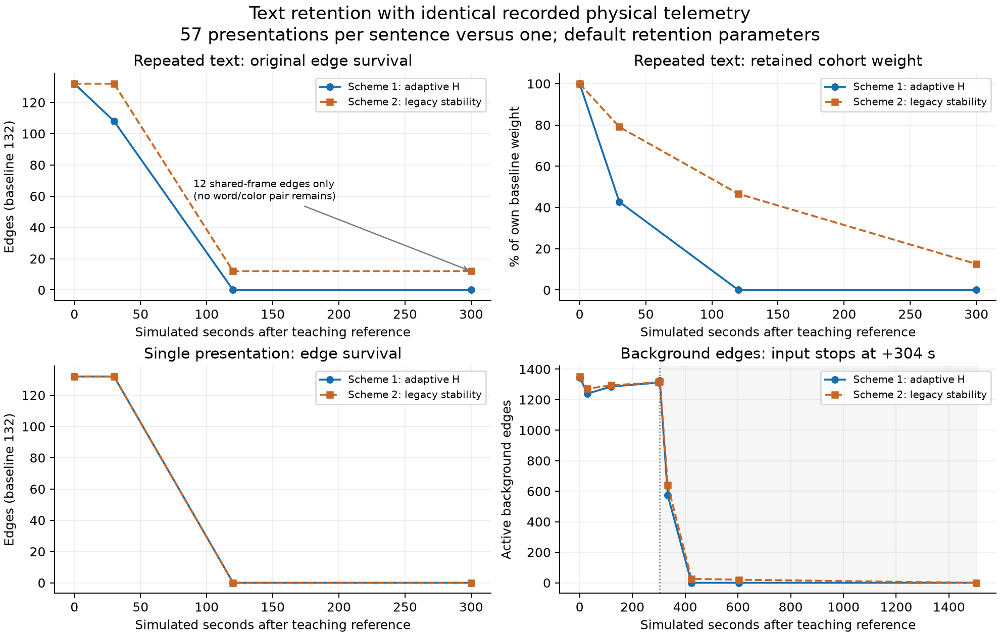
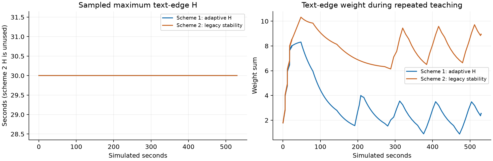
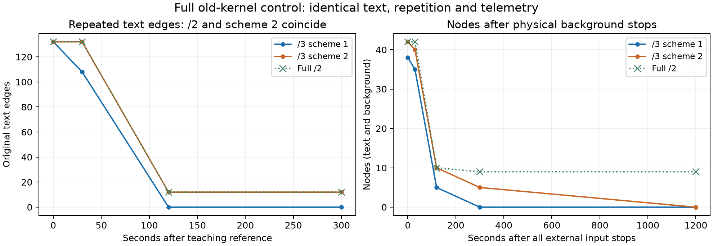

# 物理遥测背景下，文字连接的重复、保持与消退

> **修订 r4 · 2026-10-10**
> 修订原因：原件存储位置已迁移并核验，追加当前位置解析说明，保留原实验结论。
> 原版：[report.zh.md](report.zh.md)；父版本 r3：[report.r3.zh.md](report.r3.zh.md)

> **修订 r3 · 2026-10-10**
> 修订原因：补入十份嵌套逐条件原始结果的位置登记。
> 原版：[report.zh.md](report.zh.md)；父版本 r2：[report.r2.zh.md](report.r2.zh.md)

> **修订 r2 · 2026-10-10**
> 修订原因：生成证据移出 Git 并完成校验归档；追加位置登记，保留原字节与结论。
> 原版：[report.zh.md](report.zh.md)；父版本 r1：[report.zh.md](report.zh.md)

[English](report.en.md) · [原登记](protocol.md) · [整句输入追加登记](protocol-frame24.md) · [主结果](/api/v2/storage/research-artifacts/research-artifact:f5d5564a3a713898fc5e1c3c/content) · [统计](analysis.json) · [最终核验](verification.json)

2026-10-08。按用户要求比较修复后 `/3` 的方案 1 `adaptive-half-life` 与方案 2 `legacy-stability`；物理遥测只作背景，实际用例为文字。用户随后再次提醒适当重复；登记课程已经包含每句 57 次、先密后疏的重复，以及每句仅一次的对照。没有改 Core、默认参数、旧个体或 E64/E65/E66，不启动完整形色实验。

## 实测结论

**本条件下，方案 2 比方案 1 保留更多文字连接；但两方案都未保持住词语与颜色的特定关系，也没有测到可分辨的提示词联想。** 重复不是未安排：四句话各 57 次，共 228 次呈现。停止文字后 120 模拟秒，方案 1 的文字边已清空；方案 2 剩 12 条公共字符间的边，而 16 条词语字与对应颜色字的定向连接在两方案中均已消失。不能将这 12 条残存边解释为四组颜色知识保留。

随后依用户要求追加完整 `/2` 对照，其文字保持曲线与方案 2 一致，见末节。因此在本条件下，`/3` 默认方案相较完整旧版确有结构保持退化。没有参数搜索、背景关闭消融或完整语义答题，不能断言唯一原因是 H 增益，也不能归因于物理噪声或推广为全部能力退化。

图中连线仅连接登记采样点，不表示精确删除时刻。上排为重复组，左下为单次组；右下灰区是遥测停止后的诊断。两方案单次曲线重叠。

## 条件与完整保存

- 新空白 Core + 固定、非学习型 `TextSensor` + 冻结物理输入及游标；没有训练型语言译器、优化器或身体，结果不是完整意识的自然语言答题正确率。
- 真实物理来源为 E43 归档的 840 秒 OS 遥测，**不是本次实时采集**。保留 host 范围、实际时间戳与归一化，使用前 834 帧、38 个实际刺激通道、强度 0.2；不循环、不拉伸、不补造。process 和 runtime 自反馈未使用。三个分页指标不可用，原因保存在原记录，其余 18 项每项 841 个可用样本。两保持方案逐帧重放同一份记录。
- 文字为“苹果是红色的。”“树叶是绿色的。”“天空是蓝色的。”“雪花是白色的。”；已有 `literal-character` 编码、NFKC、seed=20261004、gain=1、intensity=1；整句同帧，按既有平方根规则归一化。Core 只接收匿名通道，字符标签只用于观察；不注入人工边，不做答案反馈。
- 同句复习间隔 0.5、2、4、8、16、32 秒，每句累计 57 次；单次组只接受共同末次呈现。530s 为保持基线。560/650/830s 分别是 +30/+120/+300s，**遥测一直在**。834s 停遥测，继续到 2034s 单列无外部输入诊断。单次与重复不是等剂量排程实验。
- 两组之间仅 `consolidation_mode` 不同。默认 H 下限 30s、上限 30 天、回落率 0.125、增益 0.2、对数饱和；普通学习与边固化开关开启，自动节点回收，留点/休眠/唤醒关闭。共同唯一非默认 Core 设置为 `quiescence_death_us=10^12`，为停止全部输入后仍能观察结构，不推断默认生命时长。
- 出生时预排全部既定输入，保存完整 Core 队列、出生定义、感官配置/接线、输入清单/游标和父哈希。每个提示测试从父保存点分出独立副本，输入“苹果”等提示，不带颜色；副本的学习不回写父线。原件、校验和及执行脚本均冻结保存。

## 首轮输入设计问题及纠正

完整保存的 [run-01](/api/v2/storage/research-artifacts/research-artifact:4189a35c606f227343fa1d3d/content) 每帧一个字。文字节点确实形成，但所有采样点 TT（文字—文字）与 TB（文字—背景）都为零。源码核查：默认 `edge_birth_policy=co-stimulus` 只用同帧触达对建立新边；单字帧没有两个不同文字节点。这是本次实验输入设计不适配，**不是连接先学会再被忘掉**。

在说明这一问题、追加登记后，run-02 建立四个新的空白对象，采用文字感官已有默认帧宽 24，七字句同帧。run-01 个体未替换外设、未重置，也没有删掉负结果。帧宽改变同时改变了同现方式和既有归一化幅度，因此不能将两批差别归因于遗忘方案。下述保持分析使用 run-02，且不把字共同出现称作字序或语义理解。

## 文字连接保持

按 530s 的端点节点 ID 与边出生时间固定原边集合，新建边不算原边留存。各组基线均有 132 条文字边；以下权重百分比相对**各自**基线。观察期未出现替代性新文字边。

| 课程 / 方案 | 基线权重总量 | +30s 原边数 / 权重留存 | +120s 原边数 / 权重留存 | +300s 原边数 / 权重留存 |
| --- | ---: | ---: | ---: | ---: |
| 57 次 / 方案 1 | 2.54104 | 108 / 42.74% | 0 / 0% | 0 / 0% |
| 57 次 / 方案 2 | 8.93211 | 132 / 79.04% | 12 / 46.61% | 12 / 12.59% |
| 单次 / 方案 1 | 5.45005 | 132 / 50.00% | 0 / 0% | 0 / 0% |
| 单次 / 方案 2 | 5.44355 | 132 / 50.52% | 0 / 0% | 0 / 0% |

方案 1 重复组终点权重总量甚至低于新近单次组；所以不能报告“多重复就更牢”。两组既有经历、节点稳定度/可塑性及边出生世代不同，这里没有拆分其因果。方案 2 的重复确实使部分结构更久保留；然而 +120/+300s 剩下的 12 条仅为“是、色、的、。”四个所有句子共有的字符之间的有向边。

八个提示字符与各自颜色字符构成的 16 条定向边，在四组基线和 +30s 都存在，+120s 全部消失。方案 2 的公共字符边直到 954s 仍有 12 条，1134s 已全部消失；说明本批旧稳定度也会遗忘，而非永久保存。上述删除时间均为采样区间，不冒称精确事件时刻。

## 提示测试与半衰期

每组在六个登记时点各测四个已教提示、一个未教“石桥”及无提示副本。run-02 共 144 个测试副本，其中 96 个已教提示、24 个未教提示；按登记的 0.5–1.0s 激活积分减去同源无提示，所有四个颜色通道的差值均为零，没有可分辨结果。0–2s 全窗最大绝对差仅 4.34×10^-19，也远低于登记门槛。**基线即没有测到关联表达，不能叙述为“原先答对、后来答错”。** 结构边存在与可用联想是两个不同结论；这是诊断读数，不是自然语言回答的 0% 得分。

方案 1 各登记点的文字边 H 为 30s。为防止错把稀疏采样理解成从未增长，又作了[结果后只读重放](trace-registration.md)：两种重复组各 422 个观察点，前 24s 每 100ms、之后每次原句输入后 100ms；采样文字 H 最大值仍为 30s，末态哈希严格等于原 t530。方案 2 的 H 字段不参与其遗忘。该采样不能排除采样之间极短的增长，但没有显示可持续的 H 保护。

源码中 H 只记成功通过传导门控和资源处理的发出量，普通同现学习仍强化权重/稳定度，并不直接延长 H；两方案都保留这条普通学习路径。图上仍在学权重，不意味着 H 同步增长。本批没有逐次记录每条边的门控前后信号及抑制/资源因素，因此**尚未证明**究竟是发出量太小、回落太快，还是这些机制共同限制了 H。也未给出合适的新默认。

## 背景连接与消退

有遥测期间，38 个背景通道在登记点形成约 1168–1368 条活跃背景边。到 830s，方案 1 有 1312 条，其中基线原边仅 20 条；方案 2 有 1314 条，其中原边 32 条。持续输入下“总边数仍很多”主要包含新建/重建，不能全部算作原背景记忆一直保留。

| 停止全部外部输入后 | 方案 1 背景边 | 方案 2 背景边 |
| --- | ---: | ---: |
| +30s | 574 | 640 |
| +120s | 0 | 26 |
| +300s | 0 | 20 |
| +1200s | 0 | 0 |

这些背景计数在相同方案的单次与重复组一致。所有主线最终节点也为零，休眠未启用。有限记录证明本批背景可消退，不证明无限期输入或不断新增通道下无增长。

**本批所有采样点的 TB 都为零。** 文字和遥测属于分开的刺激帧，在当前同帧出生策略下没有直接跨组连接。它满足同源物理背景持续运行的条件，但没有检验背景通过交叉连接干扰文字记忆；没有无背景对照，不能把文字失败归因于背景竞争。

## 核验、成本与后续建议

run-01 与 run-02 各自先通过两种模式的前 24s Python/Rust 完整状态比较（相对 1e-12、绝对 1e-14），以及各后端严格恢复续跑；run-02 四组 t530 恢复、分批推进及额外观察后哈希严格一致。全部提示副本确认未修改父状态。结果后重放又确认更频繁观察不改变两组 t530 状态。完整 2034s 主线为 Rust release，**没有宣称 Python 完整长程也逐帧对比过**。

run-02 四主线及副本总墙钟约 37.38s（含准备及后端前缀验证）。下表为一次执行，Core 计 `advance_to`，不含出生/入队；其余分类分列，尚有汇总、比较等未归类耗时。不是相同图、同负载上的性能排名。

| 条件 | Core / s | 观察 / s | 捕获与哈希 / s | 压缩写盘 / s | 副本恢复 / s |
| --- | ---: | ---: | ---: | ---: | ---: |
| 方案 1 重复 | 2.863 | 0.968 | 0.773 | 1.712 | 0.303 |
| 方案 2 重复 | 2.802 | 1.036 | 0.734 | 1.587 | 0.270 |
| 方案 1 单次 | 2.845 | 0.977 | 0.747 | 1.765 | 0.313 |
| 方案 2 单次 | 2.584 | 1.103 | 0.903 | 1.715 | 0.326 |

建议下一步先检查重复输入时局部有效传导量、H 增长与回落的数量关系，再讨论增益、回落率和传导门槛的对照；不能直接把增益提高视为已验证修复。若要回答文字能力，应另设能在教学结束时表达关联的基线，再测保持。若要回答背景干扰，应事前登记无背景及有实际交叉接触的对照。以上均为建议，本批不擅改机制、参数或增加完整教学。

R07/R40/R41、双语现代史及两份文言改编同步追加；旧报告和原门槛保留。重新运行使用独立输出目录，命令及不可变脚本见 [执行脚本](experiment.py)、run-01/run-02 的 `executed-experiment.py`；[分析脚本](analyze.py)只读证据并输出图，不推进 Core。

## 用户追加：完整 `/2` 旧版对照

用户在当前实验完成后要求用相同或类似用例检查 `/2`，怀疑修改造成退化。按[追加登记](protocol-v2.md)，[run-03](/api/v2/storage/research-artifacts/research-artifact:faff6cc6cda1c8514b36d4a4/content) 新建两个完整 `/2` 个体，重复和单次各一个，直接使用 run-02 冻结的感官、接线、输入文件和全部观察条件；使用 `/2` 自身节点回收规则，不向旧版移植 `/3` 的 H 或自动支持度。它不是对旧个体改版。先通过 `/2` 前 24s 独立 Python/Rust 完整状态及严格恢复比较，再运行完整 Rust 主线和 72 个提示副本。

| 重复 57 次后的文字指标 | `/3` 方案 1 | `/3` 方案 2 | 完整 `/2` |
| --- | ---: | ---: | ---: |
| 基线文字边 / 权重总量 | 132 / 2.54104 | 132 / 8.93211 | 132 / 8.93211 |
| +30s 原边 / 权重留存 | 108 / 42.74% | 132 / 79.04% | 132 / 79.04% |
| +120s 原边 / 权重留存 | 0 / 0% | 12 / 46.61% | 12 / 46.61% |
| +300s 原边 / 权重留存 | 0 / 0% | 12 / 12.59% | 12 / 12.59% |
| +120s 词色特定边 | 0 | 0 | 0 |

完整 `/2` 的**单次与重复两组，在全部登记点的文字分区统计均与 `/3` 方案 2 精确一致**，提示积分也一致。它在 120s 后剩下的同样只是公共字符边，基线也没有可分辨的颜色提示结果。故本批支持“默认 H 方案比旧版更快失去文字结构”，不支持“新版共同学习路径在这批文字上都坏了”，更不能解释成已证实自然语言能力整体倒退。

全状态并不一致：停止全部输入 1200s 后，`/3` 两种方案都无节点/边；`/2` 重复组还留 9 个无连接节点（4 个公共文字字符、5 个背景通道），单次组留 5 个背景节点。不能把节点多本身记作记忆更好。背景边数量在登记点相同；按共同通道接线和边出生时间对齐后，边身份、触达次数/时刻一致，边权最大差约 6.14×10^-10，稳定度差约 3.36×10^-10。这些是跨版本差异，不冒充完整状态严格一致，也未逐事件归因；不同个体内部节点 ID 不能直接互当语义身份。[详细核对](comparison-v2.json)

run-03 总墙钟约 15.11s；重复/单次纯 `advance_to` 分别约 2.061/1.791s，观察约 1.019/0.976s，捕获/哈希约 0.784/0.735s，压缩写盘约 1.529/1.484s。仍是单次小图耗时，不外推生产性能。319 个 run-03 文件校验通过；原两批与诊断的 1265 个文件校验仍通过。没有据此修改任何内核或默认参数。

## 数据位置修订

选定的生成证据已逐字节校验归档。原报告、评判标准、结论及数据内 source_commit 均保留。以下逻辑下载需要当前主机管理员身份，数据目录未整体公开。

`data/experiments/2026-10-08-retention-telemetry-text/`

[Location and hash index / 位置及哈希登记](../../artifact-index/2026-10-09-relocations.json)

- [run-01/results.json](/api/v2/storage/research-artifacts/research-artifact:4189a35c606f227343fa1d3d/content) — 293822 B; SHA-256 `8970b72ad813be9e532bcf8db728c789e9e54c7a884f468eb04dadf28ccf76bf`.
- [run-02/results.json](/api/v2/storage/research-artifacts/research-artifact:f5d5564a3a713898fc5e1c3c/content) — 352395 B; SHA-256 `832ad177a1310324b730cf89266b08d9d5594db368bcae29108329c3aec6b22a`.
- [run-03/results.json](/api/v2/storage/research-artifacts/research-artifact:faff6cc6cda1c8514b36d4a4/content) — 164104 B; SHA-256 `c7a1f6eee9dc92dd276fef4e47a15919dd7d2b26e29c9ec04abfe8d83c60a276`.
- [trace-01/results.json](/api/v2/storage/research-artifacts/research-artifact:532fc48cb808745696828269/content) — 190299 B; SHA-256 `16a60d8f3c01bbd2c1580f3f9471a91c98ff7b1cb59f47f956b3257885aacdb4`.

## 归档清单补充

防护复查补入十份嵌套的逐条件结果；此前它们已作为上下文原件归档，本次将其明确纳入历史移除及位置登记。测量与结论均未改变。

- [run-01/scheme1-repeat/result.json](/api/v2/storage/research-artifacts/research-artifact:299fb1dcf56393a667965212/content) — 90574 B; SHA-256 `876a64e2ac5bb669c396b2c0b24f15e63065334fa59382a0e8b11c643ae4364d`.
- [run-01/scheme1-single/result.json](/api/v2/storage/research-artifacts/research-artifact:9d7b8348eaa099f89319caf7/content) — 55742 B; SHA-256 `7d501e48cabfe76efa1c17e394f08a3de7fabdd3f3f8275358ffb55bd47b9772`.
- [run-01/scheme2-repeat/result.json](/api/v2/storage/research-artifacts/research-artifact:d83c2445e003353d7105a341/content) — 91108 B; SHA-256 `c8b5d4c9882fa0a91c6a70b7c86e84ff16c00b30abc2de92a5c4627523f28b83`.
- [run-01/scheme2-single/result.json](/api/v2/storage/research-artifacts/research-artifact:e30c563c200ee35667490571/content) — 56271 B; SHA-256 `b4bdeb8d2570529fd55fdc039a6e039b6fcc8cdc161e9f92fe17bdfb3d43a5dc`.
- [run-02/scheme1-repeat/result.json](/api/v2/storage/research-artifacts/research-artifact:f71897ed9c17911553b8f192/content) — 111195 B; SHA-256 `ae01641911bc32dbdac139f48bb64632f58a0552ca6d9866eb4ea8f2c2564031`.
- [run-02/scheme1-single/result.json](/api/v2/storage/research-artifacts/research-artifact:cfd8712691eb2d74aa635b4c/content) — 62135 B; SHA-256 `0116fb5483e85ce9cb6878ee2c20dab6afb4f8771f95822b774fc711e3865326`.
- [run-02/scheme2-repeat/result.json](/api/v2/storage/research-artifacts/research-artifact:058627a43eb16838f73ad45d/content) — 116530 B; SHA-256 `589413a2c8bfc88f16bcb6145a345d5f5861b835e522f431ce65e824ce51449f`.
- [run-02/scheme2-single/result.json](/api/v2/storage/research-artifacts/research-artifact:96d0bf4413f17c88a3117b93/content) — 62419 B; SHA-256 `8aac0b32f14109766022d20521045b28b2c9b7a7778a6cd0bf83a2da8ac57453`.
- [run-03/full-v2-repeat/result.json](/api/v2/storage/research-artifacts/research-artifact:b375a0fb1601e64e214cdf0e/content) — 107526 B; SHA-256 `db845ebf667b68f58daef80acfff7cad0c898ef34775eca2c9a2abb699475420`.
- [run-03/full-v2-single/result.json](/api/v2/storage/research-artifacts/research-artifact:f4ae2facdc971beec3fa670c/content) — 56450 B; SHA-256 `083d8610ef267d55b89ffbb4d962108de1176f79ebfe4a119dbb817df3a38605`.

> **存储位置修订 · 2026-10-10**
> 本版追加已核验的原件迁移说明：本次清单中的原件迁至 `E:\ThreeMindData`，科学身份、哈希、原实验日期、测量与结论不变。保留正文中的路径表示历史来源，当前位置通过已登记的证据引用解析。仓库文档与冻结夹具留在原处，源副本保留；结构化查询数据及运行中的检查点仍存数据库。本说明不表示缺失的历史资料已恢复。
