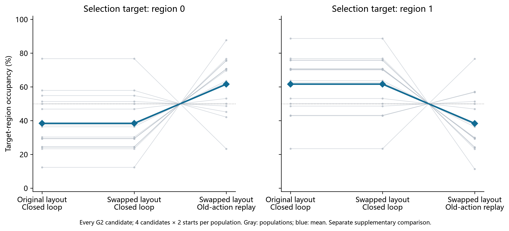

# AS63-02: Closed-loop control and action replay after a layout swap

Experiment completed on 17 November 2026; analysis completed on 18 November 2026. Core: threemind.continuous-memory/6.3.

**All 768 stages and their raw-state and trajectory audits are complete. Closed-loop control and old-action replay produced different regional occupancy after the layout swap, but the registered benefit in both selection directions was not achieved. Population means in both directional conditions still favored region 1, consistent with the absence of bidirectional differentiation in the primary study.**

## Question and expectation

This control asks whether, after the two regions exchange locations, actions based on current sensory input and internal activity improve target-region occupancy relative to replaying actions recorded in the original layout. A benefit is expected in both selection directions. The target is defined by the selection condition and is never changed in response to the results. Calling a condition “region 0 selection” does not presume that it has successfully produced a region 0 preference.

The author explicitly authorized this layout control while AS63-01 was running. Its protocol, sample, and criteria were registered separately before any layout-intervention copies were created. The primary study's fixed layout, generational scores, and decision rules remain unchanged.

## Comparison procedure

The sample includes all 192 G2 candidates from the primary study: 16 independent populations, three selection conditions, and four candidates per condition. Candidates are not selected for good performance. Each is tested from positions 0.1875 and 0.6875.

The original-layout reference is taken directly from the corresponding saved primary assessment. For each candidate and start, two new research copies begin with the candidate's complete post-development state. Their bodies are placed at the same starting position with velocity zero, and the two regions exchange locations. Region identity follows the sensory pattern: region 0 retains its original stimuli and region 1 retains its own, while the physical semicircles they occupy are exchanged.

One copy generates actions from current sensory input and Core activity. The other applies the original-layout reference's recorded motor command at each corresponding 0.1-second interval. The replay copy's Core continues to receive current sensory input, background stimulation, and energy. Its proposed actions are recorded but do not drive the body. Both copies run continuously for 60 internal seconds. Initial Core state, observation and input history, energy-supply state, and internal schedules match the corresponding primary candidate. Apart from the declared body positioning, layout swap, and motor source, conditions are unchanged.

There are 384 new stages per condition and 768 in total. These research copies remain nested within the original 16 populations and do not increase the independent sample size. They neither reproduce nor write their experience back to the original candidates.

## Preregistered decision rules

Scores are first averaged over two starts for each candidate and then over all four candidates within a population and selection condition. The primary contrast is target-region occupancy under closed-loop control minus occupancy under old-action replay, both in the swapped layout. Region 0 and region 1 selection are tested separately. Each direction must show a mean benefit of at least 1 percentage point and a Holm-adjusted one-sided exact sign-test P≤0.05. Both are required for the combined goal.

The two tests form a separate family from the eight primary-study comparisons. Absolute differences of at most 10⁻¹² count as ties. Mean-difference 95% intervals use 20,000 population bootstrap samples with a fixed seed. Original-versus-swapped closed-loop performance and the random-selection condition describe behavior; they do not replace the primary criteria.

## Results

### Closed-loop control versus old-action replay

The table scores each directional condition against its originally specified target region. Every entry is a mean over 16 independent populations, including all four G2 candidates and both starts per candidate.

| Selection condition and scored region | Original layout: closed loop | Swapped layout: closed loop | Swapped layout: old-action replay |
| --- | ---: | ---: | ---: |
| Region 0 selection: region 0 occupancy | 38.392% | 38.392% | 61.608% |
| Region 1 selection: region 1 occupancy | 61.648% | 61.648% | 38.352% |
| Random selection: descriptive region 1 occupancy | 61.702% | 61.702% | 38.298% |

For region 0 selection, closed-loop control reduced target occupancy by 23.216 percentage points relative to old-action replay. The mean-difference 95% interval was −38.221 to −6.849 percentage points. Four populations improved and 12 declined. The registered positive-direction one-sided test had a Holm-adjusted P of 0.989365. The observed direction was opposite to the expected benefit.

For region 1 selection, closed-loop control increased target occupancy by 23.297 percentage points, with a 95% interval of 6.872 to 38.753. Twelve populations improved and four declined. The one-sided exact sign test gave an unadjusted P of 0.0384064 and a Holm-adjusted P of 0.0768127 across the two directions. The mean benefit therefore exceeded 1 percentage point, but the adjusted P did not meet the registered 0.05 threshold. The displayed mean intervals are not adjusted for multiple comparisons; the registered adjusted tests determine the formal decisions.

Neither comparison met all its requirements, and the joint goal was not achieved. The decrease for region 0 and increase for region 1 cannot be combined into a claim that both directions succeeded. Selection targets are not replaced after the fact by whichever region a population occupied more often.

Figure 1. All G2 candidates under original-layout closed-loop control, swapped-layout closed-loop control, and swapped-layout replay of old actions. Gray lines connect population means; blue shows the mean across 16 populations. Region identity follows its sensory pattern. Equality of the original and swapped closed-loop means must be read alongside the symmetric-start explanation below.

### Why the two closed-loop layout means are equal

The two starts are half a circumference apart, as are the two layouts. Retrospective checks showed that, for all 192 candidates, swapped-layout closed-loop occupancy from one start equaled original-layout occupancy from the opposite start. The maximum difference across all 384 corresponding values was zero. Averaging over the two starts therefore gives identical original and swapped regional occupancy. This agrees with the apparatus's spatial symmetry; equality of these averages alone does not establish adaptation to a new environment through learning.

Old-action replay instead preserves the original physical trajectory. Swapping the regions exchanges their identities along that trajectory, so region 1 occupancy becomes the complement of its original value. Closed-loop control does not mechanically repeat that trajectory: it continues generating actions from current sensory input and Core activity, producing different regional occupancy. This comparison establishes an effect of the current control loop on behavior. It does not establish that artificial selection produced the two intended opposite preferences.

## Scientific conclusion and relation to the primary study

The study observed behavioral differences between current closed-loop control and old-action replay. Closed-loop control had higher mean performance for the prespecified region 1 target; replay had higher mean performance for the region 0 target. Random selection produced a similar overall regional distribution, so these results cannot be attributed specifically to directional selection.

AS63-01 showed that opposite selection conditions did not differentiate the current populations as intended. AS63-02 adds that the candidates' existing behavior depends on current sensory conditions and the source of motor commands, while failing the registered goal of a benefit in both selection directions after the swap. The observed control effect and the unfulfilled expectation are both retained. This supplement does not alter the primary decisions on generational accumulation, selection advantage, or the benefit of inherited state.

## Apparatus and evidence checks

Independent apparatus checks first established that, with the layout unchanged, closed-loop control and replay of the same actions produced identical complete final states. A layout swap changed the sensory channels associated with a physical position without changing the copy's initial Core state. Formal execution began only after primary computation ended. Production Core code is unchanged.

The analysis checked complete-state hashes, the copied initial state, sensory region identity, applied actions, and body trajectories for every stage. Closed-loop commands were reconstructed from saved node activity. Replayed commands were compared step by step with the original primary actions, and body trajectories were checked against the original-layout reference. Occupancy was recomputed from raw step records. All 768 stages passed, with no deaths. Scientific execution took 1722.32 host seconds, approximately 28.7 minutes. A separate standard-library calculation using binomial coefficients reproduced both sign tests and their Holm adjustment. The symmetric-start check is explicitly retrospective and descriptive; it adds no success criterion. These checks are internal verification by the same assistant.

## Evidence locations

- [Registered protocol](layout-protocol.en.md) and [primary report](report.en.md).
- [Statistical tables](tables.en.md), [compact complete summary](summary.json), and [delivery receipt](layout-delivery.json).
- The analysis-v1 directory contains audit.json, analysis.json, stages.csv, population-scores.csv, statistics-check.json, and layout-symmetry.json. The last file is generated by describe_layout_symmetry.py.
- New originals: E:/WORKSPACE/AgentWork/threemind/.work/artificial-selection63-layout-20261117.
- Source candidate states and original-layout actions: E:/WORKSPACE/AgentWork/threemind/.work/artificial-selection63-20261117.
- Research project: d0a04159-ee0f-4200-ada9-13d5ce7197b7; record: d268901c-e0df-5de0-a809-2775a0ef0065.
- Rechecking this study requires both evidence packages because the primary study provides the source candidates and replay commands. These primary records were neither rerun nor overwritten.

