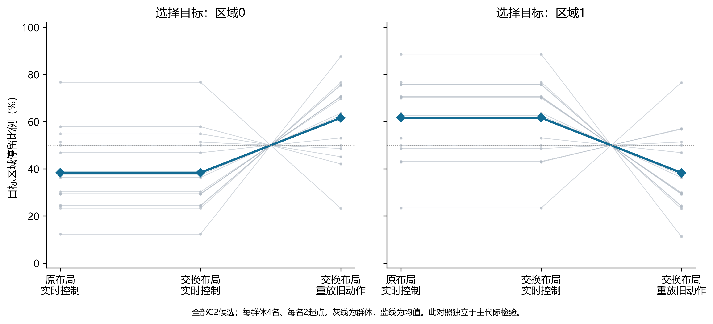

# AS63-02：交换区域布局后的实时控制与动作重放

2026-11-17完成实验，2026-11-18完成分析。内核：threemind.continuous-memory/6.3。

**本批768段测试及原始状态、轨迹核验已经完成。交换布局后，实时控制与旧动作重放产生了不同的区域占据，但没有实现预定的双向目标收益。两个定向选择条件的群体均值仍偏向区域1，与主实验未形成双向分化的结果一致。**

## 问题与预期

本对照检验：两个区域交换位置后，个体利用当前感知和内部活动控制动作，是否比机械重放原布局中的动作更有利于进入并停留在所选择的目标区域。预期实时控制在两个选择方向上均有收益。这里的“目标区域”始终由人工选择条件规定，不因测试结果改变；称为区域0选择组，并不预先断言该组已经形成区域0偏向。

作者在AS63-01进行中明确允许增加布局对照。我们在创建布局干预副本前，单独登记了本方案、样本和判据。主实验的区域布局、代际成绩和判定标准保持不变。

## 如何比较

我们使用主实验全部16个独立群体、三个选择条件的全部第2代候选，共192名，不只选成绩好的个体。每个候选都在两个起点接受对照测试，分别为0.1875和0.6875。

原布局下的参照直接采用主实验已经保存的相应测试记录。对于每个候选及每个起点，我们再从该候选培养完成时的完整状态建立两个研究副本，把身体放到相同起点、速度归零，并交换两个区域的位置。区域的身份随感官图案移动：区域0仍提供原区域0的刺激，区域1仍提供原区域1的刺激，只是二者占据的半圈交换。

第一个副本根据当前感知和内核活动实时生成动作。第二个副本每0.1内部秒重放原布局参照在相同时段产生的运动指令。重放副本的内核仍接收当前位置带来的感官输入、背景刺激和供能，其自身提出的动作也被记录，但这些建议不控制身体。两个副本均连续观察60内部秒。它们的内核初态、观察与输入历史、供能状态和内部计时均与主实验的对应候选相同；除了声明的身体定位、布局交换及动作来源，其他条件不变。

每种新增条件包含384段测试，两种合计768段。它们属于原有16个群体的研究副本，不增加独立样本量，也不参与后续繁殖。副本经历不写回原候选。

## 事前判定

每名候选先平均两个起点的成绩，每个群体再平均同一选择条件下的全部4名候选。主要比较是交换布局后，实时控制相对于旧动作重放的目标区域停留比例差。区域0选择和区域1选择分别检验；两项各自都须平均提高至少1个百分点，并满足Holm校正后的单侧精确符号检验P≤0.05，才完成预定的双向目标。

本批的两项检验独立于主实验的八项比较。绝对差不超过10⁻¹²计作平局，均值差95%区间使用固定种子的20,000次群体自助抽样。原布局与交换布局的实时控制比较，以及随机选择条件的结果，用于描述行为，不替代上述主要判据。

## 实验结果

### 实时控制与旧动作重放的结果

下表按各选择条件原先规定的目标区域计分。每项都是16个独立群体的均值，各群体包含全部4名第2代候选及每名候选的两个测试起点。

| 选择条件及计分目标 | 原布局：实时控制 | 交换布局：实时控制 | 交换布局：旧动作重放 |
| --- | ---: | ---: | ---: |
| 区域0选择，计区域0停留比例 | 38.392% | 38.392% | 61.608% |
| 区域1选择，计区域1停留比例 | 61.648% | 61.648% | 38.352% |
| 随机选择，描述区域1停留比例 | 61.702% | 61.702% | 38.298% |

区域0选择条件中，实时控制相对重放旧动作使目标区域停留比例下降23.216个百分点，均值差的95%区间为−38.221至−6.849个百分点。16个群体中4个提高、12个下降，事前规定的正向单侧检验经Holm校正后P=0.989365。实际结果与该方向预期的收益相反。

区域1选择条件中，实时控制相对重放旧动作使目标区域停留比例提高23.297个百分点，95%区间为6.872至38.753个百分点；12个群体提高、4个下降。单侧精确符号检验的原始P=0.0384064，两个方向共同校正后P=0.0768127。因此，这个方向的实际均值差超过了1个百分点，但没有满足校正P≤0.05的预定要求。表中的均值区间未经多重比较校正；正式判定仍按登记的校正检验执行。

两项比较均未满足各自全部要求，双向联合目标未完成。区域0条件的下降与区域1条件的上升不能互相抵消后改写为两个方向都成功，也不能把选择标签改成各群体事后表现较好的方向。

图1。全部第2代候选在原布局、交换布局实时控制和交换布局旧动作重放条件下的表现。灰线连接同一群体，蓝线为16群体均值。区域身份由感官图案规定。图中原布局与交换布局实时控制的均值相同，须结合下述对称起点说明理解。

### 为何原布局和交换布局的实时控制均值相同

本对照的两个起点相隔半圈，两种区域布局也恰好相差半圈。事后核对发现，在全部192名候选中，从一个起点进行交换布局实时测试，得到的区域停留比例都与原布局下另一个起点的结果相同；384项对应值的最大差为0。因此，将两个起点取平均后，原布局和交换布局的区域占据必然相同。这与本装置的空间对称性一致，不能单凭这一均值相等就认定个体通过新学习适应了新环境。

旧动作重放则保留原来的物理轨迹。两个区域交换位置后，同一轨迹上的区域身份互换，区域1停留比例变成原比例的补数。实时控制没有机械复现这条原轨迹，而是利用当前感官输入和内核活动继续产生动作，所以两种条件得到不同的区域占据。该比较说明当前闭环控制对行为结果有作用；它不证明人工选择已形成所要求的两个相反偏向。

## 科学结论与主实验的关系

本批观察到了实时闭环控制与旧动作重放之间的行为差异。对于预设的区域1目标，实时控制的平均表现更高；对于区域0目标，重放的平均表现更高。随机选择组也呈现相近的总体区域分布，因而不能把这种表现专门归功于定向选择。

AS63-01已经显示，两种相反选择没有使当前群体按预期分化。AS63-02进一步说明，这些候选的现有行为会随当前感官与控制方式而表现不同，但没有完成“两个选择方向都在交换布局后获益”的预定目标。前者是实际观察到的控制作用，后者是未完成的研究预期，两者分别保留。布局对照没有改变主实验关于代际积累、选择收益及继承状态收益的判定。

## 工具与原件核验

独立装置检查先确认：在不改变布局时，实时控制和重放相同动作具有完全相同的终态；交换布局会改变相同物理位置对应的感官通道，但不改动研究副本的初始内核状态。正式运行只在主实验结束后开始，没有修改生产内核。

分析程序逐段核对了完整状态哈希、初态继承、区域的感官身份、实际施加的动作和身体轨迹。实时条件的动作由已记录的节点活动重新计算；重放条件与主实验原动作逐步核对，身体轨迹也与原布局参照核对。最后从原始逐步记录重新计算停留比例。全部768段通过核验，没有个体死亡；科学运行耗时1722.32宿主秒，约28.7分钟。另用标准库的二项组合数复算了两项符号检验及Holm校正，结果一致。对称起点检查标为事后描述，不添加成功标准。检查由同一助手完成，属于内部复核。

## 证据位置

- [本批方案](layout-protocol.zh.md)、[主实验报告](report.zh.md)。
- [统计表](tables.zh.md)、[完整小型汇总](summary.json)、[交付回执](layout-delivery.json)。
- 原件分析目录analysis-v1中包含audit.json、analysis.json、stages.csv、population-scores.csv、statistics-check.json和layout-symmetry.json；后者由describe_layout_symmetry.py生成。
- 新增原件：E:/WORKSPACE/AgentWork/threemind/.work/artificial-selection63-layout-20261117。
- 所用候选初态及原布局动作：E:/WORKSPACE/AgentWork/threemind/.work/artificial-selection63-20261117。
- 科研项目：d0a04159-ee0f-4200-ada9-13d5ce7197b7；本批记录：d268901c-e0df-5de0-a809-2775a0ef0065。
- 复核本批需同时取得两个证据包，因为主实验提供了原始候选及重放动作的来源。本批没有重跑或覆盖这些主实验记录。

