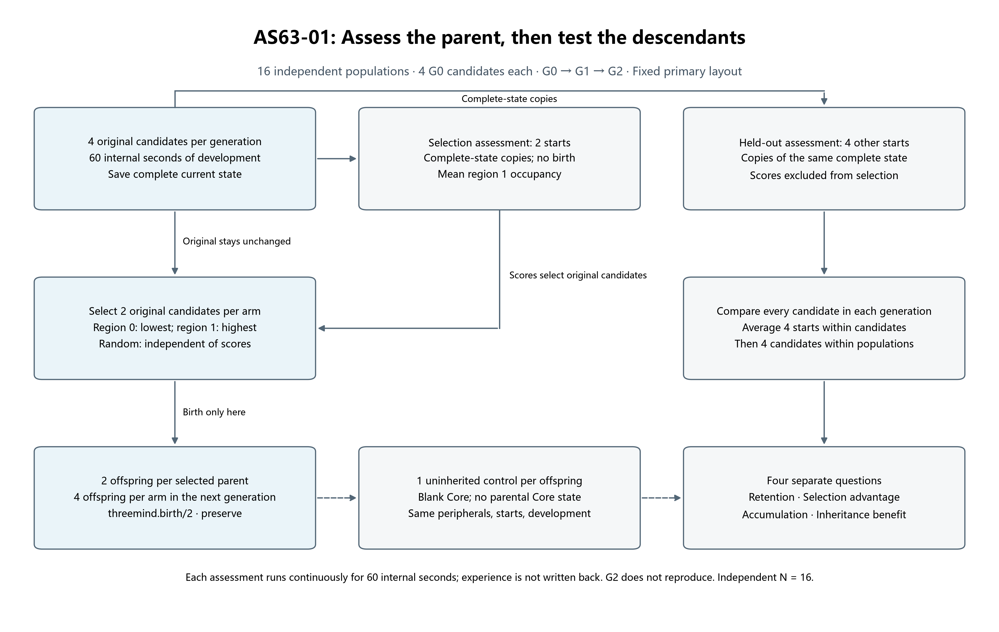
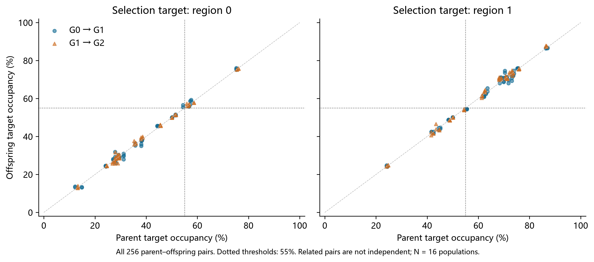
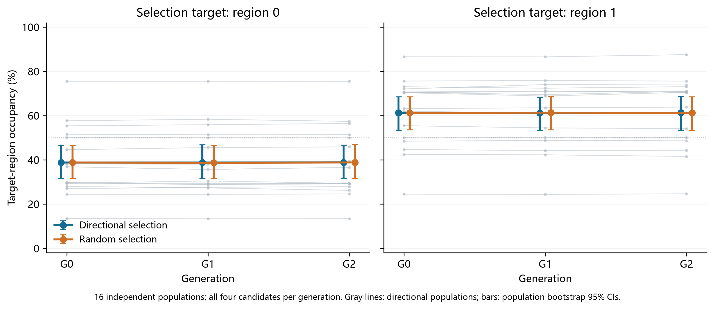
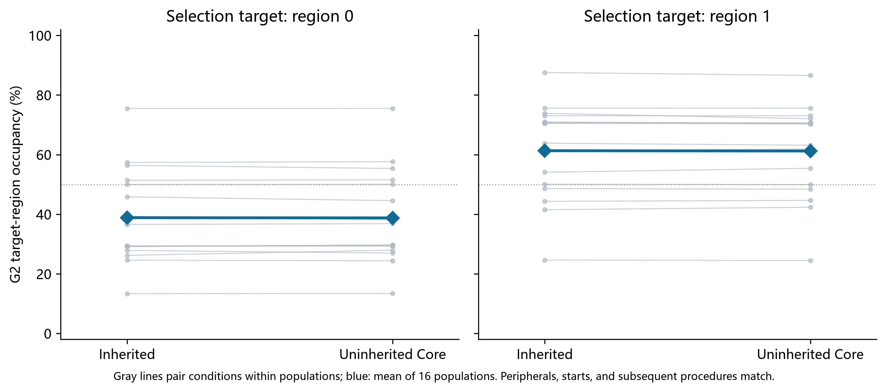
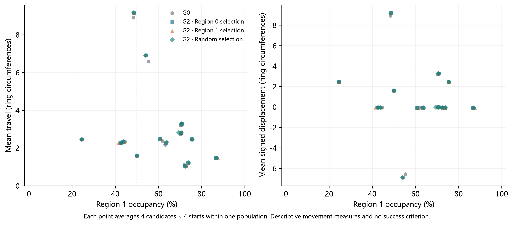

# AS63-01: Artificial selection and behavior across generations in a fixed ring environment

17 November 2026. Core: threemind.continuous-memory/6.3. Birth rule: threemind.birth/2, decay_age=preserve.

**Primary computation and the raw-evidence audit are complete: 16 independent populations and 5,056 stages, with no deaths. Some existing parental regional tendencies reappeared in descendants, but no population met the combined retention criterion in both directions across both transmissions. Directional selection, successive-generation improvement, and inheritance benefits over blank-Core controls did not meet their preregistered criteria.**

These results distinguish two facts. Parents and offspring can behave similarly, but that similarity alone does not establish that artificial selection strengthened the behavior or that the behavior required inheritance of the parental Core state. Random-selection and uninherited controls directly test those additional questions.

## Research questions

This experiment first establishes a parent's own regional tendency and then asks whether that tendency persists in its offspring and grandchildren. It also tests whether selection in opposite directions outperforms random selection and strengthens the corresponding tendency across generations. Matched controls that do not inherit the parental Core state test the behavioral benefit of that inheritance after the same subsequent development.

This is a new artificial-selection experiment. The earlier E13 procedure selected parents using assessments of newborn copies. Here, assessment copies preserve a candidate's complete current state; only the selected original candidates produce formal offspring. The earlier layout-swap and action-replay controls remain part of the historical evidence. Changing the layout was not itself a design error. The new primary study keeps the layout fixed so that generations are compared under the same conditions. The separately registered AS63-02 study tests layout changes without altering the primary scores.

## Experimental design

Figure 1. Parent assessment and formal reproduction. Assessment copies retain the candidate's complete state, while the original candidate remains the source of offspring. After development, offspring undergo the same assessment and selection procedure through G2.

### Environment, sensory input, and movement

The ring circumference is normalized to 1. Region 0 occupies positions [0, 0.5), and region 1 occupies [0.5, 1). Each region supplies a distinct sensory pattern through four fixed anonymous channels. Their locations and sensory identities remain unchanged throughout the primary experiment.

Each independent population uses sensory and motor mappings determined by its seed. These mappings remain fixed across its selection conditions, descendants, and matched controls. Sensory input is delivered every internal second and includes region, direction, and speed information. Every 0.1 internal seconds, a fixed motor adapter projects node activations through fixed positive or negative coefficients to generate a movement command. Movement changes the subsequent sensory input. The adapter is not trained and receives no selection target, reward, or correct action. A separate background channel supplies input of intensity 0.2 every 0.5 internal seconds.

The apparatus uses the existing Core 6.3 dynamics and defaults, with explicit energy accounting and external supply enabled. It provides 1 energy unit every 0.1 internal seconds without a total supply limit; normal costs remain active. This study therefore tests artificial selection, not natural selection caused by energy scarcity. Production Core code and global defaults are unchanged. The recording procedure retains all inputs, actions, node activity, body trajectories, and complete initial and final states.

### Individuals, assessment, and reproduction

The formal sample consists of 16 independent populations with seeds 1117100–1117115. These seeds determine the sensory and motor mappings as well as the Core configuration's seed and energy_seed values; complete configurations are preserved. Each population begins with four blank G0 individuals at positions 0.125, 0.375, 0.625, and 0.875. Each develops continuously for 60 internal seconds. Apparatus checks use the separate seed 1117099, which is excluded from the formal sample.

Every assessment begins with a complete-state copy of a candidate after development. The copy preserves the Core, input queue, observation and input history, energy supplier, and internal schedules. The only declared measurement interventions are moving the copy's body to a specified starting position and setting its velocity to zero. Assessment does not call the birth rule or clear current Core activity. Assessment experience is not written back to the original candidate. The original remains at its current internal time while each assessment copy runs continuously for 60 internal seconds.

Selection scores average region 1 occupancy at two starting positions, 0.0625 and 0.5625. Separate held-out assessments use four other starts: 0.1875, 0.4375, 0.6875, and 0.9375. Held-out scores never enter parent selection. Every generation uses the same selection and assessment procedures.

Each population has three selection conditions: toward region 0, toward region 1, and random selection. Region 0 selection takes the two lowest selection scores; region 1 selection takes the two highest. Ties are resolved by candidate index. The random condition uses a fixed random rule that does not inspect scores. The three conditions share the same G0 candidates and subsequently breed separately.

Each selected parent produces two offspring under threemind.birth/2, giving four offspring per condition and generation. Offspring inherit the specified persistent Core state and decay ages, while short-term state and internal time are initialized by the existing birth rule. Fixed peripherals retain the parental mappings. No extra mutation, recombination, or target-directed weight changes are introduced. Offspring develop continuously for 60 internal seconds from the prescribed four starts and then undergo the same assessments. The study includes two reproductive transitions, G0→G1 and G1→G2. G2 does not reproduce.

Every formal offspring has a matched control with a blank Core that does not inherit the parental Core state. Configuration, peripherals, body parameters, developmental start, and subsequent procedures match the corresponding offspring. Controls also develop for 60 internal seconds and complete the four held-out assessments, but they do not enter selection or reproduction. This comparison measures the contribution of inheritance after equal subsequent development, not the immediate difference at birth.

### Counts and statistical units

Each population contains four G0 candidates and four descendants in each of three selection conditions at G1 and G2: 28 formal individuals in total, plus 24 matched uninherited controls. Each formal individual completes one developmental stage, two selection assessments, and four held-out assessments. Each control completes one developmental stage and four held-out assessments. This gives 316 stages per population and 5,056 stages across 16 populations, each lasting 60 internal seconds.

There are 448 formal individuals: 64 founders and 384 descendants. There are also 384 uninherited controls and 4,224 assessment copies. The independent sample size is always 16 populations. Candidates, descendants, starts, and copies within a population do not count as additional independent replicates.

Occupancy is calculated from the region recorded for each 0.1-second interval and divided by the fixed 60-second observation period. Scores are first averaged over a candidate's four held-out starts and then over all four candidates within each population, generation, and selection condition. Populations have equal weight. Every descendant enters the analysis, not only the best performers. Trajectories, travel distance, and signed displacement describe movement; stationary behavior and circling are neither excluded nor penalized.

## Four preregistered tests

| Question | Preregistered criterion |
| --- | --- |
| H1: Does an existing parental tendency persist across two transmissions? | A selected parent must spend at least 55% of assessment time in the target region to qualify as expressing that tendency. At least 75% of all offspring of qualifying parents must also reach 55%. A population must satisfy this requirement in both directions and both transmissions. At least 4 of 16 populations must meet the combined criterion. A direction with no qualifying parent is not treated as a test of retention. |
| H2: Does directional selection outperform random selection? | At G2, each direction must improve target occupancy by an average of at least 1 percentage point over its paired random-selection condition, with adjusted one-sided P≤0.05. Both directions are required. |
| H3: Does the target tendency strengthen in each generation? | For each direction, both G1−G0 and G2−G1 must average at least 1 percentage point, with adjusted one-sided P≤0.05. All four adjacent-generation comparisons are required, using every candidate. |
| H4: Does Core-state inheritance provide a positive benefit? | At G2, each direction must exceed its individually matched uninherited controls by an average of at least 1 percentage point, with adjusted one-sided P≤0.05. Both directions are required. |

H2, H3, and H4 comprise eight population-level, one-sided exact sign tests, with a common Holm correction. Absolute differences of at most 10⁻¹² are treated as ties and excluded from the effective sign-test sample. Mean-difference 95% intervals use 20,000 population bootstrap samples; the H1 population proportion uses an exact binomial interval. Thresholds, seeds, generations, and developmental procedures were specified before formal execution. Materials are not added in response to the results.

## Results

### Parent–offspring consistency and the absence of bidirectional selection

For region 0 selection, five selected G0 parents met the 55% threshold. All ten of their offspring also met it. All twelve offspring of six qualifying G1 parents met the same threshold. Both transitions involved the same three independent populations. For region 1 selection, 40 of 44 offspring of 22 qualifying G0 parents met the threshold, as did all 40 offspring of 20 qualifying G1 parents. Ten independent populations met the directional retention criterion in each transition. Thus, some existing parental regional tendencies did reappear in offspring and grandchildren. The individual parent–offspring pairs are not independent samples.

However, qualifying parents in the two directions came from different populations. Thirteen populations had no selected G0 parent reaching 55% for region 0, and five had none for region 1. No population had qualifying selected parents in both directions. Clear differences were already present between populations at G0, whereas the four candidates within a population generally favored the same side. Selecting the two best region 0 scores therefore did not necessarily select individuals that actually favored region 0.

The combined H1 outcome was consequently 0/16 populations, below the required 4/16. The exact 95% interval for this population proportion was 0–20.591%. This primarily reflects the absence of qualifying parents in both directions within the same population; it is not evidence that existing tendencies generally failed to persist. An observed threshold loss is also retained: population 1117112's mean region 1 occupancy fell from 55.427% at G0 to 54.427% at G1, with all four offspring below 55%, and was 54.104% at G2.

Figure 2. All 256 parent–offspring pairs in the two selection directions. Each point shows an offspring's and its parent's mean score across four held-out starts. Dotted lines mark the preregistered 55% threshold. Related pairs remain nested within 16 independent populations.

### Directional selection did not achieve the registered benefit over random selection

At G2, the region 0 selection condition spent an average of 38.845% of assessment time in region 0, compared with 38.803% under paired random selection. The benefit was 0.042 percentage points, with a 95% interval of −0.167 to 0.204 percentage points and Holm-adjusted P=0.473877. For region 1 selection, the corresponding means were 61.324% and 61.197%. The benefit was 0.127 percentage points, with a 95% interval of −0.105 to 0.340 and adjusted P=1.

Neither direction met the joint requirements of a mean benefit of at least 1 percentage point and adjusted P≤0.05. The registered selection advantage was therefore not established. The fact that the selection procedure chose relatively high-scoring candidates does not itself demonstrate an effective response to selection.

### Performance did not improve in successive generations

| Selection condition and scored region | G0 | G1 | G2 |
| --- | ---: | ---: | ---: |
| Region 0 selection: region 0 occupancy | 38.780% | 38.772% | 38.845% |
| Region 1 selection: region 1 occupancy | 61.220% | 61.124% | 61.324% |
| Random selection: region 0 occupancy | 38.780% | 38.671% | 38.803% |
| Random selection: region 1 occupancy | 61.220% | 61.329% | 61.197% |

The two adjacent-generation changes were −0.008 and +0.073 percentage points for region 0 selection, and −0.096 and +0.200 for region 1 selection. All four Holm-adjusted P values were 1, and none reached the required 1-percentage-point improvement. The registered pattern of improvement in each generation did not occur. A slightly higher G2 mean than G0 cannot substitute for evidence of improvement across both successive transmissions.

Figure 3. Target-region occupancy of every candidate by generation. Gray lines show the 16 directional-selection populations. Blue and orange show directional- and random-selection population means, with population bootstrap 95% intervals. Assessment conditions are identical across generations.

### Blank-Core controls produced similar behavior

For region 0 selection at G2, inherited individuals had mean target occupancy of 38.845%, compared with 38.780% in matched uninherited controls: a difference of +0.065 percentage points, with a 95% interval of −0.305 to 0.426. For region 1 selection, the means were 61.324% and 61.220%: +0.104 percentage points, with a 95% interval of −0.238 to 0.456. Both adjusted P values were 1, and neither direction met the registered inheritance-benefit criterion.

The birth audit confirmed that formal offspring inherited the specified parental state. The behavioral comparison nevertheless did not show a target benefit of at least 1 percentage point after equal 60-second development. Blank Cores with the same configuration, peripherals, and subsequent experience produced similar performance. Parent–offspring similarity therefore cannot be attributed to persistent-state inheritance alone. This finding concerns target-region behavior after the specified development; it does not establish that inherited state has no effect at any time or on any behavior.

Figure 4. G2 inherited and uninherited conditions. Each gray line connects matched population means. The blue line shows the mean across 16 populations.

### Occupancy near 50% included sustained circling

The raw trajectories preserve movement information beyond regional occupancy. For example, population 1117107 spent a mean of 48.438% of G0 assessment time in region 1. Both its mean travel and signed net displacement were 8.909 ring circumferences, showing sustained movement in one direction around the ring. Population 1117108 had mean region 1 occupancy of 49.948%, with both mean travel and signed displacement equal to 1.575 circumferences. It was also moving rather than stationary.

At G2, across the three selection conditions, population 1117107 still had region 1 occupancy of approximately 48.6% and traveled about 9.17 circumferences. Population 1117108 occupied region 1 for approximately 50.1% and traveled about 1.59 circumferences. Both movement patterns remain in the records and summaries. Occupancy near one half means that this measure shows little regional preference; it does not mean that the individual lacks a behavioral tendency or takes no action.

Figure 5. Regional occupancy and movement. Each point averages four candidates and four held-out starts per candidate within a population. Travel measures total movement; signed displacement retains direction. Both use ring circumference as the unit. These descriptive measures add no success criterion.

## Conclusions and implications

| Goal | Observed result | Decision and scientific conclusion | Evidence |
| --- | --- | --- | --- |
| H1: Retention in both directions across two transmissions | Some qualifying parents had offspring with the same tendency, but 0/16 populations met both directions and both transitions | The registered bidirectional feasibility goal was not confirmed. Directional parent–offspring consistency was observed, while many populations lacked qualifying parents for the opposite direction | Parent–offspring and retention records; Figure 2 |
| H2: Selection advantage | Benefits over random selection were +0.042 and +0.127 percentage points | Neither direction met the required effect size and adjusted significance; the registered benefit was not confirmed | Eight-contrast table; Figure 3 |
| H3: Successive-generation improvement | Both directional means decreased slightly at G1 and increased slightly at G2; all four adjacent-generation tests failed their criteria | Improvement across both successive transitions was not confirmed | All-candidate generation means; Figure 3 |
| H4: Inheritance benefit | Benefits over uninherited controls were +0.065 and +0.104 percentage points | A benefit of at least 1 percentage point after equal development was not confirmed | Matched controls; Figure 4 |

The upper limits of all eight mean-difference 95% intervals were below 1 percentage point; the largest was 0.557. Thus, the registered benefit was not attained, and intervals too wide to assess that minimum benefit were not the main difficulty. This is not a proof of exactly zero effect. Smaller differences remain reported with their unrounded values and uncertainty.

For ThreeMind, the study establishes a concrete distinction. Transmission of internal state under the birth rule can accompany similar parent–offspring regional behavior, but behavioral controls are still needed to establish a target benefit from selection or inheritance. Within three generations, this fixed ring apparatus did not separate a population into the two intended opposite tendencies or produce accumulation across generations. The expectation that this arrangement would progressively strengthen target behavior through artificial selection was not supported.

Retrospective interpretation suggests that a subsequent study should first determine whether one initial population contains sufficiently different behaviors that remain stable across starts, and whether those differences depend on inheritable Core state. These data do not localize the cause to a specific Core rule or peripheral component. That interpretation is not treated as a verified mechanism and does not authorize Core changes or extra generations. This study closes as a valid negative result, while E13 and other completed evidence remain intact.

The study's contribution is to distinguish parent–offspring similarity, effective artificial selection, improvement across generations, and a benefit from inherited state using separate controls. The current apparatus showed parent–offspring consistency but did not meet the registered benefit or combined bidirectional-retention goals.

## Execution and verification

Before formal execution, independent apparatus materials checked complete-state copying, unchanged parents, birth state, region identity, selection functions, and agreement between short Python reference and native Rust runs. Observation frequency, host pauses, and complete save/restore did not change the tested final states. Formal runs use the native implementation.

During execution, measured file sizes from the first four populations showed that complete evidence would slightly exceed the original 3 GiB allowance for each copy. An engineering amendment was added to the existing research record, increasing the allowances for originals, archive, and readback to 4 GiB each. The scientific protocol, seeds, criteria, Core, and six-hour computation limit were unchanged. A declared pause occurred at a complete step boundary: one developmental stage in population 1117104 was saved at 24.6 internal seconds. Continuation retained all 246 earlier trajectory rows and completed the original 60-second stage. Both the independent apparatus check and the actual continuation audit confirmed that preceding records were neither discarded nor recomputed. The original executor, reviewable engineering diff, and pause evidence remain preserved.

The analysis reconstructs occupancy, body motion, and parent–offspring relationships from saved states and trajectories. It checks that assessment copies did not call birth, offspring followed the registered birth rule, and selection did not use held-out scores. These checks are performed by the same assistant with separate analysis tools. They constitute internal verification, not replication by an independent research team.

All 5,056 stages, 832 developed individuals, 4,224 complete-state assessment copies, 384 formal births, and 384 uninherited controls passed the audit. There were no deaths, replacement seeds, or discarded descendants. A separate combinatorial calculation reproduced all eight sign-test P values. Cumulative scientific execution took approximately 3.04 host hours; pre-pause timing for the continued population was estimated from saved records. Simulated time and scientific records remain complete.

## Evidence locations

- [Primary protocol](protocol.en.md), [engineering amendment](continuation-protocol.en.md), and [layout-control protocol](layout-protocol.en.md).
- [Complete statistical tables](tables.en.md), [compact statistical summary](summary.json), [population means](population-summary.csv), and [layout-control report](layout-report.en.md).
- Analysis files under analysis-v1 include audit.json, analysis.json, candidates.csv, parent-child.csv, retention.csv, population-scores.csv, and stages.csv. Archive and complete API-readback verification are recorded in the [delivery receipt](delivery.json).
- Primary originals: E:/WORKSPACE/AgentWork/threemind/.work/artificial-selection63-20261117.
- Research project: d0a04159-ee0f-4200-ada9-13d5ce7197b7; record: ef022c6e-a0f6-5bb0-acfa-e9b0629e19bc.
- Raw states, detailed trajectories, and complete evidence archives remain in ignored data storage, outside Git. This directory holds code, protocols, reports, figures, and small statistical summaries.

