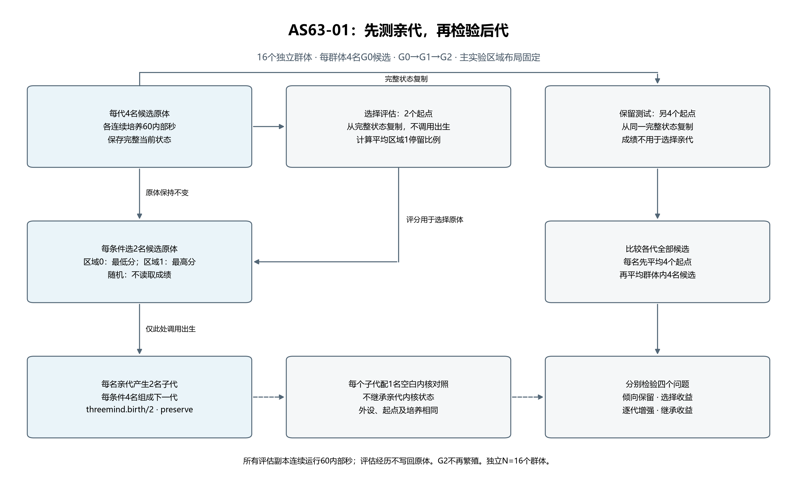
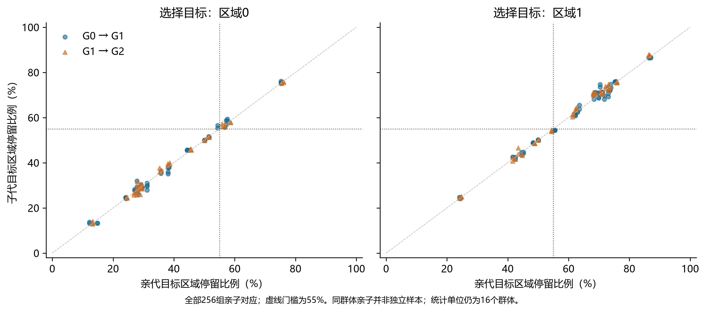
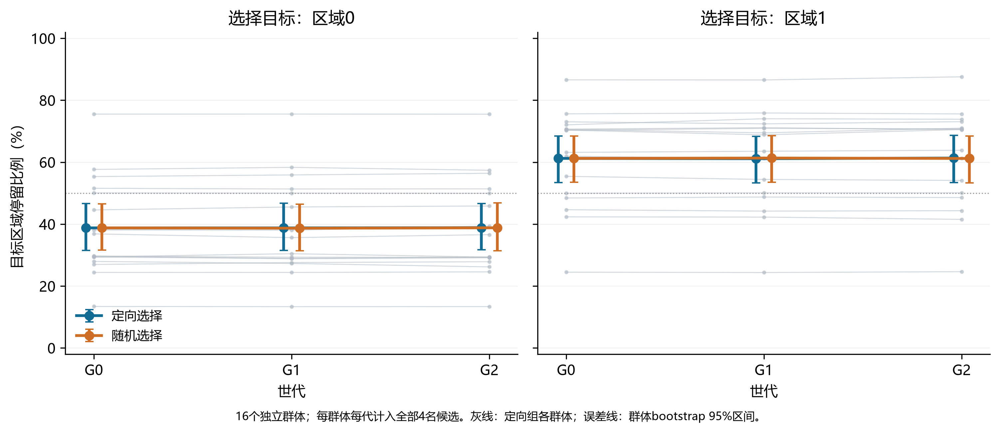
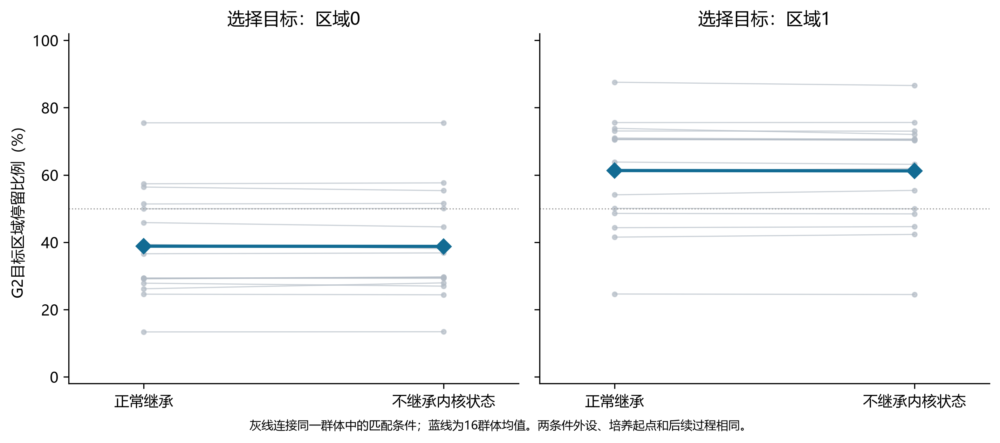
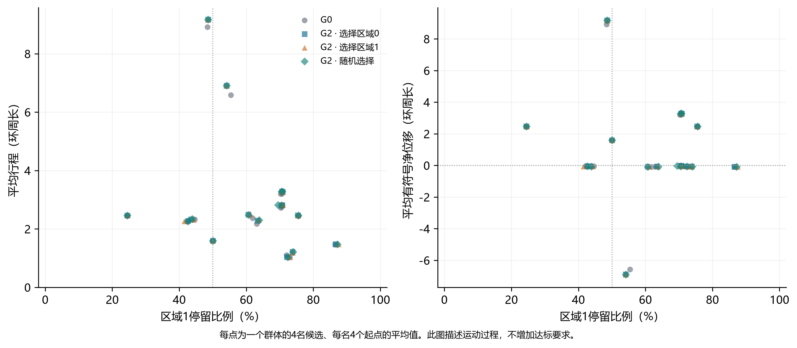

# AS63-01：固定环形环境中的人工选择与代际行为

2026-11-17。内核：threemind.continuous-memory/6.3。出生规则：threemind.birth/2，decay_age=preserve。

**主实验计算和原件核验已完成：16个独立群体、5056段过程，全部个体存活。部分亲代已有的区域倾向在后代中继续出现，但没有一个群体同时完成两个相反方向的两代保留。定向选择、逐代增强及正常继承相对空白内核的收益，均未达到事先规定的标准。**

这批结果区分了两个事实：亲子行为可以相似，而这种相似性本身还不能说明人工选择增强了行为，也不能说明相似行为必须依靠继承亲代的内核状态。后两项问题由随机选择和空白内核对照直接比较。

## 研究问题

本实验检验：先确认亲代自身的区域倾向，再让入选亲代繁殖，这种倾向能否在子代和孙代中保留；按相反方向进行人工选择，能否优于随机选择，并使相应倾向逐代增强。我们还设置了不继承亲代内核状态的匹配对照，以检验持久状态继承在相同后续培养条件下带来的行为收益。

这是一次新的人工选择实验。旧E13依据出生后评估个体的表现选择亲代；本实验从候选的完整快照建立评估副本，测量候选自身的表现，然后才由入选原体产生正式子代。旧实验的布局交换及动作重放对照继续作为历史证据保留。改变布局本身不是设计错误；新主实验固定布局，是为了让各代在相同环境条件下比较。另行登记的AS63-02检验布局交换，不改变本实验的成绩。

## 实验设计

图1。亲代评估与正式繁殖的流程。评估副本承接候选的完整状态；用于繁殖的仍是候选原体。子代培养后重复相同的评估和选择，直至G2。

### 环境、感官与动作

我们把环形轨道的周长归一为1。区域0占据位置[0, 0.5)，区域1占据[0.5, 1)。两区分别经四条固定的匿名通道向内核提供感官刺激。整个主实验中，两区的位置及其感官图案均不改变。

每个独立群体使用由其种子确定的一套感官和运动映射；同一群体的各选择条件、后代及匹配对照沿用这套映射。感官每1内部秒输入一次区域信息，并提供运动方向和速率信息。固定运动适配器每0.1内部秒把内核各节点的激活按固定正负系数投影为一个运动指令，身体据此移动，随后接收到的刺激又由身体的新位置决定。适配器不训练，也不接收选择目标、奖励或正确动作。独立背景通道每0.5内部秒提供强度0.2的刺激。

实验使用6.3的既有默认动力学，只在装置中明确启用能量记账及外部供能：每0.1内部秒提供1单位能量，总供能量不限，正常消耗保留。本实验因此检验人工选择，不检验能量匮乏造成的自然选择。生产内核和全局默认值没有修改。完整的输入、动作、节点活动、身体轨迹和起止状态均已纳入保存程序。

### 个体、评估与繁殖

正式材料包含16个独立群体，种子为1117100—1117115。这些种子同时确定感官和运动映射，以及内核配置中的seed和energy_seed；各群体的完整配置均保存。每群体创建4名空白第0代个体，从环上0.125、0.375、0.625和0.875四个位置出发，分别连续活动60内部秒。独立装置检查使用另一个种子1117099，不进入正式统计。

每次评估都从候选完成培养时的完整状态建立副本。副本保留内核、输入队列、观察与输入历史、供能状态及各项内部计时。我们只把副本的身体放到规定起点，并把速度置为零；这些是事先声明的测量操作。评估不调用出生规则，不清除内核的当前活动，不把副本经历写回候选。候选原体保留在原来的内部时刻，评估副本则连续运行60内部秒。

选择评分使用0.0625和0.5625两个起点。我们计算两个副本在区域1内停留比例的平均值，据此选亲代。与此分开的保留测试使用0.1875、0.4375、0.6875和0.9375四个起点，其成绩不参与选择。各代均采用同样的评分和测试方法。

每个群体设置三个选择条件：偏向区域0、偏向区域1和随机选择。区域0条件选评分最低的两名，区域1条件选评分最高的两名；并列时按候选编号决定。随机条件按事先固定的随机规则选两名，不读取成绩。三种条件共用同一批第0代候选，以后各自繁殖。

每名入选亲代按threemind.birth/2产生两名子代，两个亲代合计产生4名，组成该条件的下一代。子代继承规则规定的内核持久状态和衰减年龄，短时状态与内部时钟按出生规则初始化，固定外设沿用亲代映射。实验没有额外添加突变、重组或针对目标方向的权重修改。子代从规定的四个起点连续培养60内部秒，再接受相同的评估。我们完成G0→G1和G1→G2两次繁殖；G2不再繁殖。

每名正式子代还配有一个不继承亲代内核状态的对照。对照使用空白内核，配置、外设、身体参数、培养起点和后续流程均与相应子代一致，也培养60内部秒并完成四个起点的保留测试。这些对照不参与选择或繁殖。由此测得的是继承状态在共同经历60秒培养之后的贡献，不是子代刚出生时的即时差异。

### 数量与统计单位

每群体有4名第0代候选，以及G1、G2各三个选择条件、每条件4名后代，共28名正式培养个体；另有24名匹配对照。每名正式个体完成一次培养、两次选择评估和四次保留测试；每名匹配对照完成一次培养和四次保留测试，合计316段过程。16个群体共5056段，每段60内部秒。

正式培养个体合计448名，其中第0代64名、后代384名；不继承内核状态的对照384名。评估及测试副本共4224份。分析中的独立样本量始终是16个群体；同群体的候选、后代、起点和副本不计作更多独立重复。

我们按每0.1内部秒观察区间的所在区域计算停留时间，并除以固定的60秒时长。先对候选的四个保留测试取平均，再对每群体、每代、每选择条件的全部4名候选取平均。各群体权重相同，所有后代均进入统计，不只报告优胜者。轨迹、行程和有符号位移用于描述行为；静止和绕圈没有被排除或额外扣分。

## 事前规定的四项检验

| 问题 | 事前判定方法 |
| --- | --- |
| H1：亲代已有的区域倾向能否连续保留两代？ | 目标区域停留比例至少55%的入选亲代，才计作已经表现相应倾向。对这类亲代的全部子代，至少75%也应达到55%。一个群体须在两个选择方向、两次传代中均满足要求；至少4/16个群体满足，才确认预定的双向保留可行性。没有合格亲代的方向，不能当作已经检验了倾向的保持。 |
| H2：定向选择是否优于随机选择？ | 比较G2定向组与同群体随机组。两个方向各自都须平均提高至少1个百分点，并满足校正后的单侧P≤0.05。 |
| H3：相应倾向是否逐代增强？ | 两个方向各自比较G1−G0、G2−G1。四项相邻代比较均须平均提高至少1个百分点，并满足校正后的单侧P≤0.05。所有候选计入均值。 |
| H4：继承内核状态是否带来正向收益？ | 比较G2正常继承后代与逐个匹配的空白内核对照。两个方向各自都须平均提高至少1个百分点，并满足校正后的单侧P≤0.05。 |

H2、H3和H4合计八项比较，采用以群体为单位的单侧精确符号检验，并作共同Holm校正。绝对差不超过10⁻¹²的群体计作平局，不进入有效符号样本数。均值差的95%区间来自20,000次群体自助抽样；H1群体比例使用精确二项区间。全部阈值、种子、代数和课程均在正式运行前规定，不根据结果追加材料。

## 实验结果

### 已有倾向的亲子一致性，以及双向选择没有形成的原因

区域0方向中，第0代入选且达到55%阈值的5名亲代，共有10名子代，10名全部达到同一阈值；随后6名合格第1代亲代的12名子代也全部达到阈值。这两次传代都来自同样的3个独立群体。区域1方向中，22名合格第0代亲代的44名子代有40名达到阈值；20名合格第1代亲代的40名子代全部达到阈值。每次传代都有10个独立群体满足该方向的保留条件。这些数字确认，部分亲代已有的区域倾向确实在子代和孙代中继续出现；其中的亲子对不是彼此独立的样本。

不过，两个选择方向对应的合格亲代来自不同群体。区域0方向有13个群体的入选第0代亲代没有达到55%，区域1方向有5个群体没有达到；没有一个群体同时具备两个方向的合格入选亲代。个体在第0代就呈现出明显的群体间差异，同一群体内的4名候选却通常偏向同一侧。选择其中区域0成绩最高的两名，并不意味着它们已经偏向区域0。

因此，H1规定的“双向、两次传代均保留”结果为0/16，未达到至少4/16的要求；相应群体比例的精确95%区间为0—20.591%。这主要反映当前材料没有同时提供两个方向的可选亲代，不能写成已有倾向普遍无法传给后代。确实发生的阈值下降也保留在结果中：群体1117112的区域1平均停留比例由G0的55.427%降至G1的54.427%，其4名子代均未达到55%，此后G2为54.104%。

图2。两个选择方向的全部256组亲子对应。每个点表示一名子代及其亲代的四起点平均成绩；虚线为55%的事前阈值。相关亲子属于同一群体，独立统计单位仍为16个群体。

### 定向选择没有比随机选择取得预定收益

G2区域0选择组在区域0的平均停留比例为38.845%，同群体随机组为38.803%；定向选择提高0.042个百分点，95%区间为−0.167至0.204个百分点，Holm校正P=0.473877。G2区域1选择组在区域1的平均停留比例为61.324%，随机组为61.197%；提高0.127个百分点，95%区间为−0.105至0.340个百分点，校正P=1。

两个方向都没有达到至少1个百分点及校正P≤0.05的共同要求。因而，本批没有证实定向选择相对随机选择的预定行为收益。不能因为选择程序确实选出了相对高分者，就把这个程序本身当作选择已经有效的证据。

### 各代成绩没有逐代增强

| 选择条件及计分区域 | G0 | G1 | G2 |
| --- | ---: | ---: | ---: |
| 区域0选择：区域0停留比例 | 38.780% | 38.772% | 38.845% |
| 区域1选择：区域1停留比例 | 61.220% | 61.124% | 61.324% |
| 随机选择：区域0停留比例 | 38.780% | 38.671% | 38.803% |
| 随机选择：区域1停留比例 | 61.220% | 61.329% | 61.197% |

区域0选择的两次相邻代变化分别为−0.008和+0.073个百分点，区域1选择分别为−0.096和+0.200个百分点。四项比较的Holm校正P均为1，也均未达到1个百分点的要求。结果没有呈现预定的逐代增强；第2代略高于第0代的均值，不能代替连续两次传代都增强的证据。

图3。各代全部候选的目标区域停留比例。灰线为16个定向选择群体，蓝线与橙线分别为定向选择和随机选择的群体均值；误差线为群体自助抽样95%区间。各代使用相同测试条件。

### 空白内核对照也产生了相近的行为

G2区域0选择组正常继承后的目标区域停留比例为38.845%，不继承亲代内核状态的匹配对照为38.780%；差为+0.065个百分点，95%区间为−0.305至0.426个百分点。区域1选择组分别为61.324%和61.220%；差为+0.104个百分点，95%区间为−0.238至0.456个百分点。两项校正P均为1，均未达到预定的继承收益要求。

出生核验已经确认，正式后代确实按规则继承了亲代状态；行为比较却没有显示这种继承在共同培养60秒后带来至少1个百分点的目标收益。空白内核在相同配置、外设及后续经历下也得到了相近表现，因此亲子行为相似不能单独归因于持久状态继承。这项结果涉及本批培养结束后的目标区域表现，不等于已经证明继承状态在任何时刻、任何行为上都没有作用。

图4。G2正常继承与空白内核对照。每条灰线连接同一群体中匹配条件的平均成绩，蓝线为16个群体的均值。

### 接近50%的占据比例包含持续绕圈

原始轨迹保留了区域倾向之外的运动信息。例如群体1117107的第0代在区域1平均停留48.438%的时间，平均行程和有符号净位移均为8.909个环周长，说明其个体持续向同一方向绕圈。群体1117108的区域1比例为49.948%，平均行程及有符号净位移均为1.575个环周长，同样不是静止。

到第2代，三个选择条件下，群体1117107的区域1停留比例仍约48.6%，行程约9.17圈；群体1117108的比例约50.1%，行程约1.59圈。这两种持续运动都保留在记录和汇总中。区域停留比例接近一半，只说明该指标没有显示明显的区域偏向，不能解释为个体没有行为倾向或没有行动。

图5。区域停留比例与运动过程。每个点平均同一群体内4名候选、每名4个测试起点。行程表示移动总量，有符号净位移保留方向；两者均以环周长为单位。这些描述没有增加新的成功条件。

## 逐项结论与研究意义

| 目标 | 实际结果 | 判定与科学结论 | 证据 |
| --- | --- | --- | --- |
| H1 双向连续两代保留 | 部分合格亲代的后代保持同向倾向，但同时满足两方向、两次传代的群体为0/16 | 预定双向可行性未确认；单向亲子一致性确有观察，许多群体缺少相反方向的合格亲代 | 亲子及保留明细、图2 |
| H2 定向选择收益 | 两方向相对随机选择分别+0.042、+0.127个百分点 | 均未达到1个百分点及校正显著性要求，没有确认预定选择收益 | 八项比较表、图3 |
| H3 逐代增强 | 两方向G1均略降，G2略升；四项相邻代比较均未达标 | 没有确认连续两次传代的增强 | 各代全体候选均值、图3 |
| H4 继承状态收益 | 两方向相对空白内核分别+0.065、+0.104个百分点 | 没有确认共同培养后至少1个百分点的继承收益 | 匹配对照、图4 |

八项主比较的均值差95%区间上界都低于1个百分点，其中最高为0.557个百分点。因此，本批结果既没有达到预定收益，也没有以区间宽到无法判断这一最低收益为主要问题。这不构成“效应严格为零”的证明；更小的差异仍按其原始数值和区间保留。

对ThreeMind而言，本批确认了一个具体区别：按出生规则传递内部状态，可以伴随亲子区域行为相似，但还需要行为对照才能证明选择和继承带来了目标收益。当前固定环形装置在三代内没有把同一群体分化成预定的两种相反倾向，也没有获得逐代积累的结果。原先关于“这种安排能够通过人工选择持续强化目标行为”的预期，未得到本批支持。

事后分析提示，后续研究应先检查同一初始群体内是否存在足够的、能够在不同起点稳定表达的行为差异，以及这些差异是否依赖可继承的内核状态。当前数据并未把具体原因定位到某条内核规则或某个外设部件，本报告不把这种解释当作已验证机制，也不据此修改内核或追加世代。本批作为有效的阴性结果结束；旧E13及其他已完成实验的结果保持原样。

本次实际增加的认识是：亲子表现相似、人工选择有效、逐代增强和继承状态带来收益，是可以通过不同对照分别判断的四件事。当前装置观察到了其中的亲子一致性，没有完成其余预定收益和双向保留目标。

## 执行与核验

正式运行前，独立装置检查核对了完整快照复制、父体不变、出生状态、区域身份、选择函数，以及Python参考实现与Rust原生实现的短过程一致性。改变观察频率、宿主暂停和完整保存恢复没有改变被检验过程的完整终态。正式实验使用原生实现。

运行期间，前四个群体的实际文件量表明，完整证据略超过原先每份3 GiB的预留。因此，我们在原科研记录中追加了工程方案，将原件、归档和读回预留各提高到4 GiB。科学方案、种子、判据、内核及六小时计算上限均未改变。一次明确声明的暂停发生在完整步骤边界：群体1117104的一段培养在24.6内部秒保存，续接后保留此前246条轨迹，并完成原定60秒。独立装置及实际续接审计均确认此前记录没有被丢弃或重算。原执行器、工程差异和暂停证据均保留。

原件分析从保存状态与轨迹重新计算停留比例、身体运动和亲子对应，并核对评估副本未调用出生、后代确实按既定规则出生，以及选择过程未使用保留测试成绩。此处的核验由同一助手使用分析工具完成，是内部复核，不是另一个研究团队的独立复现。

全部5056段过程、832名培养个体、4224份完整状态评估副本、384次正式出生及384名空白对照均已核验通过。没有个体死亡、补换种子或丢弃后代。另用二项组合数直接复算八项符号检验，所得P值与分析程序一致。累计科学运行约3.04宿主小时，其中续接群体的暂停前耗时按保存记录估算；模拟时间和科学记录是完整的。

## 证据位置

- [主方案](protocol.zh.md)、[工程追加说明](continuation-protocol.zh.md)、[布局对照方案](layout-protocol.zh.md)。
- [完整统计表](tables.zh.md)、[小型统计汇总](summary.json)、[群体均值](population-summary.csv)、[布局对照报告](layout-report.zh.md)。
- 分析原件包括analysis-v1下的audit.json、analysis.json、candidates.csv、parent-child.csv、retention.csv、population-scores.csv和stages.csv；归档及完整API读回的验收状态见[交付回执](delivery.json)。
- 主原件目录：E:/WORKSPACE/AgentWork/threemind/.work/artificial-selection63-20261117。
- 科研项目：d0a04159-ee0f-4200-ada9-13d5ce7197b7；本批记录：ef022c6e-a0f6-5bb0-acfa-e9b0629e19bc。
- 原始状态、逐步轨迹和完整证据包保存在忽略的数据目录中，不进入Git。代码、协议、报告、图表和小型统计汇总保存在本目录。

