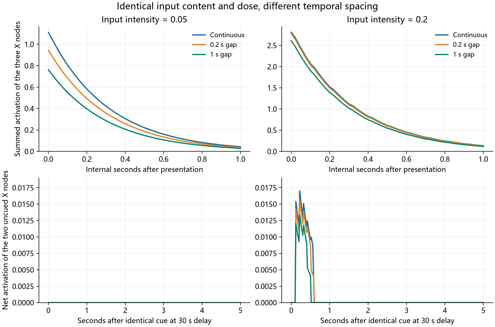

# RT63-01: 6.3 distinguishes repeated presentations and their spacing, with retained effects in connection weights

18 November 2026. All 24 continuous main runs and 120 single-probe diagnostics are complete. The study used the genuine native `threemind.continuous-memory/6.3` and its current defaults, changing only the seed for each anonymous-code block. Production dynamics, addressing, defaults, historical subjects and reports, and the manuscript were unchanged.

## What the experiment established

Identical input content and dose produced different subsequent activity when presented continuously, in two separated episodes, or with different gaps. Thirty internal seconds after presentation, activation in all task nodes had reached zero, while the three schedules still left different connection weights. At the higher input intensity, an identical cue elicited different associative activity. Exchanging only connection weights made the recipient's response closely resemble the donor's. The lower intensity also left weight differences, but the fixed cue did not evoke activation in the uncued task nodes.

The study therefore met both immediate-discrimination targets and established retention and re-expression through connection weights at the higher intensity. At the lower intensity, structural retention was established, but the complete re-expression target was not met. No cue intensity, window, or criterion was changed after these results.

## Matched presentation schedules

X consisted of three anonymous channels with amplitudes 1, 0.8, and 0.6. Identical frames arrived every 20 internal milliseconds during presentation. Each schedule contained 20 frames, 400 ms of presentation, the same dose per channel, and an identical final 200 ms.

| Schedule | Presentation intervals | Gap |
| --- | --- | --- |
| Continuous | 3.6–4.0 s | None |
| Two episodes, short gap | 3.4–3.6 s and 3.8–4.0 s | 0.2 s |
| Two episodes, long gap | 2.6–2.8 s and 3.8–4.0 s | 1 s |

This apparatus approximates sustained presentation with discrete packets; it does not simulate continuous visual illumination. Intensities were 0.05 and 0.2, tested under four anonymous channel encodings. The same separate maintenance channel kept each subject active, without forming connections to X. There was no body, trainable readout, event-count label, or timestamp-based node identity. Repeated input continued to use the same addresses.

Each of the 24 main subjects ran continuously to 34 s. Observation at 4–5 s was passive and introduced no probe. Single-probe research copies were created only from the complete state at 34 s, leaving each main subject intact. Thus the early measurement did not add an experience that could alter the later retention result.

## Immediate activity distinguishes the schedules

The primary immediate distance was the integral of the summed absolute differences between the three X activation curves during the first second after presentation. The preregistered threshold was 1e-6 activation × internal seconds.

| Comparison | Activity distance, intensity 0.05 | Activity distance, intensity 0.2 | Result across code blocks |
| --- | ---: | ---: | --- |
| Continuous versus short gap | 0.0509231 | 0.0178620 | 4/4 at both intensities |
| Continuous versus long gap | 0.1060851 | 0.0820483 | 4/4 at both intensities |
| Short versus long gap | 0.0551620 | 0.0641863 | 4/4 at both intensities |

Although the final input segment was identical, subsequent activity differed. Earlier interruptions and their duration therefore affected later activity through the evolving internal state. Both immediate targets were met at both intensities.

The four encodings produced identical values. This is a deterministic kernel, and the current defaults do not enable spatial interactions that would make these addresses affect geometry. These repetitions primarily establish insensitivity to the particular anonymous codes; they are not four draws from a population with stochastic individual variation. No population significance test is applied.

## After 30 seconds: retention and expression

At 34 s, activation was zero in all X nodes of all 24 main subjects, and the event queues were empty. Available synaptic resources had recovered to at least 0.9999999999999997; the largest residual fast enhancement was 5.25e-9. Uncued diagnostic copies showed no X activation throughout the subsequent 5 s.

A single intensity-0.2 cue was delivered to the first X channel. Delayed readout used the other two channels, which received no direct cue, and subtracted the corresponding uncued trajectory. Distances were integrated over 5 s.

| Comparison | Maximum weight difference after intensity 0.05 | Delayed activity distance after intensity 0.05 | Maximum weight difference after intensity 0.2 | Delayed activity distance after intensity 0.2 |
| --- | ---: | ---: | ---: | ---: |
| Continuous versus short gap | 0.0159069 | 0 | 0.0339257 | 0.000695201 |
| Continuous versus long gap | 0.0285144 | 0 | 0.0858883 | 0.002176463 |
| Short versus long gap | 0.0133422 | 0 | 0.0519626 | 0.001481263 |

Both intensities left weight differences above threshold. At intensity 0.2, all three schedules again produced distinguishable responses under all four encodings. Summed net activation integrals in the two uncued nodes were 0.005922601, 0.005227401, and 0.003746138 for continuous, short-gap, and long-gap histories, respectively.

At intensity 0.05, neither uncued node became active under any of the schedules. This distinguishes a retained connection difference from expression under a particular cue. Cue intensity was not subsequently increased; the study does not determine whether another probe could express those retained differences.

## Causal test by exchanging weights alone

Each pair of schedules was tested in both donor–recipient directions. Paired states had the same encoding, input intensity, internal time, and six directed task connections. Only their base weights were exchanged. Recipient node states, other connection-retention fields, synaptic resources, fast enhancement, and input mappings were preserved. No donor event label or timestamp was supplied.

Same-time state settlement and recomputation of edge-deletion deadlines were declared copy interventions. Shams performed the identical procedure while writing back the recipient's own weights. The maximum difference between sham and unmodified activity was 2.60e-18, below the 1e-10 apparatus tolerance.

At intensity 0.2, all bidirectional exchanges changed the recipient's response. Using the registered curve-distance measure, transplantation reduced the recipient–donor gap by 99.9866–99.9927%. The retained weight differences therefore had a causal effect on later response differences. This does not imply transfer of the donor's complete history: all other recipient states were retained.

At intensity 0.05, weight exchange still elicited no activation in the other two task nodes. A measurable causal contribution to expression under this cue was not established.

## Target closure and implications

| Registered question | Conclusion |
| --- | --- |
| Q1: Does continuous versus separated presentation produce distinguishable internal activity? | Yes, for both gaps, both intensities, and all four encodings. |
| Q2: Do different gaps between repeated identical inputs produce distinguishable activity? | Yes. Gaps of 0.2 and 1 s differed at both intensities under all four encodings. |
| Q3: After activation subsides, do connections retain differences that can affect a later response? | Intensity 0.2 established retention, re-expression, and a causal weight contribution. Intensity 0.05 established weight retention but did not meet the re-expression target. |

These results support processing repeated events and their timing through evolving internal state and local plasticity while keeping input addresses stable. For these materials, assigning a new address to each occurrence was unnecessary: identical content reused the same nodes, while different presentation schedules left connection differences that could later be expressed.

The experiment measured internal distinguishability and causal connection effects. It did not train the individual to count occurrences or verbally report an interval. Those are separate tasks, not additional conditions for accepting the registered results. No new addressing function or further experimental batch was implemented.

## Verification and materials

An independent apparatus material showed a maximum native/reference activity difference of 2.17e-19. Coarse versus fine advancement, observation, host pauses, and full restoration preserved identical final states. All 144 initial/final state pairs, parent links, 3,408 delivered stimuli, configurations, and production-source hashes were checked. A separate high-precision decimal calculation reproduced the primary integrals within 1.39e-17. Verification was performed by the same executing assistant, not by an external replicator.

Figure 1. Code block 181801. Top: immediate activation after presentation. Bottom: activity elicited by an identical cue after a 30-internal-second delay. All three lower-left curves are zero and overlap. Values agree across the four encodings. The complete 5 s diagnostic window is shown. Activation and internal seconds are model quantities, not biological voltages.

- [Protocol](protocol.en.md) · [All comparisons](comparisons.csv) · [Summary and audit](summary.json)
- [Execution](study.py) · [Analysis and plotting](analyze.py)
- Originals: `E:\WORKSPACE\AgentWork\threemind\.work\repeat-timing63-20261118`.
- [Delivery record](delivery.json) and [artifact index](../../artifact-index/2026-11-18-repeat-timing63.json) identify the local research record, full archive, and hashes.
