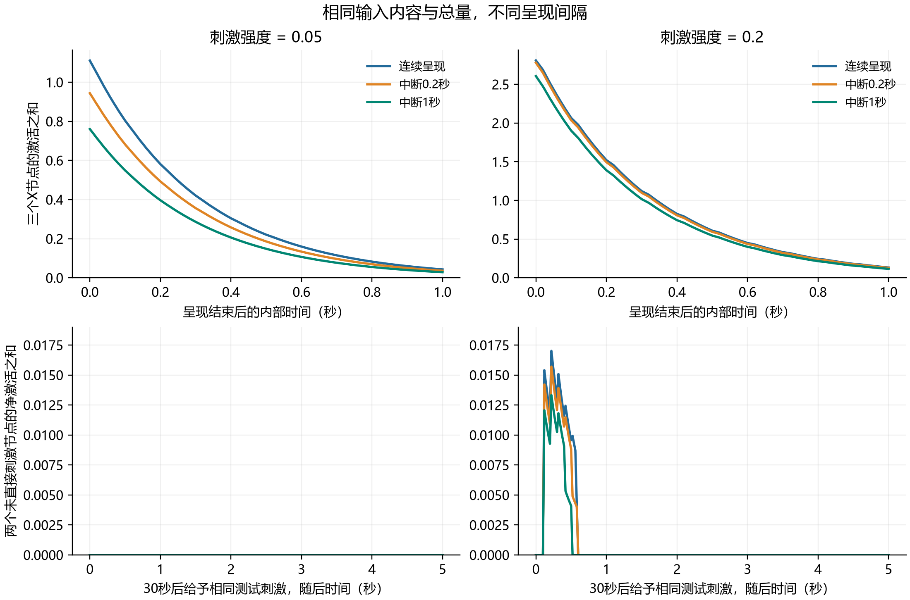

# RT63-01：6.3能够区分重复呈现及间隔，并通过连接权重保留其影响

2026-11-18。24条连续主线、120次单次诊断已完成。实验使用真实的 `threemind.continuous-memory/6.3` 当前默认配置；除各区组的种子外，没有更改参数。内核实现、节点地址规则、生产默认、旧个体、旧报告和论文均未修改。

## 实验回答了什么

相同内容和总量的刺激，连续呈现、分成两次呈现，以及采用不同的间隔，都在6.3中产生了不同的后续活动。呈现结束30内部秒后，任务节点的激活已经全部归零，但三种经历仍留下不同的连接权重。在较强输入条件下，相同的测试刺激重新引起了不同的联想活动；只交换连接权重，就能使受体的响应非常接近供体。较弱输入条件也保留了权重差异，但本次固定测试刺激没有使这些差异表现为未直接受刺激节点的激活。

因此，本批确认了前两项即时区别，并在较强输入条件下确认了连接保持及再次表达。较弱输入条件只确认了结构中的保持，未达到完整的再次表达目标。全部结果按事前规则判定，没有因较弱条件失败而提高测试强度或改动窗口。

## 怎样比较三种经历

X由三个匿名通道组成，幅度分别为1、0.8、0.6。每20内部毫秒发送一帧相同的X，将连续呈现实现为没有中断的一串刺激包。各条件都输入20帧，总呈现时间为400内部毫秒，逐通道输入总量相等，最后200毫秒的输入完全相同。

| 条件 | 呈现安排 | 中断时间 |
| --- | --- | --- |
| 连续呈现 | 3.6—4.0秒 | 无 |
| 分两次，短间隔 | 3.4—3.6秒和3.8—4.0秒 | 0.2秒 |
| 分两次，长间隔 | 2.6—2.8秒和3.8—4.0秒 | 1秒 |

这是一种离散刺激呈现装置，未模拟真实视觉的连续光照。我们使用0.05和0.2两档刺激强度，并在四套不同匿名编码下重复比较。各条件采用相同的独立背景通道维持个体活动，背景与三个X节点没有形成连接。没有身体、可训练读出器，也没有输入“第一次”“第二次”等事件标签。相同通道始终到达原有地址。

24条主线各自连续运行到34秒。4—5秒期间只观察，不追加测试刺激；到34秒才从完整状态建立用于单次诊断的研究副本。因此，较早的测量没有插入一次新提问来改变后续保持结果。副本内部时间连续推进，原主线及其完整状态保留。

## 即时活动：三种安排能够被区分

呈现结束后的1内部秒内，我们比较三个X节点的激活曲线。下表的“活动距离”是各节点在相同时刻的激活差绝对值之和，对内部时间积分所得的数值。预设可测差异门槛为1e-6。

| 比较 | 强度0.05的活动距离 | 强度0.2的活动距离 | 四套编码的结果 |
| --- | ---: | ---: | --- |
| 连续与短间隔 | 0.0509231 | 0.0178620 | 两档均4/4检出差异 |
| 连续与长间隔 | 0.1060851 | 0.0820483 | 两档均4/4检出差异 |
| 短间隔与长间隔 | 0.0551620 | 0.0641863 | 两档均4/4检出差异 |

各组最后一段输入相同，但随后活动不同。这确认，先前是否发生中断、间隔多长，会通过既有内部状态影响后续活动。前两项检验在两档强度上均达到预定要求。

四套匿名编码所得的这些数值完全相同。这里使用的是确定性内核；当前默认未启用会使节点地址影响空间关系的选项。这些重复主要检验结果不依赖所选匿名编码，不应被解释为四次具有个体随机波动的总体抽样，也不对这些数值计算总体显著性。

## 30秒后：权重保持与响应表达

到34秒时，所有24条主线的三个X节点激活均为零，输入队列为空。突触可用资源已恢复至至少0.9999999999999997，快速增强的最大残留为5.25e-9。无提示诊断副本的X节点在随后5秒内也一直没有激活。

我们对各副本的第一个X通道给予强度0.2的相同测试刺激，记录另外两个未直接受刺激节点的活动。下表仍用相同定义的活动距离，但观察窗口为5秒，且只计这两个节点，并减去无提示副本的同期活动。

| 比较 | 强度0.05经历：权重最大差 | 强度0.05经历：延迟活动距离 | 强度0.2经历：权重最大差 | 强度0.2经历：延迟活动距离 |
| --- | ---: | ---: | ---: | ---: |
| 连续与短间隔 | 0.0159069 | 0 | 0.0339257 | 0.000695201 |
| 连续与长间隔 | 0.0285144 | 0 | 0.0858883 | 0.002176463 |
| 短间隔与长间隔 | 0.0133422 | 0 | 0.0519626 | 0.001481263 |

两档强度均保留了超过预设门槛的权重差异。强度0.2条件下，三个呈现安排在所有四套编码中均再次表现出不同的响应。两个未直接受刺激节点的净累计激活量，连续、短间隔、长间隔条件分别为0.005922601、0.005227401和0.003746138。

强度0.05条件下，这两个节点在三种安排中均没有激活，因而测试没有表达出相应差异。该结果明确区分了“连接中仍有经历差异”和“这次刺激能够使差异表现出来”。本批未进一步改变测试强度，不能据此确定另一种测试是否能够读出这些差异。

## 仅交换权重的因果检验

每对呈现安排都进行了两个方向的权重交换。供体与受体具有相同的匿名通道、刺激强度、内部时刻及六条有向连接。实验只移入六条连接的基础权重，保留受体的节点状态、连接其他保持字段、突触资源、快速增强和输入映射；没有移入供体的事件标签或时间戳。

状态结算和连接删除时刻重算属于事先声明的副本操作。假操作执行同样过程但写回自身权重，与未经操作的参照之间，活动值最大误差为2.60e-18，低于1e-10的装置标准。

强度0.2条件下，所有比较的双向权重交换都改变了受体响应。按预先记录的活动曲线距离计算，受体与供体之间的差距缩小了99.9866%—99.9927%。这不仅说明权重数值不同，也确认这些权重差异对后来表达的活动差异具有因果作用。其他状态仍保留受体原值，因此不把结果说成移入了供体的完整经历。

强度0.05条件下，交换权重后仍未引起另外两个节点激活，对本次表达的可测因果作用未达到门槛。

## 判定与意义

| 事前问题 | 结论 |
| --- | --- |
| Q1：一次连续呈现与两次分开呈现能否产生可区分的内部活动？ | 能。两档强度、两种间隔、四套编码全部检出了预定幅度的差异。 |
| Q2：重复同一刺激时，不同间隔能否产生可区分的内部活动？ | 能。0.2秒与1秒间隔在两档强度及四套编码中均产生不同活动。 |
| Q3：激活消退后，连接是否保留差异，并能再次影响响应？ | 强度0.2条件确认保持、再次表达及权重的因果作用；强度0.05条件确认权重保持，但本次未实现再次表达。 |

这些结果支持在稳定输入地址上利用内部状态和局部可塑性处理重复事件与时间间隔。在本次材料中，没有必要为每次出现分配新地址，既能让相同内容作用于同一组节点，又能使不同呈现安排留下可再次表达的连接差异。

这里检验的是内部可区分性和连接的因果作用，没有训练个体回答“出现了几次”或报告具体间隔。这些语言或行为能力不属于本批目标；本批成功无需以完成它们为附加条件。也没有据本批结果修改寻址函数或启动其他实验。

## 核查与材料

独立仪器材料上，原生与Python实现活动的最大数值差为2.17e-19；粗细推进、观察、暂停和完整保存恢复所得终态一致。全部144段的完整初末状态、父状态关系、实际递送的3408个刺激包、配置和生产代码哈希均已核查。用高精度十进制算术另行复算主要积分，最大差为1.39e-17。所有核验由本次执行者完成，不冒称外部独立复现。

图1　区组181801的结果。上排为刺激呈现结束后的即时激活，下排为30内部秒后输入相同测试刺激所引起的活动。左下三条曲线均为零且重合。四套编码的数值一致；完整5秒诊断窗口保留在图中。观察变量及其积分单位为模型定义的激活量和内部秒，不对应生物电压。

- [事前协议](protocol.zh.md) · [全部比较数值](comparisons.csv) · [汇总与核查](summary.json)
- [执行程序](study.py) · [分析与绘图](analyze.py)
- 原件目录：`E:\WORKSPACE\AgentWork\threemind\.work\repeat-timing63-20261118`。
- [交付记录](delivery.json)与[原件索引](../../artifact-index/2026-11-18-repeat-timing63.json)列出本地科研平台记录、完整原件包及其哈希。
