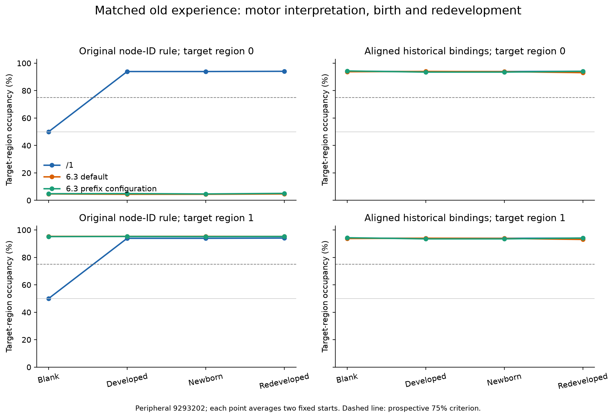
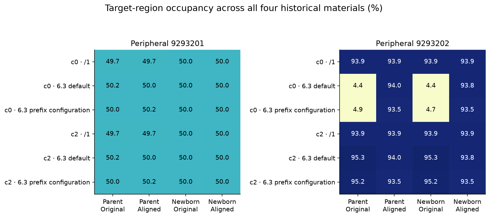

# AS63-03: Motor bindings explain the main difference in historical ring occupancy

18 November 2026. All 312 planned stages are complete. This report uses saved inputs, complete states, activity and body trajectories. Conditions use genuine threemind.continuous-memory/1, current threemind.continuous-memory/6.3 defaults, and the saved 6.3 S101/bypass prefix configuration. Production kernels, defaults, old reports and the manuscript are unchanged.

## Answer to the study question

The comparison locates the largest difference in opposing regional tendencies in the old motor adapter's dependence on node IDs. Under the original rule, /1 expresses opposite preferences after the two histories, whereas both 6.3 configurations mainly favor region 1. Aligning motor coefficients to the archived channel bindings restores high occupancy in both opposite directions in 6.3. Blank Cores given the same binding tables also attain similar scores. Thus these scores can be reproduced without first inheriting the old individual's learned connection weights; occupancy alone does not establish that plastic connections learned and transmitted the desired behavior.

Birth was not the principal point of loss. Every condition that met the prospective regional-preference criterion before birth also met it afterward. All 12 births preserved node and edge correspondence, and offspring weights matched the parent's effective weights at the birth time. The successful prefix configuration did not restore opposite tendencies under the original motor rule. Measurable history effects remained in all three configurations, so the findings also do not support a claim that 6.3 cannot retain effects of experience or that all internal activity in the old experiment was irrelevant.

## Design and prospective amendment

The two E13 peripheral seeds were 9293201 and 9293202. Each supplied the original G0 c0 and c2 60-second records, starting at 0.125 and 0.625. These predetermined materials represent initial experience in opposite regions. Each complete sensory and recorded host-telemetry sequence was replayed across the three configurations. Teaching applied recorded old actions while retaining the current Core's proposed actions, ensuring identical external experience. Subsequent free assessments used closed-loop control by the current Core.

Each history/configuration pair supplied a blank control, a developed complete individual, its newborn offspring, and that offspring after another continuous 60-second presentation of the same curriculum. Each state was assessed from positions 0.0625 and 0.5625 for 60 seconds under each of two motor rules, with region layout fixed. Two additional five-second fixed-body copies received region-0 or region-1 inputs. Their activity was retained and interpreted offline by both motor rules.

The original rule hashes actual node IDs into signed motor coefficients. The aligned rule freezes the old history's channel-to-ID bindings and uses their motor coefficients across all configurations and blank controls. It changes only the declared research-copy output interpretation, not Core addresses. The absent positive-velocity channel in the 9293201 records was completed by the prospectively specified ordering; neither 9293202 material required that completion. See the [binding table](sensory-motor-bindings.json).

An initial apparatus check found unmet demand under the old supply schedule in the 6.3 local energy model. Before formal execution, [protocol revision 2](protocol-v2.en.md) disabled energy simulation in every condition. With energy computation disabled, /1 still exactly reproduced all four archived activity and motor records: maximum absolute error was zero across 2,400 sampled points. All configurations passed short native/reference, observation, host-pause and complete-restoration checks. Interrupted checks and the correction that preserves an inactive supplier timer are retained; production implementation was not changed.

The 312 stages comprise 24 teaching/development stages, 192 free behavioral assessments and 96 fixed-body diagnostics. They are paired observations from four historical materials in two peripheral blocks, not 312 independent replications. Percentages below average two fixed starts. No population significance tests are inferred from this design.

## Main behavioral results

For peripheral 9293202, c0 targets region 0 and c2 targets region 1. Developed individuals showed:

| Configuration | Original rule: target 0 | Original rule: target 1 | Aligned: target 0 | Aligned: target 1 |
| --- | ---: | ---: | ---: | ---: |
| /1 | 93.917% | 93.917% | 93.917% | 93.917% |
| 6.3 current defaults | 4.417% | 95.333% | 94.000% | 94.000% |
| 6.3 prefix configuration | 4.917% | 95.250% | 93.500% | 93.500% |

Low region-0 occupancy in 6.3 does not mean the individual ceased moving or could not remain in a region: it mainly occupied region 1. The two histories did not produce opposite preferences. Alignment raised region-0 target occupancy by 89.583 percentage points for current defaults and 88.583 points for the prefix configuration, meeting the prospective substantial-effect and material-specific recovery criteria. Alignment did not produce a comparable gain when the original rule already favored region 1; it restored the distinction between opposing history-associated directions.

Blank controls tested whether this high score required prior development. Under the original rule, /1 blank controls averaged 50% target occupancy across starts; blank 6.3 Cores already favored region 1. With the archived binding tables:

| Configuration | Aligned blank: target 0 | Aligned blank: target 1 |
| --- | ---: | ---: |
| /1 | 94.083% | 94.083% |
| 6.3 current defaults | 93.750% | 93.750% |
| 6.3 prefix configuration | 94.333% | 94.333% |

These blank Cores inherited no learned donor connections, node-retention states or ongoing activity. The historical channel bindings were explicitly supplied to the experimental peripheral. Those bindings were sufficient to reproduce high occupancy during subsequent operation. This does not mean the blank Cores had learned the original curriculum, or that no new learning occurred during assessment.

Peripheral 9293201 remained near 50% mean target occupancy across configurations and both directions. These negative materials were retained. Travel and stationary fractions are available in [behavior.csv](behavior.csv); near-50% occupancy alone cannot identify absence of behavior, circling, or the effects of symmetric starts.

Figure 1. Blank, developed, newborn and redeveloped states for the two historical directions with peripheral 9293202. Points average two starts. The dashed line is the prospective 75% criterion. Motor rules are tested in separate complete-state assessment copies.

Figure 2. Developed and newborn results for all four historical materials. c0 targets region 0; c2 targets region 1. Configuration and output-rule comparisons are paired within each material.

## Formation, birth and the prefix configuration

Under matched fixed-body inputs, all configurations showed channel-aligned activity differences between developed and blank states. Newborn offspring also retained measurable differences, so clearing current activity did not eliminate every effect of history. Activity areas are approximated from 0.1-second samples; see [diagnostics.csv](diagnostics.csv). These measurements establish history effects, but do not automatically make them the principal cause of high regional occupancy.

Each of the 12 developed individuals produced one genuine offspring. /1 used threemind.birth/1; 6.3 used threemind.birth/2 with decay age preserved. All nodes and edge pairs remained. Each individual had 1,490 or 1,498 edges, depending on peripheral material, with no count reduction at birth. In current-default 6.3, raw snapshot weights differed from offspring weights by at most 0.02938348359664172 because the birth rule projects lazily stored values to the current time. Comparing effective parent weights at that time with offspring weights gave a maximum difference of zero in all 12 conditions. Complete offspring states also matched their genuine birth rules exactly. A difference between an unsettled stored value and a current effective value is not evidence of inheritance loss.

Across both output rules, all 10 history/configuration/output conditions with pre-birth target occupancy at least 75% remained at or above 75% after birth. These are paired conditions, not 10 independent populations. A condition lacking the tendency before birth cannot establish loss during birth. Redevelopment is reported separately and does not replace immediate newborn assessment; this study does not retest three-generation selection gains.

None of the four materials met the prospective original-rule improvement criterion for the prefix configuration versus current defaults: an increase of at least 10 percentage points and occupancy at least 75%. This does not invalidate success on the earlier prefix task, but provides no support for that configuration as the principal explanation of the present ring difference. The [configuration comparison](configuration-differences.json) includes explicit versus inherited threshold settings; each differing field must not be treated as an independently isolated mechanism effect.

## Target closure

| Target | Outcome and scientific interpretation |
| --- | --- |
| T0 validity | All four old /1 records reproduced exactly; formal inputs, configurations, clocks, complete states and births passed audit. |
| T1 formation | History effects remain in all configurations; the occupancy difference is not evidence that 6.3 cannot be affected by experience. |
| T2 inheritance | 10/10 qualifying preference conditions persisted; 12/12 births preserved structure and current effective weights. No principal loss was located at birth. |
| T3 expression | Aligning motor coefficients restored high occupancy in opposite directions in both 6.3 configurations; blank controls reproduced it too, exposing the binding contribution. |
| T4 prefix configuration | 0/4 materials met the prospective original-rule improvement criterion; opposing preferences were not restored under that rule. |

## Implications for earlier claims and future design

The old adapter still reads activation strength, so it does not bypass all Core response. However, the ID first assigned to a channel changes the direction in which its activity moves the body. Arrival-order-dependent identity allocation thereby becomes part of behavior. High regional occupancy can largely arise from these bindings and cannot by itself establish learning and transmission through plastic connections, or cumulative gains from artificial selection.

The old observations, trajectories and procedures remain reproducible evidence. This report adds an attribution limit without deleting originals or rewriting separate blockade, transplantation or fixed-readout experiments. The /1–6.3 difference does not overturn the old observation; it establishes that actual motor bindings differed. The clearest next step is to separate stable addressing from motor interpretation and control baseline sensory-to-motor pathways in new learning/inheritance designs, rather than change the Core to recover the old apparatus's score.

The author's proposed addressing function is assessed [separately](addressing-recommendations.en.md). A more complex function can separate external codes from internal identity, but hashing addresses into motor directions still produces fixed bindings. Node identity also affects energy allocation and optional spatial mechanisms, so an addressing change must be versioned and its effects evaluated. No such change was implemented here.

The [README](README.md) locates tools, originals and the API record; the [delivery receipt](delivery.json) documents archiving and full-download verification. These conclusions concern two peripherals and four histories, not an overall ranking of kernel ability.
