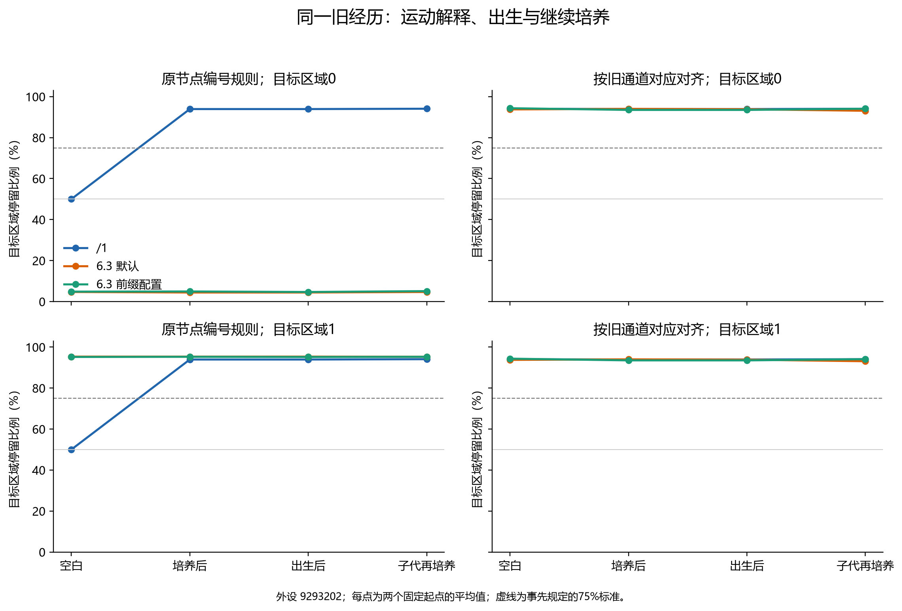
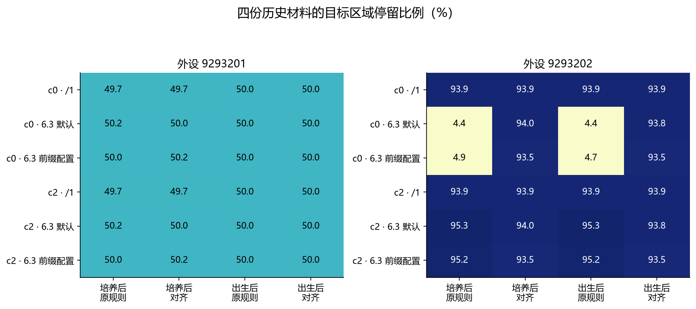

# AS63-03：旧环形高停留比例的主要差异来自运动接线对应

2026-11-18。状态：312个预定运行阶段完成；本报告依据保存的输入、完整状态、活动及身体轨迹。配置为真实的 threemind.continuous-memory/1、threemind.continuous-memory/6.3 当前默认和6.3保存的前缀成功配置 S101/bypass。生产内核、默认参数、旧报告和论文均未修改。

## 回答研究问题

本次对照把此前最显著的双向区域偏向差异定位到了旧运动外设对节点编号的依赖。使用原编号规则时，/1会随两种早期经历形成相反的区域偏向，6.3两种配置却都主要偏向区域1。只把运动系数按旧经历中的通道对应对齐，6.3即可表现出两个相反方向的高停留比例；空白内核使用同一张对应表也能达到相近成绩。因此，这项高成绩不需要先继承旧个体的已学连接权重就能重现，不能单独作为可塑连接产生并遗传所需行为的证据。

没有发现这项差异主要发生在出生时。达到预设区域偏向标准的条件，在出生后仍达到该标准；所有12次出生保留节点与连接对应，子代权重与亲代在出生时刻的有效权重一致。前缀成功配置也没有在原运动规则下恢复双向分化。三种配置均保留可测的经历作用，故结果同样不支持“6.3不能形成经历影响”或“旧实验所有内部活动均无作用”这样的概括。

## 设计与必要修订

使用E13的两套旧外设，种子分别为9293201、9293202。每套取原始第0代c0、c2的60内部秒记录，起点分别为0.125和0.625，代表来自两个区域的既定历史材料。每份输入记录在三种配置下逐条重放，包括原主机遥测背景。重放期间施加保存的旧动作，并记录当前内核提出的动作；这样三组的外部经历完全相同。自由评估时则由当前内核控制身体。

每个材料—配置组合分别评估空白个体、培养后完整个体、新生子代，以及子代再次接受同一60秒课程后的完整个体。每种状态在两种输出规则下，各从0.0625和0.5625两个起点活动60秒，区域布局不变。另从每种状态建立两个固定身体副本，分别接受区域0、区域1的刺激，运行5秒，保存活动并离线计算两种运动解释。

两种输出规则分别是：保留原程序按节点编号计算正负系数的规则；或把旧记录中的通道—节点编号对应冻结，用它产生运动系数，再把同一张表用于三种配置及空白对照。对齐只改变研究副本的运动解释，不修改内核节点地址。9293201中未曾出现的正向速度通道按事先规定的顺序补全；9293202的两个方向均不需要补全该通道。完整对应见[sensory-motor-bindings.json](sensory-motor-bindings.json)。

初次装置检查发现，旧供能方式在6.3局部能量模型中出现未满足需求。因此，在正式运行前登记[第二版方案](protocol-v2.zh.md)，所有正式组统一关闭能量模拟，排除供能差异。/1关闭能量计算后仍精确复现四份旧记录：2400个采样点的逐通道激活和原规则运动输出，最大绝对误差均为0。三配置也均通过短程原生/参考实现、观察、暂停及完整保存恢复检查。初次失败检查和未启用供应器计时器的恢复修正原件均保留，没有改动生产实现。

本批有两套外设、四份历史材料和312个运行阶段，其中包括24次培养、192次自由行为评估和96次固定身体诊断。后者是同一材料内的研究副本，不是312个独立重复。以下百分比均为两个固定起点的平均值，不进行总体显著性推断。

## 主要行为结果

9293202的c0历史对应区域0，c2历史对应区域1。下表显示培养后完整个体在相应目标区域内的停留比例。

| 配置 | 原编号规则：区域0目标 | 原编号规则：区域1目标 | 对齐后：区域0目标 | 对齐后：区域1目标 |
| --- | ---: | ---: | ---: | ---: |
| /1 | 93.917% | 93.917% | 93.917% | 93.917% |
| 6.3 当前默认 | 4.417% | 95.333% | 94.000% | 94.000% |
| 6.3 前缀成功配置 | 4.917% | 95.250% | 93.500% | 93.500% |

6.3原规则下的低区域0成绩，并不表示个体停止活动或不能停留在一个区域：它主要停留在了区域1。两种历史没有使它形成相反方向的偏向。当前默认组对齐后的区域0目标比例增加89.583个百分点；前缀配置增加88.583个百分点，均超过事先规定的实质外设效应及该材料上的恢复标准。另一方面，对齐没有给原本已偏向区域1的条件带来同等增益，它改变的是两个历史能否形成相反方向的表现。

空白内核的结果进一步检验这种高成绩是否需要先前培养。使用原规则时，/1空白组两个起点的平均目标比例均为50%；6.3空白组已明显偏向区域1。使用旧历史对应表后，尚未接受这段培养的三个空白组分别达到：

| 配置 | 对齐后空白组：区域0目标 | 对齐后空白组：区域1目标 |
| --- | ---: | ---: |
| /1 | 94.083% | 94.083% |
| 6.3 当前默认 | 93.750% | 93.750% |
| 6.3 前缀成功配置 | 94.333% | 94.333% |

这些空白组没有继承供体的已学连接、节点保持状态或当前活动。它们获得的是供实验检验而明确移入外设的通道对应表。因此，这一对照说明该对应关系足以在随后运行中重现较高停留比例；它不表示空白内核已经学过原课程，也不表示评估期间完全没有新学习。

另一套外设9293201在三配置、两个方向中的平均目标比例均接近50%。这不是删去的阴性材料。其位移和静止比例一并保存在[behavior.csv](behavior.csv)，不能仅凭接近50%便将绕行或对称起点下的活动说成没有行为。

图1　外设9293202在两个历史方向下的空白、培养后、出生后和子代继续培养结果。每点是两个起点的平均值；虚线为预先规定的75%区域偏向标准。两个输出规则使用独立的完整状态评估副本。

图2　全部四份历史材料的培养后及出生后结果。c0以区域0为目标，c2以区域1为目标。不同版本与输出规则在每份材料内部配对。

## 经历形成、出生和前缀配置

固定身体、固定刺激的诊断中，三种配置都检出了培养后相对于空白状态的逐通道活动差异。新生子代也保留可测的差异，说明本批材料中经历作用并未因为清除当前活动而全部消失。测量按0.1秒采样计算活动积分的近似值；详细数值见[diagnostics.csv](diagnostics.csv)。这一结果确认存在经历效应，但不能把它自动等同于高区域停留比例的主要原因。

12个培养个体各产生一个真实子代。/1使用 threemind.birth/1，6.3使用 threemind.birth/2并保留衰减年龄。所有节点及连接对应均保留；两套材料的每个体连接数分别为1490、1498，出生后没有减少。当前默认6.3中，快照存储权重与子代权重存在最大0.02938348359664172的数值差异；这是出生规则将延迟结算的权重投影到当前时刻的结果。用亲代在同一时刻的有效权重比较，12个条件中的最大差异均为0，完整子代状态也与各自真实出生规则逐项一致。不能把尚未结算的存储值与已结算的有效值之差当成继承损失。

原规则及对齐规则下，出生前达到75%目标比例的10个材料—配置—输出条件，出生后全部仍达到75%。这10项是配对条件，不是10个独立群体。未在出生前形成相应偏向的条件，也不能用来证明出生使偏向丢失。子代再次培养后的数值已单列；本批没有借继续培养覆盖出生后即时测量，也没有重新检验三代选择增益。

在四份材料中，前缀成功配置相对当前默认均未达到原规则下“提高至少10个百分点且达到75%”的预设改善标准。它在前缀任务上的成功不因此失效，但本批结果不支持把原规则下的环形差异主要归因于这一整套配置。两配置的具体差异见[配置表](configuration-differences.json)，其中也包含显式阈值与默认继承写法的差别，不能把每个配置字段差异都当成独立机制效应。

## 各项目标的结论

| 项目 | 结果与科学判断 |
| --- | --- |
| T0 有效性 | 四份旧/1记录精确复现；正式输入、配置、时间、完整状态及出生规则通过核查。 |
| T1 经历形成 | 三配置均有可测经历效应；没有证据把区域差异概括成6.3完全不能受经历影响。 |
| T2 出生继承 | 10/10项已形成的合格偏向继续保留；12/12次出生保留结构和当时有效权重，未定位到出生造成的主要损失。 |
| T3 行为表达 | 对齐运动系数恢复两种6.3配置的双向高停留表现；空白对照同样重现，明确暴露高成绩中的接线贡献。 |
| T4 前缀配置 | 0/4份材料达到预设原规则改善标准；没有恢复原规则下的双向分化。 |

## 对旧结论和后续设计的意义

旧外设仍读取激活强度，因此“完全绕过内核响应”不是对程序的准确描述。但某通道先取得什么编号，会影响其活动推动身体的方向；这条依赖使到达顺序相关的身份分配也成为行为的一部分。高区域停留比例可以主要通过这种对应产生，不能由该成绩独自推导出局部可塑连接学得并遗传了区域偏向，也不能据此证明人工选择带来了逐代积累。

旧行为、轨迹和程序仍有可复核价值。本报告追加对其归因的限制，不删除原始证据，也不改写其他独立的阻断、移植或固定读出实验。/1与6.3的差异并没有推翻旧观察本身；它指出此前比较中实际的运动对应不相同。当前最明确的后续工作是区分稳定寻址与运动读取，并在新的学习、遗传设计中控制基础感知—动作通路，而不是先更改内核去追逐旧装置的分数。

作者提出的寻址函数建议见[单独评估](addressing-recommendations.zh.md)。更复杂的地址函数可以隔离外部编码和内部身份，但若输出器继续对地址取哈希决定方向，同样的固定对应仍存在。当前节点身份还涉及能量分区及可选空间机制，寻址变更必须版本化、明确评估影响；本轮没有实施。

复现入口、完整原件目录及API记录见[README](README.md)，归档和完整下载核验见[交付回执](delivery.json)。本批是两套外设、四份历史下的机制定位，不是对全部任务或版本能力的排名。
