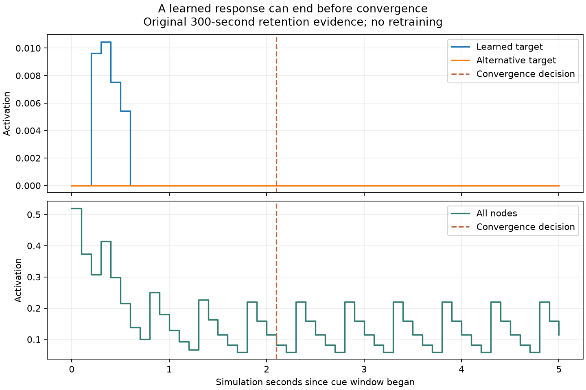

# Process-readout calibration: recovering responses that already occurred

2026-09-30. Engineering baseline `5110e10`; existing `continuous-memory/2` evidence only. No retraining, new research instances, Core dynamics changes, mapping changes or replacement of previous reports.

[中文](report.zh.md) · [Tool guide](../../../docs/en/v2-observation-tools.md) · [Original study](../../explorations/2026-09-30-memory-transfer/report.en.md) · [Reproduction and hashes](README.md)

## Main finding

**Some “no answer at convergence” outcomes contained a genuine earlier response that had already decayed. The reusable process observer now exposes it without a study-specific Python detector.**

Of 240 cued memory windows, all 192 trained tests contained target activity, versus 0/48 untrained cued controls. Target activity was zero at the original convergence decision in all 240 windows. The 48 controls are untrained **cued** tests, not no-cue copies. The original study's separate no-cue comparisons and directional scores remain unchanged.

This is a gain in measurement capability. It neither replaces the original endpoint score with a peak score nor changes the model to create a response.

Example: `memory/930101/ordinary/full/wait-300/A`. Target activation is approximately 0.009–0.0104 at 0.2–0.5 seconds after the cue window begins, disappears around 0.6 seconds, and is absent at the approximately 2.1-second convergence decision. Other activity continues. Stable background and an earlier learned response can coexist.

## Measurement improvements

V2 keeps a bounded observation window open after first convergence or early response cessation. It reports raw vectors, signed baseline changes, node-specific onset/peak/end, recurrence, integrals, cumulative change and transfers of activity distribution. Equal totals or equal endpoints need not imply equal processes. Node-specific peaks are separate from an actual simultaneous sample.

Stimulus-free markers open observation windows without Core events or fabricated input envelopes. Without an input boundary, input/post-input integrals are unavailable rather than invented. Full-vector comparisons align exact corresponding times and identities; missing coverage, untriggered sources and exhausted budgets remain visible.

Historical activity V1 and steady-state readers remain available. New configurations explicitly use V2 at 20 ms; 60 samples retain the previous maximum searched period of 1.2 seconds. This changes observation cadence, not propagation. An omitted version still restores V1.

## Calibration against existing evidence

The 840 windows consist of 736 original cued task tests, 96 connection interventions and eight denser passive replays. Shared parent states and repeated observations mean these are not 840 independent subjects or new experiments.

| Original family | Windows | Target activity in process | Target activity at original decision |
|---|---:|---:|---:|
| Memory | 240 | 192 | 0 |
| Memory interventions | 96 | 64 | 0 |
| Sequence | 256 | 64 | 0 |
| Transfer | 240 | 192 | 0 |
| Dense transfer replay | 8 | 8 | 0 |

These are activity-presence counts, not accuracy. The 64 responding sequence windows still do not distinguish both AB and BA correctly. The 192 transfer responses retain the original split of 48 intended-direction and 144 reversed-direction outcomes. Background activity in all windows is not task success.

The reusable comparison tool checked each of the 96 intervention copies against its corresponding normal cued copy:

| Existing intervention | Comparisons | Changed trajectories | Exactly equal sample vectors |
|---|---:|---:|---:|
| Silence cue outgoing connections | 32 | 32 | 0 |
| Silence, then restore before advancing | 32 | 0 | 1,632 |
| Silence matched other connections | 32 | 0 | 1,632 |

All comparisons had exact shared sampling times, without zero-filled gaps. This confirms the previous connection-dependent recall finding and validates the extracted detector against both known changes and unchanged trajectories.

## Reusable implementation

The shared layer is a Python library, fixed tool registry and declarative batch runner, integrated with existing research plans and operations. `analyze_record` and `compare_records` work offline. `probe_copy` restores the same source, uses existing decoded input frames, applies explicit interventions to a copy, records source/intervention/final hashes, and enforces budgets. It preserves pending Core events; external worlds and devices still require their owning Runtime.

`threemind-observation` supports up to 32 declarative steps, saving each completed result. The UI, API, existing CLI/MCP operation catalog and standalone Runtime use the shared capabilities. New tools require registration, versioning and tests; no arbitrary-code plugin loader or duplicate experiment manager was added. Environment selection and cross-seed identity alignment remain explicit experimental choices.

## Validation and limits

Tests cover brief weak signals, raw activity below reporting tolerance, sustained background, decreases, temporal transfers, recurrence, identical endpoints with different processes, missing/empty samples, budget cuts, version recovery, CLI exports, API access, worker capabilities and 1440/390-pixel UI interaction.

For `causal/9`, `continuous/1`, `continuous-memory/1`, `continuous-memory/2` and `lif/1`, both Python and Rust produce the same complete Core hashes with the observer enabled or disabled. Observer restoration preserves results; legacy reader cadence and evidence remain unchanged, apart from the separate chat-primary display flag. Standalone Runtime model interoperability and CLI behavior were also checked.

The final Runtime/CLI regression passes 55 tests. The final 1440/390-pixel UI checks, production build and code checks pass; affected legacy reader, report, configuration and operation-catalog regressions were also exercised. Existing large-chunk build warnings remain. Migration 054 is applied locally; application processes were not automatically restarted.

Calibration took approximately 10.3 seconds; controlled comparisons approximately 1.7 seconds. Two new JSON evidence files total **4,892,025 bytes (about 4.67 MiB)**. No new simulations were launched. **2,760 source file hashes** were independently rechecked and remained unchanged. See README and `summary.json` for paths and hashes.

Recorded samples cannot reconstruct events never sampled. A 20 ms observer is still discrete, so faster events require denser sampling or event-specific probes. Process measurements do not automatically turn activity into task accuracy. No new environment-selection or consciousness-criterion experiment was performed in this calibration.
