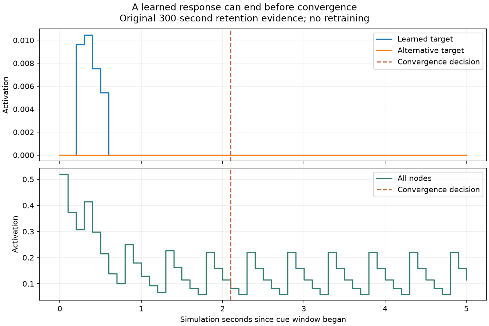

# 活动过程读出校准：把已经发生的响应读出来

2026-09-30。工程基线 `5110e10`；复用上一轮 `continuous-memory/2` 的已保存证据。本轮没有新训练或新研究实例，没有修改内核动力学、感官映射、学习及遗忘参数，也没有覆盖原报告。

[English](report.en.md) · [工具使用说明](../../../docs/zh/v2-observation-tools.md) · [原实验报告](../../explorations/2026-09-30-memory-transfer/report.zh.md) · [复现与文件摘要](README.md)

## 最重要的结果

**此前一部分“收敛时没有回答”，实际是回答发生过，但在收敛判定前已经消退。现在，通用读出工具能直接报告这段活动，不必每轮另外编写专用 Python 探针。**

重新分析记忆实验的 240 个有提示窗口：192 个训练后检验全部测到目标的过程活动，48 个未训练检验均没有；这 240 个窗口在原收敛判定时的目标激活都是零。48 个是“未训练但给了提示”的对照，不能叫成无提示对照。原实验另外保存的无提示副本及方向评分继续保留。

这次增益属于**测量能力**：模型本来已有的响应更容易被可靠地找到、比较和展示。原来的收敛时刻指标没有被峰值替换，也没有用改内核的方法制造响应。

图来自 `memory/930101/ordinary/full/wait-300/A`。目标在提示后约 0.2～0.5 秒有约 0.009～0.0104 的激活，约 0.6 秒已消退；原判定约在 2.1 秒作出。下图的持续总激活主要来自其他节点。因此，“最终有稳定背景”与“先前有短暂记忆响应”可以同时成立。

## 这次补上了哪些检测能力

- 保存整个有界观察过程，首次收敛或短暂静默不提前结束 V2 窗口。既记录原始活动，也记录相对基线的增强、减弱。
- 给出每节点的出现、峰值、消退、再次激活及累计变化。总激活没变、活动从一批节点转到另一批节点，也能测到；终态相同不再意味着过程相同。
- 节点各自峰值与某个真实时刻的整体状态分开，避免拼出一个从未同时存在过的“最强回答”。
- 可在不发刺激的情况下观察内部活动；观察标记不作为输入信封或内核刺激。没有输入边界时，不杜撰“输入期间／输入结束后”的积分。
- 比较同源副本的完整活动向量，支持屏蔽、解除屏蔽及匹配对照。时间对齐不到、原数据缺失或预算截断，明确给出条件，不补零冒充阴性结果。
- 记录哪些输入来源未触发观察窗口。没有开启观察，不能解释成没有活动。

旧活动过程 V1、旧稳态读出及其恢复路径保留。新建配置显式使用 V2，20 ms 采样；最大周期搜索范围仍是 1.2 秒（60 个样本），没有随采样加密缩短为 0.24 秒。采样节律不是内核传播节律。历史配置省略版本仍解释成 V1。

## 用已有实验校准

共重新分析 **840 个窗口**：原正式有答案检验 736 个、连接干预 96 个、加密记录的只读复演 8 个。它们来自共享父本和既有实验，不能当作 840 个独立样本，也不是新做了 840 次实验。

| 原实验分组 | 窗口数 | 过程中有目标活动 | 原收敛判定时有目标活动 |
|---|---:|---:|---:|
| 记忆 | 240 | 192 | 0 |
| 记忆连接干预 | 96 | 64 | 0 |
| 顺序 | 256 | 64 | 0 |
| 迁移 | 240 | 192 | 0 |
| 迁移加密复演 | 8 | 8 | 0 |

此表统计活动存在，不是任务正确率。顺序组的 64 个有响应窗口仍不能双向区分 AB／BA。迁移组的 192 个响应中，原报告为 48 个原方向、144 个反方向；新工具不会把反方向事后改成答对。所有窗口都有背景等原始活动，这本身也不能代表任务成功。

完整向量比较另外检查了原实验的 96 个干预副本，每个与同父本、同提示、同等待时长的正常副本比较：

| 原有操作 | 比较数 | 检出轨迹差异 | 完全相同的采样向量 |
|---|---:|---:|---:|
| 屏蔽提示传出连接 | 32 | 32 | 0 |
| 屏蔽后、推进前解除 | 32 | 0 | 1,632 |
| 屏蔽匹配的其他连接 | 32 | 0 | 1,632 |

所有这些比较都有完整时间交集，没有把缺失时刻补零。它复核了原来“该组连接确实参与唤起”的结果，也验证了提炼后的通用工具能找出已知差异、不会为未变的轨迹编造差异。

## 可复用工具的落地形式

采用 **Python 库、固定工具目录、声明式批处理，加上现有实验计划与操作目录**。没有再搭一套平行实验系统。

- 纯检测：`analyze_record`、`compare_records`，可脱离 Lab 数据库使用。
- 实验操作：`probe_copy` 从同一状态恢复副本，复用原输入帧，执行明确干预，记录原始、干预前后及最终状态哈希，并统一执行资源预算。
- 编排：`threemind-observation` 的 JSON 批处理最多 32 步，复用相同工具定义；每步完成即保存，后续失败不抹掉先前结果。
- 人与 AI：页面接入同一 API；操作目录提供 `observation.process`、`observation.compare`，供现有 CLI/MCP 调用。命令行 `--observe` 可开启无刺激观察。
- 扩展：新工具经注册、版本声明和测试加入。本期没有加入任意脚本插件加载器；环境选择、跨种子节点对应等仍由实验明确规定，避免把某轮假设写成通用答案。

## 验证、资源与局限

验证覆盖短暂弱响应、低于报告容差的原始活动、持续背景、减弱、活动转移、再次激活、相同终态的不同过程、缺失及空采样、预算截断、CLI 导出、API、版本恢复、worker 能力约束及桌面／手机界面。

对 `causal/9`、`continuous/1`、`continuous-memory/1`、`continuous-memory/2`、`lif/1` 分别验证 Python 和 Rust：开启／关闭新观察器不改变完整 Core 状态哈希；观察状态保存恢复后结果一致；旧读出的采样及结果保持一致（聊天主展示标记单独处理）。独立 Runtime 的模型互操作及命令行也经过回归。

最终运行时／命令行回归 55 项通过，桌面 1440／手机 390 像素交互验收通过，前端生产构建及代码检查通过。另完成旧读出、报告导出、配置及操作目录的受影响回归。构建仍提示既有大资源包体积，不等于本次已完成全站包体优化。迁移 054 已在本机数据库应用；应用进程没有被自动重启。

校准计算约 **10.3 秒**，全向量干预比较约 **1.7 秒**。新增两份 JSON 证据共 **4,892,025 字节，约 4.67 MiB**；没有启动新模拟。独立复核 **2,760 个来源文件哈希**，均未改变。证据路径、哈希和摘要见本目录 README 与 `summary.json`。

这是对已记录数据的测量校准，不能补回从未采样的瞬间。20 ms 采样也不是连续监测；更快的现象仍需更密采样或专门事件探针。完整过程变得可见后，记忆、迁移及顺序的任务判据仍须预先定义，不能把“有活动”自动变成“答对”。这次没有进行新一轮环境选择或意识判定实验。
